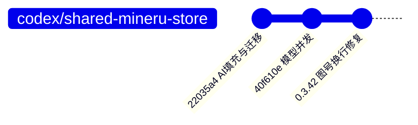
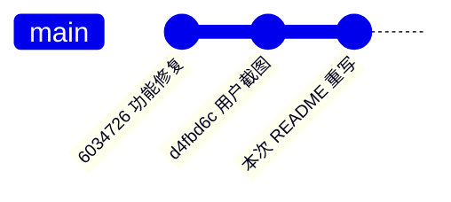

# Zotero Research Database — 当前交接与后续任务

**日期**：2026-09-07
**分支**：`feat/zotero-research-database`
**当前状态（2026-09-07 接续核对）**：P0/P1、P3/P4 的实现已完成；P2“原生工具栏按钮消失”已有修复实现但用户实际验收仍报告按钮消失，因此不能关闭；P5 已完成表格行模型的首个小步。当前单元测试为 130 项通过，隔离宿主最近一次为 16 项通过、1 项失败（横向自动滚动断言）；正式 Zotero Profile 未安装本轮 XPI，正式窗口验收待用户确认。

### P0/P1 工作区记录（2026-09-02 历史，当前状态见第七节）

下表为 P0/P1 阶段记录，不代表当前完整 Git 状态；当前已有改动仍须保留，不要回退：

| 文件                              | 状态      | 说明                                                                   |
| --------------------------------- | --------- | ---------------------------------------------------------------------- |
| `src/storage/localData.ts`        | 已修改    | P1 前置基础：快照、替换、导入前 `.bak` 备份、失败恢复                  |
| `src/ui/refreshPolicy.ts`         | 已修改    | P0：识别 Zotero `library` content type                                 |
| `src/ui/viewController.tsx`       | 已修改    | P0：保留 React root，返回文献库后原地刷新；MutationObserver 100ms 节流 |
| `test/startup.test.ts`            | 已修改    | P0 集成测试更新，断言 React root 不被替换                              |
| `test/unit/refreshPolicy.test.ts` | 已修改    | P0 刷新策略测试                                                        |
| `HANDOFF.md`                      | 新增/更新 | 本交接文档                                                             |

P1 新增文件（已实现并验证，历史记录）：

- `src/services/backup.ts`：备份服务。导出/导入 ZIP（只含 `research-data-v1.json`、`prefs.json`、`mapping.json`、`manifest.json`）、manifest 含 `formatVersion`/`addonVersion`（config.version）/`generatedAt`/`schemaVersion`/三个数据文件 SHA-256；严格 itemKey → DOI → 标题匹配，歧义不降级，目标重复报冲突；重映射覆盖 `ItemInternalState.libraryID/itemKey`、`record.libraryID/itemKey`、`figures[].parentItemKey`、`comparisons[].itemKeys`、`snapshots[].rows[].itemKey`；导入前 `replaceLocalPayload(..., { backupCurrent: true })` 自动 `.bak` 备份，写入失败回滚内存，有数据但零匹配时拒绝覆盖；`prefs.json` 不导出/不恢复 `artifactImportToken`（且导入时若 ZIP 内含该键直接拒绝）。
- `src/ui/preferencesController.ts`：`bindLocalControls()` 新增 `exportBackup()`/`importBackup()`，用窗口自带 `FilePicker`（modeSave/modeOpen，`*.zip` 过滤器），`IOUtils.write`/`IOUtils.read` 读写 ZIP，导入后刷新设置控件与字段列表。
- `addon/content/preferences.xhtml`：底部保存区上方新增"数据备份"区块和"导出备份"/"导入备份"按钮（`#zrdb-backup-export` / `#zrdb-backup-import`）。
- `test/unit/backup.test.ts`：14 个用例，覆盖 DOI/标题规范化、匹配优先级、歧义不降级、目标冲突、未匹配收集、全部重映射位置、重映射标识冲突、ZIP 往返、缺文件/多文件、checksum 篡改、manifest/schema/凭据拒绝、非 ZIP 输入、四文件契约。

验证结果（2026-09-02 全部通过）：

```text
npm run lint:check   ✔（注意：prettier --write 重排过 localData.ts 等文件的换行，语义不变，git diff 行数变大）
npm run test:unit    ✔ 115 passing（含 backup 14 例）
npx tsc --noEmit     ✔
npm run build        ✔ → .scaffold/build/zotero-research-database.xpi（2026-09-02 11:03）
```

---

## 七、2026-09-07 接续状态：P2/P3 验证与 P5 首个拆分小步

本节覆盖前文较早的测试计数和“按钮修复已完全收口”的表述；历史章节保留作为变更记录，以下以当前工作区和最近一次验证为准。

### 已完成

- P0 返回文献库刷新链路：按 Zotero `library` 标签类型识别、保留 React root 并原地刷新；已有单元和宿主回归覆盖。
- P1 数据备份/导入：四文件 ZIP 契约、manifest/checksum、严格 itemKey → DOI → 标题匹配、重映射、导入前备份和失败回滚；实现和单元测试已完成。
- P3 Linked File：根目录配置、stored → linked 迁移、SHA-256 校验、文件名清理与冲突后缀、`.zrdb-manifest.json`、断链检测、打开目录、未配置根目录时的 stored fallback；隔离 Zotero Profile 已验证挂载路径和迁移行为。
- P4 删除安全边界：仅清理插件 manifest 所有的文件和空目录，保留用户文件；删除通知注册/注销和设置页入口已实现。
- P5 首个低耦合拆分：新增 `src/ui/features/table/tableRows.ts`，将 `ResearchDatabaseApp.tsx` 内的表格扁平行模型构建抽为纯函数；新增 `test/unit/tableRows.test.ts`，覆盖未分组顺序、首次分组顺序、空值和自定义标签解析。
- 本轮代码级验证：`npm run test:unit` 为 130 passing；`npx tsc --noEmit`、新增/涉及源码的 Prettier、ESLint 和 `git diff --check` 均通过。

### 尚未完成 / 当前阻塞

- P2 不能宣称闭环：修复实现和隔离路径测试已存在，但用户实际测试仍反馈工具栏按钮消失；必须在隔离宿主继续确认真实布局、XUL `toolbarbutton`/HTML fallback 的显示条件和主题下尺寸，不能仅凭 DOM 存在判定通过。
- 隔离宿主最近一次完整运行不是全绿：16 passed、1 failed，失败为 `dragging into the right gutter starts horizontal scrolling`（自动横向滚动断言，`edgeScrollFirstFrame` 未增加）。此前一次为 15 passed、2 failed，其中集合切换失败在下一次运行通过；因此还需确认是否为表格几何初始化/拖拽竞态，不能弱化测试断言。
- `npm run lint:check` 当前仍被根目录 `HANDOFF.md` 和 `PROJECT_PROGRESS.md` 的既有 Markdown 格式告警阻断；新增源码和测试的范围检查已通过。
- 宿主问题收口后，必须重新执行 `npm run build`，再核对 `.scaffold/build/zotero-research-database.xpi` 的大小和 SHA-256；当前 XPI 不能代表本轮 P5 修改后的最终构建。
- P5 仍未完成：`TableView`/PDF/图表/Agent/导出域的后续拆分、Service 依赖注入收口、Zotero 9 类型补全和减少 `(Zotero as any)` 仍待处理。
- P6 尚未开始：`reloadRecords` 增量 diff、PDF 缩略图 LRU 上限和 `flatRows` 进一步缓存。
- 正式 Zotero 人工验收仍待用户明确确认，且不得自行安装本轮 XPI。待验收内容包括 P2 深浅主题/左右位置/来回切换、P0 返回与集合切换、P1 跨 Profile 备份导入，以及 P3/P4 根目录、迁移、主 PDF 保持 stored、断链、打开目录、回收站/永久删除和用户文件保护。

### 下一步顺序

1. 先复现并修复/确认 P2 按钮消失问题，同时调查宿主横向自动滚动失败。
2. 重新跑完整单元、类型、lint、宿主测试，随后生产构建并核对 XPI 哈希。
3. 把最终结果写回本文件和 `PROJECT_PROGRESS.md`，再继续 P5 后续拆分；P6 暂不提前开始。

不要执行 `git add`、`git commit` 或 `git push`。用户会在验收后自行决定提交。

---

## 一、P0 修复总结（已完成）

### 根因

Zotero 9 的 `tab/select` Notifier 中，文献标签的内容类型是 **`library`**，不是 `zotero-pane`（后者是 tab ID 前缀，不是类型）。之前的代码用 `selectedType === "zotero-pane"` 判断，导致从阅读器返回时 `libraryTabActive` 永远为 `false`，刷新链路被完全阻断。

### Codex 的修复方案（当前工作区）

**核心思路**：不再重建 React root，而是**保留现有 React 树，用 `scheduleSourceRefresh()` 原地刷新数据**。

| 文件                              | 改动                                                                                                                                                                                                                                                                                 |
| --------------------------------- | ------------------------------------------------------------------------------------------------------------------------------------------------------------------------------------------------------------------------------------------------------------------------------------ |
| `src/ui/refreshPolicy.ts`         | 新增 `isLibraryTabType(type)`，判断 `type === "library"`                                                                                                                                                                                                                             |
| `src/ui/viewController.tsx`       | ① 所有 `selectedType === "zotero-pane"` 改为 `isLibraryTabType()`；② 删除 `scheduleDatabaseViewReload` / `cancelDatabaseViewReload`（不再重建 root）；③ 从阅读器返回时调用 `scheduleSourceRefresh()` 而非重建；④ 保留 `debugLog` 诊断日志；⑤ ItemTree MutationObserver 加 100ms 节流 |
| `test/unit/refreshPolicy.test.ts` | 新增 `isLibraryTabType` 测试                                                                                                                                                                                                                                                         |
| `test/startup.test.ts`            | 更新集成测试：断言 React root **不被替换**（`assert.equal(controller.root, firstRoot)`），`type` 从 `zotero-pane` 改为 `library`                                                                                                                                                     |

### 关键代码变更

```typescript
// refreshPolicy.ts — 新增
export function isLibraryTabType(type: unknown): boolean {
  return type === "library";
}

// viewController.tsx — 从阅读器返回时
if (this.mode !== "default") this.scheduleSourceRefresh(); // 不再 scheduleDatabaseViewReload()

// ensureLibraryTabIsActive() — 兜底
if (!isLibraryTabType(this.win.Zotero_Tabs.selectedType)) return false;
```

### 验证状态

- [ ] 用户人工验收（安装新 XPI 后测试：双击 PDF → 切回 → 切文件夹）
- [x] `npm run lint:check`
- [x] `npm run test:unit`
- [x] `npm run build`
- [ ] 提交 git（用户确认后）

---

## 二、后续任务清单（按优先级）

### P1：备份/导出功能（已实现，待真实 Zotero 验收）

**需求**：手动导出插件数据 + 配置，方便迁移到另一台电脑。

**真实 Zotero 验收步骤**：

1. 安装 `.scaffold/build/zotero-research-database.xpi`（或 `npm start` 到隔离 Profile）。
2. 设置页 → "数据备份" → "导出备份"，选择路径保存 ZIP；解压确认只有四个文件且 manifest 含 SHA-256。
3. 把 ZIP 复制到另一台电脑（或隔离 Profile），确认文献已由 Zotero 同步（itemKey 可能变化但 DOI/标题一致）。
4. 设置页 → "导入备份"，确认状态栏报告匹配/跳过/歧义数量，且提示 `artifactImportToken` 不恢复。
5. 检查研究属性、锁定、图表记录、视图与比较快照是否迁移到新 key。

**已知限制**：

- 匹配报告只覆盖 mapping.json 中列出的条目；导入报告中的"跳过"指未匹配。
- 附件本体（PDF、MinerU Markdown 等）不走备份，由 Zotero 自身同步/迁移；备份只迁移插件数据与设置。
- 导入按 ZIP 中原样应用 `prefs.json` 里的路径类设置（如 `mineruExecutable`），换机后若路径不同需在设置页手动修正。

**实现细节（与上文契约一致，已完成）**：

**导出内容**：

- `research-data-v1.json`（研究属性、锁定、manifest、主 PDF 指定）
- 插件偏好设置快照
- `mapping.json`（每条记录附带 `itemKey + DOI + 标题`，用于换机后 key 不匹配时的映射修复）

**格式**：单个 `.zip`（用现有 `jszip` 依赖），内含版本号 + 时间戳 + SHA-256 校验。

**导入逻辑**：

- 校验 `schemaVersion`，不兼容拒绝
- 严格按 `itemKey` → DOI → 标题匹配；高优先级产生多个候选时报告歧义，不降级
- 目标条目被重复使用时报告冲突；只导入唯一匹配条目
- 覆盖 item、figure、comparison、snapshot 中的相关 key 引用
- 导入前自动备份当前数据
- 任何写入失败都要回滚研究数据
- 无有效条目匹配时不得覆盖当前数据

**位置**：设置页（`PreferencesController`）加"导出备份"和"导入备份"按钮。

#### P1 已完成的前置基础

`src/storage/localData.ts` 已提供：

- `LocalPayload`
- `parseLocalPayload(value)`
- `getLocalPayloadSnapshot()`
- `replaceLocalPayload(value, { backupCurrent: true })`
- 导入前将当前数据备份为 `research-data-v1.json.bak`
- 持久化失败时恢复内存中的旧 payload

这些改动已通过 lint、单元测试、类型检查和构建；后续完整复验结果见第七节。

#### P1 ZIP 契约

ZIP 必须包含且只包含以下四个文件：

```text
research-data-v1.json
prefs.json
mapping.json
manifest.json
```

`manifest.json` 至少包含 `formatVersion`、插件版本 `config.version`、`generatedAt`、`schemaVersion`，以及 `research-data-v1.json`、`prefs.json`、`mapping.json` 三个文件的 SHA-256。导入时必须拒绝缺文件、多余文件、schema 不兼容、manifest 无效或 checksum 不匹配的 ZIP。

`prefs.json` 只导出用户可见的插件设置，不得导出敏感凭据 `artifactImportToken`。导入报告要明确说明该凭据不会恢复，并保留当前机器的值。

#### P1 匹配和重映射细则

当前条目枚举使用 `Zotero.Items.getAll(Zotero.Libraries.userLibraryID, true, false)`，只保留 `isRegularItem()`，排除工作区系统条目。

- DOI 规范化：去除 `https://doi.org/`、`http://doi.org/`、`doi:` 前缀，去除首尾空白，统一大小写。
- 标题规范化：去除首尾空白，折叠连续空白，统一大小写。
- 每条备份记录按 `itemKey`、DOI、标题依次匹配。
- 某一级出现多个候选时报告歧义，不能降级到下一级。
- 一个当前目标条目不能被多个备份条目重复使用。

旧 key 到新 key 的重映射必须覆盖：

- `ItemInternalState.libraryID/itemKey`
- `record.libraryID/itemKey`
- `figures[].parentItemKey`
- 工作区 comparisons 的 `itemKeys`
- snapshots 的 `rows[].itemKey`

具体字段和嵌套结构以现有类型、codec 和 repository 实现为准。

#### P1 导入事务

导入顺序固定为：完整读取并校验 ZIP → 枚举当前条目并生成匹配报告 → 导入前备份当前研究数据 → 应用重映射后的 payload。任一步写入失败都必须回滚，且没有有效匹配时绝不能覆盖当前数据。

已新增 `test/unit/backup.test.ts`，覆盖规范化、匹配优先级、歧义、重复目标冲突、所有重映射位置、ZIP 往返、manifest/checksum、非法 ZIP/schema 和无匹配不覆盖。

---

### P2：切换按钮嵌入工具栏（隔离宿主验证通过，待正式窗口验收）

**需求**：把悬浮的 HTML button 改成真正的 XUL `toolbarbutton`，嵌入 `#zotero-items-toolbar`，并允许用户放在最左或最右。

**已实现（2026 年 9 月 3 日）**：

- Zotero 9 使用 `doc.createXULElement("toolbarbutton")`，不再使用会生成 DOM 节点但可能不创建 XUL 渲染框的 `createElementNS()`。
- 原生按钮采用 Zotero 的 `zotero-tb-button` 样式，并通过 `image` 属性加载本地 `view-table.svg` / `view-list.svg`；不再向 XUL 按钮插入内联 SVG 子节点。
- 原生 XUL 和 HTML 备用按钮的 CSS 已分离：前者保留 Zotero 的原生工具栏布局，后者只在原生控件宽或高为零时启用，使用绝对定位并预留工具栏边缘空间。
- `viewTogglePosition` 已接入设置页、偏好注册和运行时 observer，支持在工具栏最左/最右切换。
- 原生 XUL 与 HTML fallback 采用互斥事件监听，避免 `click` 与 `command` 令同一次操作切换两次。
- 集成测试覆盖原生与 HTML fallback 两条渲染路径、图标状态、可见尺寸和左右位置偏好。

**已知根因**：早期改动把 XUL `toolbarbutton` 当成 HTML `button` 处理，既使用了错误的 XUL 创建 API，又以 `display: grid` 和内联 SVG 覆盖原生控件的渲染路径，因此真实 Zotero 9 中可能出现“DOM 存在但按钮不显示”。

**后续验收**：在真实 Zotero 9 中重启插件后，分别验证深浅主题、工具栏左右位置和两种视图间来回切换；若宿主或主题令原生控件无布局，应自动显示 HTML fallback。

---

### P3：Linked File 存储迁移（已实现，待正式窗口验收）

**需求**：把 MinerU Markdown、图表、快照附件从 stored file（`storage/<key>/`）改为 linked file（用户指定根目录下的 `<itemKey>/` 目录）。

**用户决策**（已确认）：

- 使用 Zotero 云同步，但不在乎附件是否同步
- 目录按稳定 `itemKey` 命名
- 条目从回收站彻底删除时，自动删除对应产物目录（不提示）
- 已有附件全部迁移（B 方案）
- 主 PDF 不动，保持 stored file
- 根目录用户可指定
- 文件名冲突自动加后缀（`fig-xxx-2.png`）

**技术要点**：

1. 设置页加"研究产物根目录"路径选择
2. 新附件：写入 `<根目录>/<itemKey>/` → 使用 `Zotero.Attachments.linkFromFile({ file: absoluteTargetPath, parentItemID, title })` 挂载；不使用 `linkFromFileWithRelativePath()`，避免依赖 Zotero 全局 `baseAttachmentPath`
3. 已有附件迁移：复制文件 → 建 linked file → 校验 SHA-256 → 删旧 stored 附件 → 更新 manifest
4. 去重逻辑改为"目标路径 + SHA-256"判重
5. 条目删除监听：Notifier `item` 的 `delete` 事件，删 `<根目录>/<itemKey>/` 目录（保留非插件文件）
6. 提供"断链检测"和"打开产物目录"按钮

**实现状态**：已完成 stored → linked 迁移、SHA-256 校验、Windows 文件名清理、冲突后缀、`.zrdb-manifest.json` sidecar、断链检测、打开目录入口，以及未配置根目录时的 stored attachment fallback；实际挂载已在隔离 Zotero Profile 中验证。

---

### P4：条目删除联动删目录（核心删除联动已随 P3 实现）

- 启动时注册 artifact deletion notifier，关闭时注销；只响应条目彻底删除。
- 按 manifest 只清理插件拥有的文件和空目录；目录内非插件用户文件保留，不提示。
- 设置页提供“打开产物目录”和“断链检测”。

---

### P5：代码结构优化（中优先级）

- **拆分巨型组件**：`ResearchDatabaseApp.tsx`（5614 行）按域拆分为 `features/table/`、`features/figures/`、`features/agent/`、`features/export/`
- **Service 层依赖注入**：禁止模块级 `new ResearchRepository()`（如 `primaryPdf.ts:3`）
- **类型安全**：补全 `typings/global.d.ts` 中 Zotero 9 新 API 类型，减少 `(Zotero as any)`

---

### P6：性能优化（低优先级）

- `reloadRecords` 增量 diff：只更新变更的 `itemKey`，不全量重建 Map
- PDF 缩略图 LRU 上限 50 张
- `flatRows` 缓存优化

---

## 三、历史 P1 续跑提示词（已执行，仅留档）

以下为已执行的 P1 历史提示，不是当前任务或模型路由要求；当前阶段与下一步以第七节为准：

```text
继续处理当前工作区的 Zotero Research Database 项目。先阅读仓库根目录 HANDOFF.md，再检查 git status 和现有 diff。当前目标只做 P1“数据备份/导出与换机导入”，不要开始 P2。

当前工作区已有未提交改动，必须保留并基于其继续：
- src/storage/localData.ts：已增加 LocalPayload、parseLocalPayload、getLocalPayloadSnapshot、replaceLocalPayload，以及导入前 research-data-v1.json.bak 备份和持久化失败恢复。
- src/ui/refreshPolicy.ts、src/ui/viewController.tsx、test/startup.test.ts、test/unit/refreshPolicy.test.ts：P0 修复，禁止回退。

实施要求：
1. 新增 src/services/backup.ts，复用现有 jszip。ZIP 必须且只能包含 research-data-v1.json、prefs.json、mapping.json、manifest.json。
2. manifest 至少包含 formatVersion、config.version、generatedAt、schemaVersion，以及三个数据文件的 SHA-256。导入严格校验 ZIP、固定文件名、manifest、schema 和 checksum；失败不得部分导入。
3. prefs.json 只导出用户可见插件设置，绝不导出 artifactImportToken。导入报告必须说明凭据不会恢复并保留当前值。
4. mapping.json 为每个可迁移条目保存 itemKey、DOI、标题。当前条目从 Zotero.Items.getAll(Zotero.Libraries.userLibraryID, true, false) 枚举，只保留 isRegularItem()，排除工作区系统条目。
5. 匹配优先级必须严格是 itemKey -> DOI -> 标题。DOI 去除 doi.org/http 前缀和 doi: 前缀后统一大小写；标题折叠连续空白并统一大小写。某一级出现多个候选时报告歧义，不能降级；目标条目被重复使用时报告冲突；只导入唯一匹配条目。
6. 重映射必须覆盖 ItemInternalState.libraryID/itemKey、record.libraryID/itemKey、figures[].parentItemKey、工作区 comparisons.itemKeys、snapshots.rows[].itemKey。先阅读现有类型和 codec/repository 结构，不能凭空重建 payload。
7. 导入顺序必须是：完整读取和校验 ZIP -> 枚举和匹配 -> 导入前备份当前研究数据 -> 原子应用重映射后的 payload。写入任一步失败要回滚，且无有效匹配时绝不能覆盖当前数据。
8. 在 src/ui/preferencesController.ts 的 bindLocalControls() 接入导出/导入按钮，使用现有 addon.data.ztoolkit.FilePicker 约定；在 addon/content/preferences.xhtml 保存区域附近增加“数据备份”区块和两个按钮，沿用当前 UI 风格。
9. 新增 test/unit/backup.test.ts，覆盖 DOI/标题规范化、匹配优先级、歧义、重复目标冲突、所有重映射位置、ZIP 往返、manifest/checksum、非法 ZIP/schema、无匹配不覆盖。
10. 不要调用 azf-auto-dev-loop。手动编辑使用 apply_patch。不要执行 git add、git commit、git push，也不要回退用户已有改动。

完成后依次运行并修复问题：
npm run lint:check
npm run test:unit
npx tsc --noEmit
npm run build

确认 .scaffold/build/zotero-research-database.xpi 存在。最后更新 HANDOFF.md，写明实际改动文件、测试结果、已知限制、真实 Zotero 验收步骤和下一步建议；不要只给方案，必须完成实现和验证。如果某条命令失败，保留失败输出和根因，不要宣称完成。
```

---

## 四、开发环境

```powershell
# 安装依赖
npm install

# 检查
npm run lint:check
npm run test:unit
npx tsc --noEmit

# 构建
npm run build

# 隔离测试（不污染正式库）
$env:ZOTERO_PLUGIN_ZOTERO_BIN_PATH='E:\software\Zotero\Zotero\zotero.exe'
npm test -- --no-watch --abort-on-fail --exit-on-finish
```

**隔离 Profile**：`.scaffold/test`（独立数据目录，用于验证高风险改动）

---

## 五、关键文件索引

| 文件                                       | 职责                                                         |
| ------------------------------------------ | ------------------------------------------------------------ |
| `src/ui/viewController.tsx`                | 主控制器：视图切换、刷新调度、React root 生命周期            |
| `src/ui/ResearchDatabaseApp.tsx`           | 表格组件（5614 行，待拆分）                                  |
| `src/ui/refreshPolicy.ts`                  | 刷新策略纯函数                                               |
| `src/storage/repository.ts`                | 数据仓库：研究属性、manifest、主 PDF 指定                    |
| `src/storage/localData.ts`                 | 本机 JSON 存储（Profile 目录）                               |
| `src/services/artifactEndpoint.ts`         | 产物导入与去重；使用共享存储服务                             |
| `src/services/artifactStorage.ts`          | P3 linked file 写入、迁移、sidecar、断链检测与删除清理       |
| `src/services/snapshotExport.ts`           | 快照导出使用共享产物存储服务                                 |
| `src/services/mineru.ts`                   | MinerU 转换服务                                              |
| `src/services/primaryPdf.ts`               | 主 PDF 解析                                                  |
| `addon/content/zoteroPane.css`             | P2 原生工具栏、fallback 和 overlay 边界样式                  |
| `test/integration/startup.test.ts`         | 原宿主集成测试；已从 `test/startup.test.ts` 迁入隔离测试目录 |
| `test/integration/00-viewToggle.test.ts`   | P2 真实 Gecko 命中与布局回归                                 |
| `test/integration/artifactStorage.test.ts` | P3 linked 导入、迁移、主 PDF 保留与删除清理回归              |
| `test/unit/artifactStorage.test.ts`        | P3 文件名、冲突、路径与 manifest 纯逻辑回归                  |
| `test/unit/refreshPolicy.test.ts`          | 单元测试                                                     |

---

## 六、联系与确认

**用户**：An Zhaofeng
**确认方式**：本轮用户已要求 P2 验证修复后继续 P3，故已完成 P3 源码与隔离验证；正式窗口验收仍由用户确认，未自动安装。P5 已开始，P6 尚未开始。

**当前待确认**：正式 Zotero 窗口验收 P2 原生按钮可见性与左右位置、默认列表 ↔ 数据库表格切换，以及 P3 根目录选择、stored → linked 迁移、主 PDF 不迁移、断链检测和删除清理。

---

## 七、2026-09-07 P2 验收与 P3 完成状态

### P2：按钮消失修复已验证

- 用户附件图片仅作为“按钮消失”现象参考，不作为额外开发指令。
- 根因是 `.zrdb-custom-pane` 的 `inset: 0` 覆盖了含原生 toolbar 的整个容器；修复后 overlay 仅覆盖 `#zotero-items-pane`，用 `ResizeObserver` 同步边界。真实 Gecko pointer event 回归确认原生 toolbar 不再被遮挡，toggle 与 `#zotero-tb-add` 均可被 `elementFromPoint()` 命中。
- toggle 在工具栏左右两侧的位置偏好均正常；默认列表 ↔ 数据库表格切换正常；视图切换后原生按钮仍可见。
- 隔离 Zotero 宿主最终结果：`15 passed, 0 failed, 3 pending`。两个早期失败项（figure child attachment 去重、reader pause 测试）本次均通过。测试没有修改正式 Zotero Profile、正式 `zotero.sqlite`、正式论文或附件。

### P3：Linked File 存储迁移已实现

- 新增 `artifactStorageRoot` 与 `artifactStorageMigrationVersion` 偏好；产物目录固定为 `<artifactStorageRoot>/<itemKey>/`。
- MinerU Markdown、图表、表格和快照支持 linked file；文件名经过 Windows 安全清理，冲突时使用 `-2`、`-3` 等确定性后缀，并写入 `.zrdb-manifest.json` sidecar。
- 迁移和写入均校验 SHA-256；已存在的 stored artifact 可迁移为 linked file，主 PDF 明确不参与迁移。
- 实际挂载使用 `Zotero.Attachments.linkFromFile({ file, parentItemID, title })`，避免 `baseAttachmentPath` 对全局相对路径设置的影响；未设置根目录时保留 stored attachment fallback。
- 条目彻底删除时，notifier 只清理插件 manifest 所拥有的文件和空目录，目录中的非插件用户文件保留；已提供打开产物目录和断链检测。
- 设置页已加入根目录选择、打开目录、迁移和断链检测入口；启动注册 artifact deletion notifier，关闭时注销。

### 最终验证

- 2026-09-07 再次执行 `npm test -- --no-watch --exit-on-finish`，使用 `E:\software\Zotero\Zotero\zotero.exe` 与隔离 `.scaffold/test`。
- 3 项 pending 为 Translate for Zotero 标题往返、HanaAgent 健康检查、HanaAgent WebSocket round-trip；对应外部插件/服务环境未具备，不能视为通过。
- P2/P3 用例均通过；根目录选择对话框、系统打开目录以及正式 Profile 深浅主题等仍需人工窗口验收。
- 本轮主要变更：`src/services/artifactStorage.ts`、`artifactEndpoint.ts`、`snapshotExport.ts`；`src/domain/types.ts`、`src/core/extraProperties.ts`、`src/storage/repository.ts`、`syncedData.ts`；`src/hooks.ts`、`src/ui/preferencesController.ts`、`nativeArtifactVisibility.ts`、`viewController.tsx`；偏好、设置页、样式与类型声明；`test/integration/`、`test/uiHelpers.ts`、`test/unit/artifactStorage.test.ts`。
- 宿主测试会重建 test-mode bundle，因此已在测试结束后重新运行生产构建，交付的是 production XPI。

```text
npm run test:unit    ✔ 122 passing
Zotero 9.0.6         ✔ 15 passed, 0 failed；3 pending（外部环境）
npm run lint:check   ✔
npx tsc --noEmit     ✔
git diff --check     ✔
npm run build        ✔ production
```

- 最终生产 XPI：`D:\Postgraduate_JilinUniversity\03_Sundries\02_DevLab\20260815-zotero-research-database\.scaffold\build\zotero-research-database.xpi`
- 版本：`0.3.32`
- 大小：`435046` 字节
- SHA-256：`F8EDB577F55767F5A8DD3D3A728622A817EA1782F49220DA8BFC5B0D93920739`
- 本轮未执行 `git add`、`git commit`、`git push`；工作区现有未提交改动均保留。

### 下一步

1. 不要把本轮 XPI 自动安装到正式 Zotero；如需正式窗口验收，由用户先确认并正常关闭/备份正式 Profile。
2. 正式环境验收重点：P2 原生按钮在浅色/深色主题与左右位置、P3 根目录选择、stored → linked 迁移、主 PDF 不迁移、断链检测及删除清理。
3. 用户确认后再考虑提交或推送；当前交接不执行任何 Git 写入操作。P5 已完成首个小步，P6 尚未启动；P4 核心删除联动已随 P3 实现，正式环境安全性仍须按上述边界验收。

---

## 八、2026-09-07 P4 安全边界补强与 P5 首个小步（最新）

本节为当前最新交接状态，覆盖前文“P5/P6 尚未开始”的旧记录；不改变既有未提交改动，也不替代用户对正式 Zotero 窗口的人工验收。

### P4：删除联动安全边界

- `src/services/artifactStorage.ts` 现在要求 manifest 的 `relativePath` 必须属于当前 `itemKey`，并拒绝 manifest 自身、Windows 保留文件名（`CON`、`PRN`、`AUX`、`NUL`、`COM1`、`LPT1` 等）作为产物记录。
- 删除插件拥有的文件前重新计算 SHA-256；哈希一致才删除，用户修改过的文件、不可读文件、异常路径和非普通可读路径均保留。item 目录、manifest、产物文件若为符号链接时清理默认跳过，按 fail-closed 处理。
- notifier 只响应个人库的永久 `delete` 事件；`trash` 不触发清理，其他库中相同 item key 不会清理个人库目录。现有用户文件不会因删除 Zotero 条目而被误删。
- `test/unit/artifactStorage.test.ts` 已覆盖跨条目路径、sidecar、Windows 保留名、哈希未变化/已修改文件、同 key 不同库等安全边界；现有 Zotero 隔离宿主回归继续覆盖实际迁移后的永久删除清理。

### P5：Service 依赖注入首步

- `src/services/primaryPdf.ts` 移除模块级 `new ResearchRepository()`，新增窄类型 `PrimaryPdfRepository`，`resolvePrimaryPdf()` 与 `setPrimaryPdf()` 支持可选 repository 注入；不传入时仍在调用时创建默认 repository，保持既有调用点兼容。
- `test/unit/primaryPdf.test.ts` 新增注入 repository、保存/清除主 PDF、非法附件 key、best attachment 与 first PDF 回退测试。
- P5 剩余计划仍是拆分 `ResearchDatabaseApp.tsx`、补全 Zotero 9 API 类型并继续消除不必要的 `any`；P6 尚未开始。

### 本轮验证

```text
npm run test:unit                       ✔ 127 passing
npm test -- --no-watch --exit-on-finish ✔ 17 passed, 0 failed；3 pending（外部环境）
npm run lint:check                      ✔
npx tsc --noEmit                        ✔
git diff --check                        ✔
npm run build                           ✔ production
```

- 宿主测试使用 `E:\software\Zotero\Zotero\zotero.exe` 和隔离 `.scaffold/test`；测试结束后已重新运行生产构建，避免把 test-mode bundle 当成交付包。
- 3 项 pending 是 Translate for Zotero 标题往返、HanaAgent 健康检查和 HanaAgent WebSocket round-trip，属于当前外部插件/服务环境未具备的条件，不能视为通过。
- P2“按钮消失”回归仍已通过：真实 Gecko `elementFromPoint()` 命中 toggle 与新增条目按钮，toolbar 未被 overlay 覆盖，左右位置和列表/数据库表格切换正常。
- 生产 XPI：`D:\Postgraduate_JilinUniversity\03_Sundries\02_DevLab\20260815-zotero-research-database\.scaffold\build\zotero-research-database.xpi`；版本 `0.3.32`；大小 `435320` 字节；SHA-256 `05149E68D345291E7E18AA44BA8E12A5D10A6659E47C40414F19C954EF3C68C9`。
- 正式 Zotero Profile、正式 `zotero.sqlite`、正式论文与附件均未修改；没有自动安装 XPI；没有执行 `git add`、`git commit`、`git push` 或打标签。

### 下一步

1. 继续 P5 时优先从 `ResearchDatabaseApp.tsx` 中抽取边界清晰、低耦合的表格/主 PDF域逻辑，每一步都保持隔离单测和宿主回归通过。
2. 在用户明确允许前，不安装到正式 Zotero；正式验收仍需用户在备份并关闭正式 Profile 后手动进行，特别是深浅主题、按钮左右位置、P3 目录/迁移/断链/删除行为。

---

## 九、2026-09-07 P5 表格列模型拆分与最新验证

### P5：表格列模型低耦合拆分

- 新增 `src/ui/features/table/tableColumns.ts`，抽出 `ColumnDefinition`、内置列定义、动态研究字段列构建、归档字段与内置 `translated-title` 过滤、列顺序/别名、基础信息列折叠以及固定列排序逻辑。
- `src/ui/ResearchDatabaseApp.tsx` 的 `useColumns()` 和 `ColumnManager` 已改为复用共享列模型，移除了组件文件中的重复定义；未主动改变表格交互行为。
- 新增 `test/unit/tableColumns.test.ts`，覆盖归档过滤、列顺序、列别名、基础信息列折叠和固定列排序。
- P5 仍未完成：后续还需要继续拆分 PDF、图表、Agent、导出域，继续推进 Service 依赖注入、补全 Zotero 9 API 类型并减少不必要的 `any`。

### 最新验证结果

```text
npm run test:unit                       ✔ 133 passing
npx prettier --check <P5 files>         ✔
npx eslint <P5 files>                   ✔
npm run lint:check                      ✔
npx tsc --noEmit                        ✔
git diff --check                        ✔
npm test -- --no-watch --exit-on-finish ✔ 17 passed, 0 failed；1 pending
npm run build                           ✔ production
```

- 隔离宿主使用 `E:\software\Zotero\Zotero\zotero.exe` 与 `.scaffold/test`；本轮 P5 拆分后，P2 toolbar/toggle 命中、列表/数据库表格切换、P3 linked 迁移/主 PDF 保留/断链相关回归仍通过。唯一 pending 为 Translate for Zotero 标题往返，受外部插件环境影响，不能视为通过。
- 最新生产 XPI：`D:\Postgraduate_JilinUniversity\03_Sundries\02_DevLab\20260815-zotero-research-database\.scaffold\build\zotero-research-database.xpi`；版本 `0.3.32`；大小 `435402` 字节；SHA-256 `D7DE9ADE4D3661505803F5BA358593179246C4DED73201ADD7EE4FB9C19438B5`。
- 正式 Zotero Profile、正式 `zotero.sqlite`、正式论文和附件未修改；未自动安装 XPI；未执行 `git add`、`git commit`、`git push` 或打标签。

### 当前未完成

1. P5 后续低耦合拆分尚未完成，P6（增量 diff、缩略图 LRU、`flatRows` 缓存与渲染优化）尚未开始。
2. 用户报告的“正式窗口按钮消失”仍需在正式窗口中按备份、关闭 Profile、手动安装新 XPI 后验收；隔离宿主通过不能替代正式窗口人工验收。
3. P1 跨 Profile 迁移、P3 根目录选择/对话框、P3 stored → linked、主 PDF 保持 stored、断链检测、P4 回收站/永久删除边界及用户文件保护仍需正式窗口人工闭环。

---

## 十、2026-09-07 当前完成/未完成清单（P6 已部分完成，隔离宿主回归已稳定）

本节覆盖前文“P5 尚未完成、P6 尚未开始”的旧结论。两张附件只记录用户反馈的“按钮消失”现象，不是操作指令。

### 已完成

- P0：返回文献库刷新、library 标签识别、React root 保留及集合/标签/保存搜索/ItemTree 刷新链路。
- P1：ZIP 备份/导入、manifest/SHA-256、严格匹配与 key 重映射、导入前备份和失败回滚；设置页入口已实现。
- P2 核心修复：overlay 不再覆盖原生 toolbar，隔离 Gecko 已验证 toggle、新增条目按钮、左右位置和列表/数据库表格切换。
- P3 核心实现：产物 stored → linked、根目录、哈希、文件名冲突后缀、sidecar manifest、断链检测、打开目录和未配置根目录 fallback；主 PDF 排除迁移。
- P4 核心安全边界：只删除 manifest 所有且哈希未变化的插件文件，异常路径/符号链接/用户修改/非永久删除事件等默认保留或跳过。
- P5 当前小步：`tableRows.ts`、`tableColumns.ts` 与 `primaryPdf` 依赖注入首步。
- P6 当前小步：`reloadCache.ts` 已接入 `ResearchDatabaseApp.tsx`；`lruCache.ts` 已接入 `pdfThumbnail.ts`；新增 `TableFlatRowsCache`，页数/缩略图缓存上限为 256/128，分组结构缓存默认上限为 12。
- 最新单元测试实测：`npm run test:unit` 为 **141 passing**。
- 最新隔离宿主实测：**17 passed, 0 failed, 1 pending**；唯一 pending 为 Translate for Zotero 标题往返，HanaAgent 健康检查和 WebSocket round-trip 本轮均通过。
- 最新生产构建已完成：版本 `0.3.32`，XPI 大小 `436247` 字节，SHA-256 `5264A0358295DDB0E36D91EEB488729A0A2FBD13ACBBC820049900EF57ED17F5`。

### 未完成

1. 正式 Zotero 窗口人工验收仍未完成，尤其是用户报告的按钮消失；在用户确认备份并关闭正式 Profile 前不安装 XPI。
2. P1 跨 Profile 迁移仍待正式窗口验收。
3. P3/P4 正式窗口边界验收尚未闭环：根目录选择/对话框、迁移、主 PDF、冲突/断链、打开目录、永久删除/回收站及用户文件/普通附件保护。
4. P5 后续拆分、Service 依赖注入收口、Zotero 9 类型补全与不必要 `any` 清理仍待继续。
5. P6 仅部分完成：`reloadRecords` 增量 diff、重复渲染优化、其余增量刷新策略和性能回归仍待继续；`flatRows` 缓存已实现但还需要宿主性能回归。
6. 未执行 `git add`、`git commit`、`git push` 或打标签；正式 XPI 未自动安装。

### 当前验证基线

```text
npm run test:unit    ✔ 141 passing
代码范围检查        ✔ Prettier / ESLint / TypeScript / git diff --check
隔离 Zotero 宿主     ✔ 17 passed, 0 failed, 1 pending
生产构建             ✔ XPI 436247 bytes / SHA-256 5264A0358295DDB0E36D91EEB488729A0A2FBD13ACBBC820049900EF57ED17F5
正式 Zotero 窗口     ⏳ 尚未人工验收，正式 Profile 未修改
```

### 下一步

1. 继续 P5/P6 剩余拆分、增量刷新和性能回归，保持当前隔离宿主 17/0/1 基线。
2. 每个小步完成后重新跑单元测试、隔离宿主测试、代码检查和生产构建，并同步根目录 `PROJECT_PROGRESS.md` 与 `HANDOFF.md`。
3. 最后由用户确认正式 Profile 已备份并关闭后，再安装 XPI 并进行正式窗口人工闭环。

## 十一、2026-09-08 P5/P6 收尾与隔离宿主闭环

本节覆盖本轮接续后的最新状态，旧章节中的“P6 尚未开始”“TypeScript 未通过”以及旧 XPI 哈希均已被当前证据 supersede。

### 已完成

- P5 UI 拆分完成：`ResearchDatabaseApp.tsx` 从 5632 行降至约 1100 行，拆出 `features/table`、`features/pdf`、`features/figures`、`features/agent`、`features/export` 和 `features/shared`；主入口保留工作区、筛选排序、跨域编排。
- P5 服务收口完成：新增插件范围共享 `getResearchRepository()`、`createResearchServices()`；主 PDF、内容源、产物导入/存储、快照导出和标签迁移均支持同一仓库注入；补充 Zotero 9 SyncedSettings 类型并减少不必要的 `any`。
- P6 增量刷新完成：可见范围缓存、`ReloadQueue` 请求合并、按条目 key 精确本地数据变更通知、Map 行引用复用和切换期间旧范围结果丢弃。
- P6 PDF 缓存完成：缩略图 LRU 上限 50，页数缓存上限 256；缓存 key 含库、附件、文件修改时间和大小；插件关闭时清理缓存；PDF.js 文档统一释放。
- P2 reader 守卫修复：每次从 Zotero 权威 `selectedType` 判断，reader 中不会触发数据库 render；返回 library 后继续自愈刷新。

### 当前验证证据（2026-09-08）

- `npm run test:unit`：146 passing。
- `npx tsc --noEmit`：通过。
- `npm run lint:check`、`npx eslint .`、`git diff --check`：通过。
- 隔离 Zotero：`npm test -- --no-watch --exit-on-finish` → 18 passed、0 failed、0 pending；Translate for Zotero 2.4.7 和 HanaAgent 健康检查/WebSocket 结构化往返均已真实验证。
- 生产构建：`.scaffold/build/zotero-research-database.xpi`，441072 bytes，SHA-256 `2A785F676E762C1DC592CFE27C53C3F27D3F146C5F67BF626411A435A0B063FA`。
- 本轮未安装 XPI 到正式 Profile，未修改正式 `zotero.sqlite`、论文或附件。

### 仍需用户完成的正式窗口闭环

在用户确认正式 Profile 已备份并完全关闭后，使用附加组件管理器安装上面这个 XPI，并人工验收 P1/P2/P3/P4：按钮深浅主题与左右位置、跨 Profile 导入、根目录选择与 stored→linked、主 PDF 保持 stored、断链/打开目录、回收站与永久删除、用户文件和普通附件保护。当前不能把隔离宿主结果替代正式窗口验收，也不能把 3 个外部依赖 pending 当作通过。

### Git 状态

当前仍保留未提交修改；本轮未执行 `git add`、`git commit`、`git push`、`git reset` 或 `git clean`。修改前备份：`E:\software\AI改前备份\20260908_181242_Zotero数据库P5P6续跑_修改前备份_codex`。

## 十二、2026-09-08 性能回归、图表刷新修复与生产构建（最新）

### 本轮新增修复

- `test/integration/performance.test.ts` 已移除显式 Mocha 导入，避免 Zotero 宿主构建误解析 `node:path`、`node:events`、`stream` 和 `util`。
- PDF 性能回归按导入附件的实际存储路径统计 `IOUtils.read()`，不再把导入前临时路径误当作 Zotero 附件路径；临时 PDF、附件和父条目均在 `finally` 中清理。
- `figureRecords.ts` 新增完整 `figureDataSignature()`；`useResearchData.ts` 的行协调现在比较图表的图注、类型、页码、区域、来源 PDF、哈希以及 Zotero Figure 的 entry、图像引用和 cache revision，刷新后不会复用过期图表对象。
- 新增 `test/unit/figureRecords.test.ts`，覆盖 MinerU 图表显示字段和 Zotero Figure 图像版本变化。

### 最终验证证据

```text
npm run test:unit                                      ✔ 148 passing
npx tsc --noEmit -p test/tsconfig.json                 ✔
npm run lint:check                                    ✔
npx eslint .                                           ✔
git diff --check                                      ✔
npm test -- --no-watch --exit-on-finish               ✔ 21 passed, 0 failed, 0 pending
```

新增宿主性能用例实际执行并通过：

- 10,000 条 synthetic records：`39084ms`，并发上限 8，覆盖缓存复用、dirty key 和集合切换旧结果丢弃。
- 10,000 行 `TableFlatRowsCache`：`180ms`，覆盖同组/多组冷热路径、新 item 引用和 12 条结构缓存上限。
- 51 个 PDF 宽度：`5279ms`，测试断言 51 次源读取、重复宽度命中不再读取，缩略图缓存不超过 50 条。
- 同一宿主回归还通过 Translate for Zotero 2.4.7 标题往返、HanaAgent 健康检查/WebSocket 结构化往返、P2/P3/P4 现有用例。

生产构建已在上述修改后重新执行：

- 路径：`D:\Postgraduate_JilinUniversity\03_Sundries\02_DevLab\20260815-zotero-research-database\.scaffold\build\zotero-research-database.xpi`
- 版本：`0.3.32`
- 大小：`441471` 字节
- SHA-256：`4F2B904B2A26934C8935AD058D72DAC1056A280D95DE643370F4D55AEDC3958B`

本轮没有新启动 HanaAgent；宿主测试使用现有本机服务完成探测。正式 Zotero Profile、`zotero.sqlite`、论文和附件未修改，也没有自动安装 XPI。正式 Profile 仍须用户先确认已备份并完全关闭，再由附加组件管理器安装本 XPI，人工验收 P1/P2/P3/P4；本轮未执行任何 Git 写入操作。

### 正式安装前状态

- 2026-09-08 已确认正式 `zotero.exe` 未运行。
- 已创建正式 Profile 只读备份：`E:\software\AI改前备份\20260908_正式ZoteroProfile安装前备份_codex`；Profile 备份 `228503752` 字节，数据目录备份 `4912` 字节。
- 当前仍未安装 XPI；下一步只需用户明确授权正式安装，然后通过 Zotero 附加组件管理器安装并完成窗口人工验收。

### 正式安装结果（2026-09-08）

- 用户已确认安装并通过 Zotero 附加组件管理器完成安装；`extensions.json` 显示版本 `0.3.32`、`active=true`、`visible=true`、`userDisabled=false`、`appDisabled=false`，安装来源为 `about:addons`。
- 正式 Profile 中的 XPI 与生产构建逐字节一致：441471 字节，SHA-256 `4F2B904B2A26934C8935AD058D72DAC1056A280D95DE643370F4D55AEDC3958B`。
- 正式 Zotero 9.0.6 已运行，插件本地端口 `23119` 正常监听；使用错误令牌 POST 到 `/zotero-research-db/v1/artifacts/import` 返回 `401`，证明端点已注册且认证守卫生效。
- 由于当前 Windows 原生窗口控制服务未配置，按钮可见性、深浅主题、左右位置和跨 Profile/P3/P4 对话框仍需用户在正式窗口手动确认；隔离宿主回归不能替代这些视觉和交互检查。

## 2026-09-08 handoff

The 0.3.33 artifact implemented formula rendering and settings/menu consolidation. Its preference-window regression was not completed; the earlier attribution to an unavailable scaffold pane was not verified. The 2026-09-09 investigation below supersedes that explanation.

## 2026-09-09 设置保存修复（0.3.34）

- 根因：设置页实际使用 `<html:input>`；旧代码比较 `tagName === "input"`，加载时未恢复 `checked`，保存时读取了 `value`。真实宿主复现为取消“显示图”后仍保存 `true`，偏好类型仍为 boolean。
- 修复：`PreferencesController` 统一使用 `localName` 和 `type` 识别复选框，只读取和恢复 `checked`，不重置其它偏好或数据。
- 已恢复真实设置窗口回归：检查保存值与原生类型、关闭重开、字段页重复打开。测试错误显式序列化 message/stack；之前 CLI 的 `undefined` 来自普通 Error 被 JSON 序列化为空对象，不能据此判定设置页不可测。
- 新测试已先复现旧版失败，再通过修复版。关闭窗口时等待窗口管理器完成移除，避免测试立刻重开误取旧窗口。
- 原版本错误保存的布尔值无法推断用户实际意图；安装修复版后按需要重新勾选并保存一次。
- 验证：164 项单元测试、代码类型检查通过；保存/关闭/重开和字段重复初始化在真实隔离设置窗口通过。公式复制测试等待初始化 effect、异步复制完成后再检查提示，公式与设置 4 项联合宿主回归通过（修复前的全量宿主为 21 通过、1 项公式测试时序失败）。
- 最终生产包：`.scaffold/build/zotero-research-database.xpi`，版本 `0.3.34`，`813495` 字节，SHA-256 `8A09631341CDBB0F53AE330AAAC307673E796D2F55FE040811A2DD5F40DBEEF9`。插件 ID 保持不变；生产构建、Prettier/ESLint、TypeScript 和 ZIP 完整性检查通过，包内已核对 `localName` 修复。尚未替用户安装新包。

## 2026-09-09 发布前修复（0.3.35）

- 此处原先记载的“保存时复制、启动空库时自动导入默认库”方案已被 2026-11-05 的修复取代：保存只安排迁移，重启后在初始化仓库前复制并校验，成功才切换。
- 新目录不会因 `items` 为空就自动覆盖工作区。旧默认库恢复必须有明确来源和当前库校验保护；详见末尾 2026-11-05 记录。
- 本机研究数据读取增加主文件/`.bak` 的 schema 校验和原子恢复；主备均损坏时拒绝覆盖。便携设置严格白名单过滤，接口令牌和 `dataRoot` 不进入 `settings.json`。
- 设置写入等待持久化队列完成后才报告成功；初始化失败可重试，损坏设置文件不会被默认值静默覆盖。
- 本轮 179 项单元测试、两套 TypeScript 检查和针对设置存储的回归均通过；正式 Zotero 未安装本轮 XPI。

### 0.3.35 生产包

- XPI：`.scaffold/build/zotero-research-database.xpi`
- 稳定副本：`release/archive/zotero-research-database-0.3.35.xpi`
- 大小：903194 字节；SHA-256：`A482A48DD35B6928B816A740F03353B64D1A17494EE38271BC83027365D85350`
- ZIP 清单核对：版本 `0.3.35`，插件 ID `zotero-research-database@anzhaofeng.local`，47 个条目；未安装到正式 Zotero。

## 2026-11-03 构建产物归档规则

- npm run build 的正式构建产物固定输出到 .scaffold/build/zotero-research-database.xpi；安装和验收应使用该路径。
- 项目根目录旧的 zotero-research-database.xpi 已移入统一归档目录：release/archive/zotero-research-database-0.3.39-20261102-root-copy.xpi。
- 根目录副本不是构建工具的输出位置；原先位于 release/archive/ 的历史发布包也已迁移到 release/archive/，后续旧 XPI、发布副本和历史包统一放入 release/archive/，避免与当前构建产物混淆。
- 本次归档文件大小：887719 字节；SHA-256：1B6A2F17ADE2D029B4B6C384B7661C66F8EAFF592C88A1552D9002EF064A2ED2。
- 当前正式构建文件大小：888415 字节；SHA-256：74EF5CD507D0F583CD3F705588ED6B29368EAE20CC326AAF8BEAB109EA65EA70。

## 2026-11-03 XPI 目录规范修订

- 根目录 release/ 是唯一的 XPI 交付目录。
- 当前可安装包位于 release/zotero-research-database.xpi。
- 历史包统一位于 release/archive/；旧的根目录 XPI 和原 release/archive/ 中的历史包均已迁移到这里。
- .scaffold/build/zotero-research-database.xpi 仍是构建工具的临时产物；npm run build 现在会在类型检查通过后自动同步一份到 release/。
- 后续安装、验收和交付使用 release/zotero-research-database.xpi；历史版本只从 release/archive/ 查找。
- 本次当前交付包大小：888415 字节；SHA-256：4B7E24050182276143D0467BB0540809EE2167BF0D2D8607B93539FAD45E5A1F。

## 2026-11-03 MinerU 网页 API 地址修复

- 正式 Profile 中保存的 `mineruOfficialEndpoint` 为完整任务接口 `https://mineru.net/api/v4/extract/task`，插件继续拼接 `/file-urls/batch` 后得到不存在的路由，实际响应为 HTTP 404 和纯文本 `404 page not found`；旧提示误报为“服务没有返回 JSON”。已保存 Token 经真实接口验证有效。
- 设置版本升级到 6，启动迁移会把官方完整任务、批量上传和批量结果接口地址规范化为 API 根地址；解析和保存本机设置也会规范化，避免错误地址再次写回。
- 连接测试现在要求官方接口返回有效 JSON，并只把 `-60012 task not found or expire` 视为合成任务探测成功；错误路由的 HTTP 404 不再显示为连接成功。
- JSON 解析失败会显示真实 HTTP 状态和经过截断、标签清理的响应摘要；401/403 明确提示检查 MinerU API Token。
- 使用修正后的 `https://mineru.net/api/v4/file-urls/batch` 和已保存 Token 实测：HTTP 200、`code: 0`，成功返回批次 ID 与上传地址。该验证未上传 PDF、未启动解析，也未记录 Token 或签名 URL。
- 回归：216 项单元测试通过，TypeScript、Prettier、ESLint、生产构建和 `git diff --check` 通过。
- 当前交付包：`release/zotero-research-database.xpi`；大小：888897 字节；SHA-256：`E6A87DF2AF0BAD19A3A108DEDC7FCD1CEB87FF68737782FBBFA4970E3974D9B0`。安装后重启 Zotero 会执行地址迁移。

## 2026-11-05 AI 填充闭环与安全迁移（0.3.40，未提交）

- 当前分支 `codex/shared-mineru-store`，保留所有前序未提交修改；本轮没有 commit、push 或安装到正式 Profile。项目修改前备份：`E:\software\AI改前备份\20261105_021804_ZRDB迁移与AI填充修复前_codex`。Obsidian 本轮只读。
- 真实根因：七字段整篇输出约 86 秒遭上游断流，已有约 3249 字符却不能形成完整结果。旧非流式等待、最后整篇保存使用户一直看不到结果。
- 新增 `agentResponse.ts`：Responses/Chat SSE 增量读取，UTF-8 分块、结束事件、超时/取消、截断和 4 MB 上限；错误脱敏 API key，不保留含密钥的 cause。
- `ConfiguredAgentBridge` API 按字段发起请求，最多 3 并发，每字段保留全文；校验后用 `onPartial` 立即落盘。没有启动 CLI 子代理。输入用量会因全文重复发送增加，协议、模型、强度不自动变更。
- `extraction.ts`/表格收到已保存记录后即更新，保护运行中的人工编辑；失败/取消保留完成字段，重试仅覆盖未完成字段。超过 200000 字符明确停止，不静默截断。
- `contentSource.ts` 使用 `Zotero.Fulltext.isFullyIndexed()` 校验缓存完整性，部分缓存先 complete 重建，失败后不给 API 发送片段；扫描件无可读全文时 API/Ollama/隔离 Codex 直接提示先做 MinerU/OCR，不能假定没有 PDF 读取工具的 Codex 收到路径后就能读全文。

### 真实验证与限制

- 详见 `docs/AI_FILL_VALIDATION_2026-11-05.md`。生产桥接代码实测两篇完整 MinerU 全文（37223、43830 字符），七字段 high 分别 131.0、116.5 秒，首个研究字段约 24.9、26.3 秒；同篇 medium 对照 102.2 秒，没有修改用户设置。
- Zotero 10.0.7 隔离 Profile 使用真实附件、真实供应商和研究仓库完整运行：约 133 秒，七次逐字段保存、重新读取核对一致。已完整阅读两篇生成输出和 MinerU 原文并核对关键数值、图号及推论边界，未发现关键事实错误；不能据此保证所有论文 100% 准确或秒级完成。
- 正式 Profile 保存的默认仍是 Codex CLI（`k3.1-pro / max`），实测通过的是另一已保存供应商 `601lab`（`gpt-6.1-sol / Responses / high`）。安装后应选择该供应商并保存；没有把 API 实测说成 CLI 也已达标。
- 最终 293 项单元测试、两套 TypeScript、Prettier/ESLint 通过。真实宿主填充 1 项；原生迁移/旧库恢复 2 项及设置持久化 1 项通过。最后两个全文质量边界新增 4 项单元回归。
- 测量和 fixture 均在忽略的 `.scaffold/`；真实密钥仅测试时从既有 prefs 读取，未写入源码、测试 Profile 或报告。不要提交原始论文、用户输出或 prefs。
- 真实集成测试必须 `npm test -- --no-watch`，不要默认 watch，避免编辑时重复发送付费 API。需要完整真实填充时才设置 `ZRDB_TEST_LIVE_AGENT_FIXTURE`；用 `ZRDB_TEST_GREP` 限定范围。所有前序测试进程已结束，正式 Zotero 未关闭。
- Windows 原生 GUI 枚举可用，但截图仅壁纸、输入无法激活窗口；已停止输入，没有绕过限制或杀正式 Zotero。未完成正式窗口的可视渲染验收。

### 目录迁移与本机旧库恢复

- `directoryMigration.ts`：保存仅安排计划，重启在初始化仓库前复制最新数据，SHA-256 校验、数据库解析通过后才切换目录。支持配置数据、独立产物及共享 MinerU 目录，目标同内容复用、不同内容拒绝覆盖，拒绝嵌套/交叉路径与符号链接；仅重写已知内部 JSON，普通产物字节保留。
- 迁移 relink 原有附件而不建重复条目，失败回滚附件及偏好，允许重试。迁移失败继续打开旧库并显示原因。不得恢复此前“空库就自动覆盖工作区”的危险实现。
- `dataRecovery.ts`：显式安排恢复，先验证来源并备份当前库，运行中的数据库不变。启动时校验来源、目标预期 hash 和备份；若当前库出现新编辑则拒绝覆盖，原子写入且支持崩溃后幂等完成。
- 当前配置库 `E:\software\Zotero\zotero-research-database\config\database.json` 仍为 0 条；旧 Profile 库有 34 条、16 字段，文件未丢失。产物位于同根的 `data`。
- 恢复备份：`E:\software\AI改前备份\20261105_ZRDB旧库恢复待重启_codex`，包括 current-config、原 prefs、原安装包、recovered-database.json 和 current-database-before-restore.json。其中 prefs 含私密配置，禁止打印/提交。
- 已在当前 config 写入 `pending-data-recovery.json`，来源/备份/目标 hash 均已核对一致。**恢复已安排但尚未执行，必须新版安装并重启才执行；不能声称正式库已恢复。** 不要重复执行 `.scaffold/prepare-real-recovery.ts`，它会因备份已存在拒绝。

### 交付与后续操作

- 版本提升为 0.3.40，插件 ID 保持不变。交付只用 `release/zotero-research-database.xpi`；构建覆盖前会把不同内容的旧包自动复制到 `release/archive/`，相同内容不重复归档。
- 目前未获得本轮新 commit/push 授权；不要代替用户发布。正式 Profile 未安装本包，后续如安装，应先正常退出正在运行的 Zotero，并保留上述恢复备份。
- 03:15 生产构建：1017421 字节，SHA-256 `5CDE55155A3ABD6C89C82E174F09B349FFF5DED0C8689727D7DE629D29FBF418`；后续构建会按规范归档该包，最终交付以末尾记录为准。

### 03:45 继续验收：Codex 的真实失败与未完成项

- 本轮是实际进展：修复子进程管道读取、Codex 连接检查超时和独立配置；没有把旧状态说明当成完成。当前目标仍为“解决上面的所有问题到可用为止”，尚未完成。
- Codex CLI 0.166.0 的真实生产桥接 smoke 检查（保存的 `k3.1-pro / max`）失败；本地路由 `127.0.0.1:15730/v1/responses` 上游返回 503，CLI 重连。`.scaffold/live-zotero-report-codex.json` 保存最新失败，不能把它记录成通过；API `601lab` 的两篇完整论文和真实落盘结果仍是另一条已通过路径。
- Gecko 原生 Subprocess 的 `readString()` 只读一个 chunk，旧版各 CLI 桥接只读一次，所以错误会停在 `OpenAI Codex v`。新增 `subprocessOutput.ts` 连续读取到 EOF，保留有界尾部并继续清空管道；Codex 超时保留实际网络诊断，UI 对 503 明确提示服务不可用。简单连接检查上限 60 秒，正式填充仍尊重已保存超时。
- `codexWorkerConfig.ts` 用固定依赖 `smol-toml@1.9.1` 解析真实 TOML，只复制模型、供应商、认证和选定 profile 的路由；相对模型目录转为原 home 下的绝对路径。排除 MCP/hooks/plugins/项目指令，不修改用户原文件。配置解析错误不回显可能含密钥的源行。准备失败也会清理临时目录。
- 已撤销试验性的逐项 MCP 命令行覆盖方案；空表会合并而非清除，虚拟服务和带点名称会出现 invalid transport。最终方案是生成最小独立配置，不再枚举或覆盖这些服务。
- 真实 Zotero 的 CLI 配置隔离用例通过（214ms、没有启用的 MCP）；随后用最终方案调用原保存模型仍在 60 秒内以包含 503 的诊断失败。没有静默切换模型、供应商、协议或思考强度。
- 最终 303 项单元测试通过，TypeScript 与 lint 通过。新 `codexLive.test.ts` 仅 `ZRDB_TEST_LIVE_CODEX=1` 时启用；真实调用还需显式 fixture，避免普通测试误发付费请求。仅配置验证不需要 fixture、不会调用模型。始终使用 `--no-watch`。
- 正式 Profile 当前安装 0.3.39、active=true；当前库仍 0 条，恢复计划的 source/target/backup hash 全部匹配，旧 34 条仍待恢复。Windows 输入点击返回 `coordinate input geometry is unavailable`，重新选择后激活仍返回 `failed to activate captured window`，已停止输入，未强杀/替换运行中的正式实例。
- 剩余验收需要用户在正式 Zotero 安装新版、正常重启，并选择已通过实测的 `601lab`；随后验证 34 条恢复及正式表格交互。若用户坚持当前 Codex `k3.1-pro`，还需其路由上游恢复可用。不要在这些条件未满足时标记整体目标完成。
- `.scaffold/remaining-gates.py` 只读检查安装版本及恢复计划完整性，可用于下一轮确认真实状态变化；没有新 commit/push 授权，工作树改动继续保留。
- 03:47 最终生产包：`release/zotero-research-database.xpi`，0.3.40，1026831 字节，SHA-256 `5DB559624E5CF0ED45FECE55171CC0C8889936C9D0311B7653ADF5778550557C`，47 个 ZIP 条目完整。上个包已归档到 `release/archive/`。此包包含本轮子进程与 Codex 隔离修复。

### 用户安装并切换后的正式环境核验（2026-11-05）

- 用户回复“已安装切换”。只读核验确认正式安装 0.3.40、active=true，安装包与最终 release 包 SHA-256 完全相同；不要仅凭版本号判断包一致。正式偏好已选中 `601lab / gpt-6.1-sol / Responses / high`。
- 恢复计划已完成，正式数据库现有 34 条记录、16 字段，解析后的整个数据库与备份中的 `recovered-database.json` 完全相同，包括字段、视图、历史值及映射。不要再次运行恢复准备脚本。
- 当前 Zotero 中仍存在 28 条对应文献，关联产物无缺失；325 个产物文件全部通过 SHA-256 核对。另 6 条历史记录的 Zotero 条目返回 404，其中 4 条关联的 70 个产物在当前 data 和旧 Profile artifacts 根目录均不存在。保留历史记录，没有删除或伪造产物；不能声称所有历史文件均恢复。核验报告：忽略目录 `.scaffold/formal-install-recovery-check.json`。
- 正式 Zotero 10.0.7 本地 API/Connector 正常。重新枚举后的正式窗口可访问性树能读到研究内容、PDF 预览和论文图表，但截图仍是壁纸；点击“字段与工具”返回 `point (2052, 148) is outside window bounds ... width: 1920`，重新选择后激活返回 `failed to activate captured window`。遵循 Computer Use 恢复规则，已停止输入，没有改用 PowerShell UI Automation、没有强杀实例，也没有触发正式库填充。
- 正式安装、供应商切换和数据库恢复已通过；正式窗口点击填充、可视进度及关闭重开仍未验收。既有两篇 API 质量/速度测试和隔离 Zotero 逐字段保存结果继续有效，未无理由重复付费调用。Codex CLI 上游 503 未复测或宣布修好。
- 本轮只更新核验文档，无源码修改、无重新构建、无 commit/push。下一步需要在可控制的正式窗口触发一次文献填充并核对逐字段保存；当前窗口控制故障不能记成插件测试通过。

### 正式填充成功确认（2026-11-05 08:52 后）

- 用户手动触发后回复“成功了”，提供正式表格截图。已只读核验当前磁盘数据库：`JSQB8T5Q` revision 32→38，六个未锁定字段分次保存，包括五个研究字段及中文标题内部字段；原题为中文，翻译值为空。已有人工锁定的“结果与证据”值逐项完全保留。
- 首次保存 08:51:16.737，末次保存 08:52:34.908，跨度 78.171 秒。未采集点击时刻，不声称这是完整请求耗时。五个研究字段分别 730、1853、2371、2530、2156 字符；不是只停留在界面或只生成半篇 JSON。
- 仍为 34 条记录、16 字段；其他 33 条记录、工作区、该文献产物及图表引用未变化。只读报告 `.scaffold/formal-fill-success-check.json`，禁止提交用户正文或凭据。
- 正式环境当前 API 路径的填充、界面显示（用户截图）与磁盘保存已获得证据；本轮未验证关闭重开、单字段重试或新输出逐句事实准确性。前序真实 API、宿主集成、人工编辑保护等测试按既有记录引用，不重复付费请求。自动窗口控制仍失败，Codex CLI 上游 503 未解决；不要将 API 成功写成全部 Agent 通过。
- 文档已更新；无源码修改、无重新打包、无 commit/push。

## 2026-11-05 模型并发与 Codex CLI 闭环（0.3.41）

- 当前版本改为 0.3.41，新增“当前模型并发数”1–8。供应商内按助手类型与模型 ID 保存，切换模型和供应商、保存后关闭重开均恢复；API 旧配置默认 3，其他适配器默认 1。范围是单次文献任务内字段并发，不是跨窗口全局配额。
- 统一生产桥接按字段发送完整论文，字段完成即校验、串行保存；保留取消和保存失败保护。HTTP 认证、限流、服务故障及超时停止排队请求。Codex 临时自定义供应商配置禁用重试，原用户 config.toml 和正式供应商设置未改。
- 生产服务在隔离 Zotero 10.0.7 完成真实 37,223 字符全文、六研究字段及持久化校验：gpt-6.1-sol / max / 并发 2 为首字段 25.694 秒、全部 239.051 秒；medium / 并发 3 为首字段 11.202 秒、全部 33.397 秒。两参数同时变化，不分别归因；正式库未替换为测试输出。
- k3.1-pro / max 同凭据、同最小请求分层对照，直连供应商、清洗网关和 router 全部 503；实际 CLI 约 8.4 秒明确失败。不能宣称这个上游已修好，也不能把用户“之前所有模型都失败”的体验直接归咎于单次 503。当前可用模型的 CLI 全文链路已有独立实测证据。
- 单元 313 项、主项目与测试 tsc、lint、真实设置页均通过；常规隔离宿主 29 passed / 8 pending，付费全文测试另行显式执行两次通过。详见 docs/MODEL_CONCURRENCY_CODEX_VALIDATION_2026-11-05.md。
- 本轮 XPI 仍统一交付 release/zotero-research-database.xpi，旧不同内容包归档 release/archive/。正式 profile 不自动覆盖安装。用户已授权提交并 push；提交范围不包含忽略目录中的论文输出、凭据或临时 worker 配置。
- 最终生产包 0.3.41：1,028,732 字节，47 个 ZIP 条目 CRC 完整，已确认包含并发控件；SHA-256 为 F10A35E05125C6BAC37E6FFD32510AE42C2D82F57E80FF9774958050426324D6。上一版 0.3.40 的 5DB559... 包已由构建脚本归档到 release/archive/。

## 2026-11-05 图号顿号被误识别为列表的显示修复（0.3.42）

- 用户截图中原始保存值为“（Fig. 2、Fig. 3）”，没有换行；旧 researchMarkdownSource 的全局列表猜测把空格后的“2、”当成编号，插入换行后又变成“2.”。此前只有“Fig. 2”的测试未覆盖图号后带顿号的场景。
- 仅调整显示层：普通段落不再按数字、顿号、点或行内短横线自动拆行；紧凑旧列表仅在原本已编号的行中、遇到另一个带短标签及冒号的条目时恢复分行。保留原有段落、合法 Markdown 列表和旧编号标签列表；不写回原始研究数据。
- 修复前新增四项回归均失败，修复后 317 项单元测试通过；主项目和测试 TypeScript、lint、diff 检查通过。隔离 Zotero 10.0.7 渲染三项通过，包含 220/300/380 像素列宽下的连续图号引用、没有合成 br/列表节点、图号内部不折行。
- 交付版本 0.3.42，release/zotero-research-database.xpi；不同内容旧包仍归档 release/archive/。安装后已有正常原文直接使用新显示规则，不需要重新调用 AI。正式 profile 未自动覆盖安装；用户后续已授权提交并 push。
- 包大小 1,028,769 字节，47 个 ZIP 条目校验通过；SHA-256 为 AF0FED19EC459E7ADEB33E7BC38A343EDE2B4C9656CCFD1320E990E8F541BEA5。上一版 0.3.41 已归档到 release/archive/。
- Git 交接：当前分支 codex/shared-mineru-store，本节对应修复提交的父提交为 40f610e；具体提交号见 git log。已执行 git log --oneline --graph --decorate --all -n 5 核对线性历史；下图只展示最近三次提交，不推断分支创建来源。



## 2026-11-05 表格字体与段首标题设置（0.3.43）

- 设置 → 外观新增本机字体选择、正文字号（10–28px）、段首标题字号（10–36px）、实时预览和恢复默认。默认跟随系统字体，正文 15px、段首标题 16px；保存后已打开表格即时更新，关闭设置后重开仍继承。
- 三个选项沿用原 settings.json 可迁移配置，不新增配置架构。其他电脑缺少所选字体时使用系统字体；字体名作为 CSS 字符串转义，字号按范围规范化。
- 只有段首或显式换行后、以冒号结尾的短粗体标签使用灰底标题。正文中的普通粗体保留正文大小与行高；自然折行不创建段落，段落间距随正文字号缩放。标题、基础信息与研究字段使用统一表格字体，论文标题随正文字号放大。
- 验证：320 项单元测试、主项目与测试 TypeScript、完整 lint 通过；隔离 Zotero 10.0.7 常规宿主 31 passed / 8 pending（外部模型与可选插件测试未启用）。新增宿主断言覆盖字体选项、预览、恢复默认、保存后重开、打开表格的即时更新，以及大字号下标题和普通强调的区别。
- 独立 Playwright 渲染外观设置的 1440×900、390×844 与深色截图，无页面错误、资源失败或横向溢出；证据在忽略目录 .scaffold/typography-*.png。
- XPI 统一交付 release/zotero-research-database.xpi，上一包归档 release/archive/。包大小 1,030,799 字节，47 个 ZIP 条目 CRC 校验通过；SHA-256 为 564CD5E3AE0CD254479AF562D9AD6D6BA2A2C968395D0FE584AC6231E5761981。未自动安装正式 profile；用户已授权在 codex/shared-mineru-store 提交并 push，具体提交号见 git log。

## 2026-11-05 本机 Harness CLI 手动配置（0.3.44）

- 用户授权移除原本机 HTTP 产物导入接口与令牌，并明确要求所有本地 Harness CLI 都可手动配置。当前仍在 codex/shared-mineru-store，HEAD 为 262c1b8；本轮改动尚未提交或 push，不延用上一轮的提交授权。
- 设置 → 外部 Agent → 本机 CLI 新增“添加本机 CLI”“编辑当前 CLI”“选择程序”。每项可命名，保存后进入当前供应商列表并选中；编辑保留供应商 ID，切换与重开设置可恢复路径、参数及模型配置。Codex CLI / Claude Code 保留专用适配和自动检测；其他 CLI 使用提示词模式或原 JSON 协议，均支持手动程序路径或 PATH 命令。
- 提示词模式默认通过标准输入发送完整提示词和 Schema，参数支持字面替换 {prompt}、{model}、{effort}、{schema}，不执行 Shell 或展开环境变量。JSON 协议请求补充已配置的 model / reasoningEffort。保存成功不等于模型连通，需点击“检查助手”验证输出。
- 通用模式要求非交互调用和符合 Schema 的 JSON；仅有 TUI 或专有输出的工具需自行提供适配脚本。脚本应填 Node/Python 等解释器路径并在参数中指定脚本，不能把 Windows .cmd/.ps1 当作原生程序。长论文优先 stdin，避免 argv 长度限制；未实测所有第三方 Harness 或付费模型。
- 删除 HTTP 路由注册/注销、令牌生成/复制/轮换、默认偏好和设置控件；升级启动时清理旧 artifactImportToken。旧备份的该键仍作为废弃敏感项排除。内部 importArtifacts 与 MinerU 导入保留，未删除产物或研究数据。
- 新通用桥接从写入 stdin 前开始计时，避免不读取输入的 CLI 堵塞管道后无限等待；超时终止子进程并保留超时原因。隔离 Zotero 用不读输入的真实 Node 子进程发送约 220 万字符验证，250ms 超时在约 0.3 秒明确退出。测试曾发现终止导致的管道错误抢先覆盖超时，已修复并复验。
- 验证：325 项单元通过，主项目及测试 TypeScript、完整 lint、diff 检查通过。隔离 Zotero 10 常规宿主 34 passed / 8 pending；随后增加超时回归并复跑受影响范围 5 passed，覆盖 stdin / argv、字段 JSON、进程错误、超时、四种调用方式保存和供应商切换、设置关闭重开。外部模型与可选第三方插件测试未启用，没有发起付费模型请求。
- 独立 Playwright 检查 1440×900、390×844、深色截图，无页面错误、资源失败或横向溢出；已目视检查窄屏及深色截图。证据在忽略目录 .scaffold/local-harness-*.png。真实正式 Zotero profile 未覆盖安装或更改；宿主测试使用隔离 .scaffold/test/profile，并通过 kill override 避免关闭真实实例。
- 生产包 release/zotero-research-database.xpi 为 0.3.44，1,032,422 字节，47 条目 CRC 完整；SHA-256 为 294732B0A17BD199567995E312BF7B66E1B75DF4EC10F1D22C545547225056DD。确认包含新 CLI 控件，不含废弃 HTTP 路径和测试运行时配置；上一版按规范归档 release/archive/。后续安装新版并在用户选定的实际 CLI 上点击检查助手即可验证各工具的登录和参数。

## 2026-11-05 MinerU 超长路径附件回退（0.3.45）

- 定位：Windows 长路径兼容层可以读写共享 MinerU 目录，但 Zotero 10 的 Attachments.linkFromFile() 及后续附件状态检查仍使用未加扩展前缀的普通路径。共享根目录达到约 500 字符时，linked attachment 创建后无法被 Zotero 自身回读，之前会导致整次产物导入失败。
- 修复：createManagedAttachment() 先尝试 linked file；失败后把共享源文件复制到短临时路径，通过 Zotero.Attachments.importFromFile() 创建 stored attachment，随后删除临时副本。共享目录中的源文件、manifest 相对路径和 SHA-256 保留不变，短路径仍保持 linked file 模式。
- 结果：Zotero storage 只作为超长路径的宿主兼容回退，不改变备份/迁移的共享目录数据模型；图片预览继续通过长路径 IO 读取共享源文件。
- 测试：新增隔离宿主断言，要求超长共享根导入后使用 stored attachment 并可重新打开、读取和生成图片 Data URI；短路径的 linked-file 迁移测试继续保留。单元测试 333 项通过，npx tsc --noEmit 通过；npm test -- --no-watch --abort-on-fail --exit-on-finish 已触发构建但当前环境找不到 Zotero 可执行文件，因此该宿主断言尚未在本轮执行。
- 交付：版本保持 0.3.45。正式构建后 XPI 统一输出 release/zotero-research-database.xpi，旧包归档到 release/archive/。

## 2026-11-06 GitHub README 面向使用者重写

- 用户要求：重新介绍插件，保留已有图片、视频等附件，允许按需上传截图。本次沿用现有真实截图与演示视频，无需新增上传。
- 开工时本地分支 codex/shared-mineru-store 位于 6034726，远端 main 已到 d4fbd6c；先快进至该提交，保留用户新加的截图，再改写文档。README.md 与 HANDOFF.md 的改前副本位于 E:/software/AI改前备份/20261106_094120_ZRDB_README改写前备份_codex/。
- README 以“从收藏论文，到看清研究脉络”介绍使用价值，先展示截图与视频，再说明阅读字段、AI 填充与人工核对、图表、比较导出、五步安装上手、API/CLI 选择、MinerU 复用及本机数据备份。CLI 与 Docker 进阶说明折叠展示。
- 对照当前代码纠正旧的 20,000 字符截断说明，说明 200,000 字符上限与不自动截断；精简字段设置说明，明确六个阅读字段只是可自定义的示例；去除已过时的测试数量、构建哈希与开发机 Docker 镜像版本。
- 原附件完整保留：图片资产 62894049-daed-4e38-b103-dfa339086ab0；视频资产 6557ee54-17b8-49a1-94cf-07163140a8eb。保留原始 GitHub 附件 URL，视频保持独立行以嵌入播放；仅补充图片替代文字。
- 文档验证：GitHub Markdown API 渲染得到三个表格、两个折叠区和图片/视频元素；原附件 GET Range 检查分别返回 206 image/png 与 206 video/mp4，最新 XPI 下载入口返回 200 application/x-xpinstall。格式与差异检查在提交前执行。
- 仅更新 README.md 与本交接记录，不修改代码、个人字段配置、版本号或 XPI。本轮验证范围为文档、媒体和下载链接；不以历史测试记录或跳过的外部测试宣称当前 CI 全绿。
- Git 来源与发布目标如下，文档提交基于已合并功能及用户图片提交，推送 origin/main 时不改写历史：


