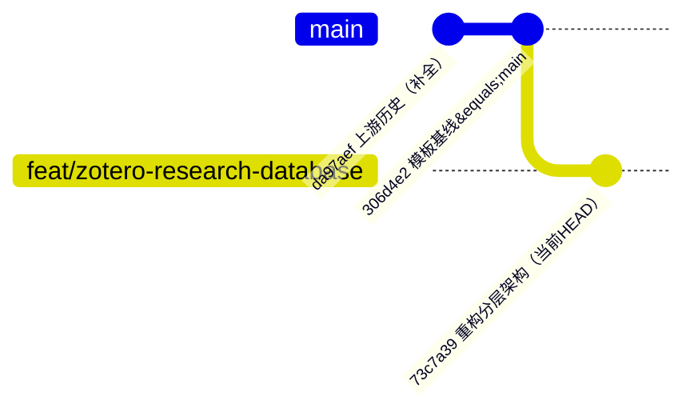

# 当前目标

实现 Zotero 9 原位表格/卡片研究数据库，通过本机外部 Codex 完成可选字段提取和论文比较，并保留精读工作流自动入库。

# Git 状态

- 当前分支：`feat/zotero-research-database`（GitHub 默认分支，跟踪 `origin/feat/zotero-research-database`）
- 项目自有公开仓库：`https://github.com/anzhaohao/zotero-research-database`（2026-08-24 创建，PUBLIC）
- 起点：`windingwind/zotero-plugin-template` 3.1.0；本地曾为浅克隆，2026-08-24 已 `git fetch --unshallow template` 补全历史
- 远程：`origin`（自有仓库）+ `template`（上游模板）
- 首次提交：`73c7a39` 重构 Zotero 研究数据库插件：落地分层架构与核心模块（91 文件，+28035/−1631）；`main` 基线分支也已推送（`306d4e2`）
- 里程碑标签：`v0.3.32`（annotated，2026-08-24 创建并推送，对齐 package.json 当前版本；仓库既有 `v*` 标签均为上游模板历史）

# 已完成

- 插件身份、Zotero 9.0.6 最低版本和 React/TypeScript 构建配置。
- 研究字段、记录、模型配置、视图、比较、快照和产物导入类型。
- 普通条目与系统工作区的 `Extra` 属性序列化；旧子笔记只读迁移并保留。
- 默认/表格/卡片原位切换和安全回退。
- 表格筛选、排序、分组、列宽、列顺序、行高；卡片宽度和密度。
- 字段管理、人工锁定、四类模型配置、批量提取进度和取消。
- MinerU Markdown 优先、PDF 全文回退。
- 动态比较、固定快照、AI 综合和三种导出。
- 带令牌和 SHA-256 校验的本地产物导入端点。
- 论文精读 Skill 的 Zotero 交付命令、重复交付去重、验收门和可恢复工作区退休流程。
- Zotero bootstrap 沙箱的 React `window` 上下文兼容修复。
- 纯逻辑单元测试 18 项通过；Zotero 9.0.6 隔离运行测试 19 项通过；`npm run lint:check`、TypeScript 和 `git diff --check` 通过。

# 2026-07-31 真实 Zotero 验收

- 隔离 Profile：`C:\Users\anzhaofeng\Desktop\test\.tmp\zrdb-zotero-profile-906`；隔离 Data：`C:\Users\anzhaofeng\Desktop\test\.tmp\zrdb-zotero-data-906`；端口 `23120`。
- 隔离配置中表格模式成功创建唯一系统工作区；插件日志不再出现 `console is not defined` 或 `window is not defined`。
- 本地产物接口实测：无效令牌返回 `401`；合法 Markdown 首次交付返回 `imported`，再次交付返回 `unchanged`，父条目下只有一个对应附件。
- 正式个人库已安装最终 XPI，本地端点 `23119` 实测无效令牌返回 `401`。
- 正式库示例论文：`E5HTMRWK` 与 `JI5C3VVH`；研究数据库子笔记键分别为 `7LQIH2YV` 与 `9XFPR3K9`，各且仅各一个。
- 正式库系统工作区键为 `I9KP9QAX`，配置子笔记键为 `W9XJL7H6`；四个默认字段为研究问题、研究意义、研究价值和主要成果。
- 已保存唯一动态比较与唯一固定快照 `示例：SHG-FROG 论文对比`，两者的条目键均严格为 `E5HTMRWK`、`JI5C3VVH`。
- 一次性示例初始化代码已从源码和最终 bundle 中移除。
- 正式 Profile 安装 XPI 的 SHA-256 为 `AB03E0C1D826858CDCD20E0A3C22C918D8A488A41AC57101C4C0F504B8170730`；2026-07-31 23:05 的最终重构建 XPI SHA-256 为 `5EE89E752C4A0C9BC427EA29A36CC5B741AA1B1727F5D966BAF43E7E73EBDD82`。两份归档均为 14 个文件，逐文件 SHA-256 完全一致，差异仅来自 ZIP 元数据。
- 已在安全关闭正式 Zotero 后移除一次性 `extensions.startupScanScopes=1` 偏好；重新启动后插件本地端点仍正常加载，无效令牌返回 `401`，隔离测试实例未被停止。
- 重启后再次通过 Zotero 本地只读 API 核验：两篇示例各一个记录子笔记、唯一系统工作区、唯一配置子笔记、唯一动态比较和唯一固定快照；所有示例字段和 AI 综合仍为空。

# 当前风险

- Zotero 的主列表没有正式自定义视图 API，当前实现对 Zotero 9 DOM 做受控注入；不兼容时会退回默认列表。
- 已完成隔离配置与正式配置的本机验收，但尚未做两个登录同一 Zotero 账号的配置间真实云同步往返。
- Windows 应用控制工具能识别两个 Zotero 窗口，但绑定窗口时错误地报告相同所有者 ID 不一致，因此没有用坐标点击做视觉回归；表格启动、系统条目、子笔记、比较和快照均由 Zotero 本机接口与插件运行日志核验。
- `npm audit --json` 当前报告模板依赖树中 14 个漏洞（1 low、3 moderate、10 high、0 critical），未运行可能引入破坏性升级的 `npm audit fix --force`。
- 论文精读 Skill 源项目已有大量未提交改动，本任务必须只做增量修改。

# 下一步

1. 经用户确认后，在正式 Zotero 的附加组件管理器中从文件安装 `0.2.0`，不要继续手工复制 XPI 到 Profile 的 `extensions` 目录。
2. 用户在 Zotero 中手动切换一次“默认列表｜数据库表格｜文献卡片”，确认本机实际视觉布局和拖动手感。
3. 可用一篇短文献试跑“调用 Codex”；当前实现不会伪造结论，失败或 Schema 非法时不写入。
4. 若有第二台设备或第二个已登录同一账号的测试配置，再验证字段、视图、比较和快照的 Zotero 云同步往返。
5. 在确认当前里程碑后做本地提交、推送和版本标签；本轮不自动提交。

# 回滚

修改前备份：`E:\software\CodexPlusPlus\Codex备份\20260731_230500_Zotero数据库插件与文献工作流修改前备份`。

正式库两篇示例写入前的完整数据库和 Profile 元数据备份：`E:\software\CodexPlusPlus\Codex备份\20260731_220320_Zotero正式库两篇示例_写入前备份`。

# 2026-08-01 Extra 属性层与 Notion 动效收口

本节覆盖前文中“研究字段继续使用子笔记保存”的旧实现说明；旧子笔记仍作为迁移来源保留，不做清理。

- 用户确认全部采用 A 方案：标题、日期、DOI、URL、标签允许表格内联编辑；作者等复杂字段使用原生编辑器；个人库共享一套属性字典；旧子笔记迁移后只读保留。
- 每篇论文的研究字段改为条目自身的 `ZRDB.Record` 与 `ZRDB.Property.<fieldID>` Extra 行。字段值包含类型化值、锁定、来源和最小审计信息。
- 字段方案、保存视图、模型非密钥配置、动态比较和快照改为系统条目的 `ZRDB.Workspace` Extra 行，不再创建配置 Markdown。
- 写入只替换 `ZRDB.*` 命名空间，`Citation Key`、其它插件字段、手写 Extra 与普通文本保持不变；重复或损坏的插件行会阻止覆盖。
- 新增右侧 Zotero“研究属性”区块；表格、卡片与右侧面板读写同一条目属性。Zotero Notifier 会在条目修改后刷新自定义视图。
- 动效参考 Notion：视图整体 `160ms` 淡入并移动 `4px`；弹窗 `170ms` 轻微淡入、移动与缩放；卡片悬停只移动 `1px`；虚拟表格行不做逐行动画；完整支持 `prefers-reduced-motion`。
- 隔离测试首次暴露 React 开发构建在 Zotero 沙箱缺少 `console`，已在 bootstrap 增加本地日志桥接；随后发现 Zotero 9.0.6 实际要求 `ItemPaneManager.registerSection()` 提供同步 `onRender`，已补齐。
- 最终隔离测试命令 `npx zotero-plugin test --no-watch --abort-on-fail --exit-on-finish` 为 19 passed；测试 Profile 正常退出，正式 Zotero 主进程未被终止或写入。
- 当前 `npm run lint:check`、`npx tsc --noEmit`、`npm run test:unit`（18 passed）和 `git diff --check` 均通过。
- 2026-08-01 11:20 生产构建成功；最终 XPI 为 `.scaffold/build/zotero-research-database.xpi`，大小 `305627` 字节，SHA-256 `C111C399DF07216E850B027C4E32248971FE3F6E9B2C9513AD22C00AC745DBFD`。
- 本轮修改前备份：`E:\software\CodexPlusPlus\Codex备份\20260801_101500_ZoteroResearchDatabase_Notion属性层重构_修改前备份`。

# 2026-08-01 外部 Codex 桥与 XPI 注册修复

本节覆盖前文中“插件内配置模型并直接调用厂商 API”的旧方案；旧记录数据与旧子笔记仍按原边界保留，不清理论文条目。

- 用户决定插件内不再集成 OpenAI、Anthropic、Gemini、OpenAI-compatible、模型选择或 API Key；模型身份、登录和全局配置由本机现有 Codex 自己管理。
- 已删除 `ProviderProfile`、`ProviderKind`、`CredentialStore`、HTTP provider 实现及相应 UI/测试。系统工作区读取旧版字段时会把 `type: ai` 非破坏迁移为 `longText + extraction`；旧 provider 配置不再写回，但普通论文的 `ZRDB.Property.*` 值不受影响。
- 新增受限 `CodexAgentBridge`：自动解析 npm 全局目录或 PATH 中的 `codex.exe`，通过标准输入传递任务，使用 `--sandbox read-only`、`--ephemeral`、`--output-schema` 和 `--output-last-message`，默认 15 分钟超时。
- 一次虚构摘要的真实 Codex 结构化调用返回合法 JSON，但也发现全局 `xhigh` 与插件加载会造成明显额外开销；桥已改为继续沿用登录、模型和 provider，同时对单次任务固定 `medium` 推理并禁用 plugins、apps、browser、computer-use、multi-agent、hooks 与 shell tool。
- 外部任务失败、取消、超时、缺少输出或 JSON Schema 校验失败时不写入研究属性；人工锁定值仍不覆盖。首版不开放任意 Shell 命令模板，其它 Agent 需增加专用适配器。
- 安装故障根因：正式 Profile 的扩展目录中虽然存在旧 `0.1.0` XPI，但 `extensions.json` 没有插件 ID，本地端点为 404，说明 Zotero 从未注册或启动该插件，不是自定义视图被隐藏。
- 插件版本已升至 `0.2.0`。`npm run lint:check`、TypeScript、`git diff --check` 和 16 项单元测试通过。
- Zotero 9.0.6 独立运行测试 18 项通过；其中真实从 Zotero bootstrap 沙箱执行本机 Codex CLI，返回 `codex-cli 0.142.5`，未调用模型。
- 真实 XPI 安装验证使用全新隔离 Profile `C:\Users\anzhaofeng\Desktop\test\.tmp\zrdb-xpi-install-020-profile` 和 Data `C:\Users\anzhaofeng\Desktop\test\.tmp\zrdb-xpi-install-020-data`。扩展注册结果为 `version=0.2.0`、`active=true`、`visible=true`、`appDisabled=false`、`userDisabled=false`；端点返回预期 `401`。测试实例已停止，正式 Zotero 进程未关闭。
- 最终生产 XPI：`.scaffold/build/zotero-research-database.xpi`，大小 `304384` 字节，SHA-256 `003239B93D8409451361A6FFBAEDD7379DEE4F0C0C3379096FBB2F087C59B855`。
- 正式安装必须走 Zotero“工具 → 附加组件 → Install Add-on From File…”；根据 Windows 应用控制确认规则，在执行正式安装前等待用户当场确认。

# 2026-08-01 0.2.1 数据库视图空白修复

本节覆盖前文中“0.2.0 已完成正式视觉验收”的旧判断：`0.2.0` 能启动并注入视图切换器，但数据库表格和文献卡片在正式 Zotero 中没有可见内容。

- 正式 Profile 已确认 `zotero-research-database@anzhaofeng.local` 为 `version=0.2.0`、`active=true`；按钮出现证明插件已启动，故障不是安装或注册失败。
- 第一处根因：`#zotero-items-pane` 是 XUL `<hbox>`，原实现把它当普通 HTML 元素设置 `.hidden`。改为显式增删 `hidden` 属性，并使用仅作用于该节点的 `zrdb-native-pane-hidden` 类，以覆盖 Zotero 自带的 `.virtualized-table-container { display: flex }`。
- 第二处根因：GSAP 在 bootstrap 沙箱中调用 `matchMedia` 和裸全局 `getComputedStyle`，React 被动 Effect 随后抛错并卸载整棵自定义视图。现在减弱动效查询使用实际 DOM 所属 Zotero 窗口，动画目标使用元素引用；沙箱兼容层显式桥接 Zotero 主窗口的 `getComputedStyle`。
- 动效参数保持不变：视图 `160ms`、`4px` 淡入移动，弹窗 `120–170ms` 轻微淡入、移动和缩放；仍尊重 `prefers-reduced-motion`，并由 `useGSAP` 负责清理。
- 新增真实 DOM 回归：切换表格后验证原生 XUL 面板的属性、CSS 计算结果、自定义视图实际高度和 React 挂载；等待动画完成后检查没有插件脚本错误；再切换卡片并返回默认列表，验证状态完全恢复。
- 最终验证：16 项单元测试通过；Zotero 9.0.6 隔离运行 19 项全部通过；`npm run lint:check`、TypeScript 和 `git diff --check` 通过。
- 版本升至 `0.2.1`。生产 XPI：`.scaffold/build/zotero-research-database.xpi`，大小 `304532` 字节，SHA-256 `EBCEE33B103F482671B6F8DAA05D1B507F64937C4D7598C97CF6F909BE7B9A60`。
- 正式库仍运行 `0.2.0`，下一步是在附加组件管理器中从文件覆盖安装 `0.2.1`，重启后手动检查三种视图；本轮诊断和隔离测试没有修改正式论文条目。

# 2026-08-01 0.2.2 阅读器后台渲染修复

本节覆盖前文的安装状态：正式 Profile 已安装并激活 `0.2.1`，但打开含大量批注的 PDF 时发生卡顿。

- 诊断论文的 PDF 附件键为 `3PMWSNVY`，共有 532 个有效且位置唯一的批注；没有删除、修改或清理任何批注、PDF、论文条目或正式 `zotero.sqlite`。
- Zotero 卡住时调用栈位于自带的 `resource://zotero/react-dom.js`。插件没有注册阅读器组件，但 `0.2.1` 会响应所有 `item` 通知，导致阅读器批注变化时数据库表格在后台重复渲染，放大了 Zotero 阅读器自身的负载。
- 数据库控制器现在同时监听 `tab` 与 `item`：进入阅读器立即取消待执行刷新并暂停数据库渲染；返回 `zotero-pane` 时只补一次刷新。
- `item` 通知只接受当前 Zotero 视图中的普通文献和插件系统工作区；附件、批注、子笔记及当前视图外文献均不再触发数据库 React 渲染。`itemsView.onRefresh`、`setMode()` 与最终 `render()` 也有文献库标签状态保护。
- 所有刷新统一使用 80 ms 合并调度，离开文献库或销毁控制器时会取消定时器。Zotero 早期启动尚未提供标签类型时仍允许首次文献库渲染，避免数据库视图空白。
- 新增刷新策略单元测试与真实 Zotero 标签回归。最终结果：19 项单元测试通过；Zotero 9.0.6 隔离运行 23 项通过；`npm run lint:check`、TypeScript、生产构建和 `git diff --check` 通过。
- 版本升至 `0.2.2`。生产 XPI：`.scaffold/build/zotero-research-database.xpi`，大小 `305190` 字节，SHA-256 `C96B5664BF33BE7D25332E3F00738C02F4A60B977A954E0B22716ED61CC61CFE`。

# 2026-08-03 0.3 表格增强与 0.4 图表协议预览收尾

本节覆盖前文中“只有 Codex 适配器、无插件设置页、只导出 Markdown/HTML/CSV”的旧状态。正式 Zotero 与正式文献库未在本轮写入或安装。

- 0.3 表格增强已接入：默认 `120px` 行高、PDF 首页预览、基础信息组合列、视图级表头别名、列显示/隐藏/固定/移动、列宽与单行行高、编辑/复制操作条、行与单元格语义背景色。
- 新增 Zotero 原生设置页：管理默认视图、行高、导出范围、密度、圆角、阴影、动效、明暗模式，以及自定义字段名称、类型、说明、提示词、归档和恢复。
- 外部 Agent 支持 Codex CLI、本机 Ollama 和直接启动的自定义 JSON 进程；自定义参数必须是 JSON 字符串数组，任务走 stdin、结果走 stdout，不经过 Shell，也不保存云端 API Key。
- PDF 首页缩略图只为可见行生成、并发限制为 2，并缓存到 Zotero Profile 的插件缓存目录；读取失败时只显示占位图。
- 导出支持 CSV、XLSX、HTML 和系统打印 PDF。发现 `JSZip.generateAsync()` 在 Zotero 特权窗口以空错误拒绝，已改为纯 TypeScript 的 ZIP32 STORED 写入器；Node 端反向解析包结构，Zotero 端验证实际 Blob 生成。
- 工作区 schema 升至 3，旧 0.3 视图非破坏增加图表画廊列。图表/表格图片可由本地导入接口携带页码和区域坐标交付，按图表 ID 与 SHA-256 去重，并在父条目 `ZRDB.Figures` 中保存最小清单。
- 图表画廊单击调用系统图片查看器，双击通过 Zotero Reader 回到 PDF 页码或区域；没有 manifest 时显示“尚未提取”。自动提取全部图表仍是后续 0.4 工作，不在插件内伪造结果。
- 图表请求与 Extra 清单现在拒绝非有限坐标和宽高不为正的区域；可选 PDF 附件键类型也在请求入口校验。
- 最终验证：`npx tsc --noEmit`、`npm run lint:check`、`git diff --check` 通过；Node 单元测试 28 项通过；Zotero 9.0.6 独立 Profile 运行测试 33 项全部通过，其中包含图表子附件重复导入去重。
- 生产版本暂时保持 `0.3.0`，因为 0.4 自动图表提取链尚未完成。最终 XPI 为 `.scaffold/build/zotero-research-database.xpi`，大小 `325588` 字节，SHA-256 `38B5F7A4291F7ECE57E4987F38080BA81C071D5B6F20333D0BA09A8BFB30F4B5`。
- 回滚备份：`E:\software\CodexPlusPlus\Codex备份\20260801_研究数据库0.3视图增强_修改前备份`；本次继续开发前备份：`E:\software\CodexPlusPlus\Codex备份\20260803_Zotero数据库0.3继续开发_修改前备份`。
- 当前分支仍为 `feat/zotero-research-database`，工作树包含本项目从模板起的全部未提交实现；没有提交、推送、打标签或安装 XPI。

下一步建议：先在正式 Zotero 中从文件安装 `0.3.0` 并手动验收表格拖动、PDF 首页和设置页；需得到用户再次确认后才能执行。0.4 后续只补 MinerU/外部 Agent 图表提取清单和真实论文回归。

# 2026-08-03 0.3.1 表格滚动、尺寸拖动与编辑完成态修复

本节覆盖上一节的 `0.3.0` 安装建议；当前应验收 `0.3.1`。本轮只在源码和隔离 Zotero Profile 中修改、测试，没有安装到正式 Zotero，也没有改写正式文献条目。

- 用户截图确认三个真实回归：横向滚动后表头与数据列错位、列宽拖动无效、首行高度拖动无效。
- 根因一：表头原本位于 `.zrdb-table-scroll` 外，只有数据行响应横向滚动。现将表头与虚拟表体放入同一个滚动容器，表头只在纵向使用 `position: sticky`，横向坐标与数据列天然一致。
- 根因二：列宽手柄原来向单元格右侧伸出，被下一列表头覆盖；首行高度手柄向下伸出，被第二行覆盖。两个拖动热区都已收回当前格子内部，增加明确层级与 `touch-action: none`，并阻止列拖动和尺寸拖动互相抢事件。
- 列宽拖动继续通过 `requestAnimationFrame` 实时更新，松手后只保存一次；松手前保留最终草稿，避免异步保存期间瞬间回跳。
- 单行高度拖动会同步调用虚拟列表的 `resizeItem()`，后续行位置和总滚动高度实时重算；首行和中间行不再被下一行遮挡手柄。
- 默认行高从 `120px` 提高到 `160px`，插件默认偏好、恢复默认值和工作区迁移一致。schema 升至 4；旧默认 `120px` 自动升级，用户自定义的单行高度原样保留。
- “基础信息”列包含机构、作者、年份和期刊；它显示时，独立作者、年份列自动隐藏。只改变数据库视图投影，不删除或改写 Zotero 元数据；日期、DOI、URL、标签仍可独立管理。
- 单元格编辑不再因失焦或选择变化立即保存。编辑态显示“完成”和“取消”；点击“完成”通过原有字段校验与锁定逻辑保存，保存结束后退出编辑态，按钮随之消失。
- 新增真实 Zotero DOM 回归：验证表头与表体共享滚动容器、横向位移一致、列宽增加 `48px`、首行高度增加 `36px`、拖动手柄位于自身边界内、基础信息去重，以及“编辑 → 完成 → 操作条消失”。
- 最终验证：`npm run lint:check`、`npx tsc --noEmit`、`git diff --check` 通过；Node 单元测试 29 项通过；Zotero 9.0.6 隔离运行测试 34 项全部通过。
- 生产版本为 `0.3.1`。XPI：`.scaffold/build/zotero-research-database.xpi`，大小 `326188` 字节，SHA-256 `46AC0691E4426317DDE6276B688D01A8DA7EE27473C44EFEE7B1F32DFAA1CBAE`。
- 修改前回滚备份：`E:\software\CodexPlusPlus\Codex备份\20260803_ZRDB表格滚动与尺寸修复_修改前备份`。
- 当前分支仍为 `feat/zotero-research-database`；没有提交、推送或打标签。下一步必须先由用户确认，再从 Zotero 附加组件管理器覆盖安装 `0.3.1` 并在截图中的两篇文献上复验。

# 2026-08-03 表格视觉与动效原型待选

本节不覆盖 `0.3.1` 的插件实现状态。用户要求先比较视觉原型，选定后再迁移进 Zotero；因此本轮没有修改插件源码、版本号、XPI 或正式 Zotero。

- 新增 `design-prototypes/`，提供 A「Notion 清爽」、B「Apple 玻璃」、C「学术工作台」三套可独立打开的 HTML。三版共享同一份论文数据和交互，只比较字体、材质、层级、颜色与动效强度。
- 原型把排序/分组/升降序收进“排列”，把自定义字段/列/外部工具/临时固定列收进“字段与工具”，把保存/读取/更新视图及 Excel、CSV、HTML/PDF 导出收进“视图与导出”。
- 基础信息示例已包含作者、年份、期刊、机构、DOI、期刊分区标签与灰色引用行；字号和行距加大，使用微软雅黑优先的系统字体栈。
- 单击格子按当前字面需求选择整列；双击才激活具体单元格并显示编辑、复制和填色操作条。点击编辑后按钮变为“完成”，完成后恢复为“编辑”。
- 临时固定列会移动到第一列并使用 sticky 定位。独立 Playwright 验证三版在横向滚动 `740px` 后固定列横坐标变化均为 `0px`；将“基础信息”设为固定列后，三版首列均为 `basic`。
- 三版均验证 4 行论文、3 个组合菜单、整列选择、双击操作条、编辑/完成切换、暗夜模式和无页面脚本错误。HTML/JS/CSS 通过 Prettier 检查，`prototype.js` 通过 Node 语法检查。
- 本轮截图位于 `design-prototypes/previews/`；选择入口为 `design-prototypes/index.html`。下一步只等待用户选择 A、B、C，或指定“以某版为主、混合另一版细节”，再修改 React/Zotero 插件。
- 用户已选择 C「学术工作台」作为后续插件视觉基线。C 原型继续保留最左侧 PDF 首页预览列，但标题列删除重复的 PDF 徽标与附件文件名；中文论文只显示原标题，外文论文显示原标题与较弱的中文译名。
- “视图与导出”菜单增加引用格式选择，原型支持 Zotero 当前样式、GB/T 7714、APA 7、Nature 和 IEEE；每条灰色引用右侧增加低对比度复制图标，悬停时才增强，不占用单元格操作条。
- C 原型已进一步收敛为 Notion 配色：继承中性白/灰表面、弱蓝状态色、轻边界和无面板阴影；移除原学术主题的深蓝顶边与高对比装饰，只保留 C 的信息结构与较宽松排版。
- 表头现在支持直接原生拖放。拖动任意可见表头时显示细落点线，松手后表头和所有数据行按同一 `columnOrder` 同步换位；默认不固定列，用户仍可在“字段与工具”中把一列临时置首并固定。
- 独立 Playwright 已验证把“研究方法”拖到“文献标题”前后，表头和首行顺序同时变为 `preview → method → title → basic`；同时确认 C 的应用背景为 `#f7f7f5`、面板阴影为 `none` 且无页面脚本错误。
- 顶部默认列表/表格/卡片、排列、字段与工具、视图与导出、明暗模式全部改为统一的 16–17px 线性 SVG 图标；图标按钮默认无边框和阴影，仅在悬停、选中或展开时显示弱背景。
- 所有顶部图标都有 `aria-label` 与自定义悬停提示；菜单展开后继续保留完整文字，避免图标含义不明确。单元格操作条的编辑、完成、复制、填色和打开 PDF 也改为图标，编辑态会从铅笔切换为勾选。
- Playwright 验证 3 个菜单触发器、3 个视图按钮和 3 个单元格操作按钮均为纯图标；悬停提示可见，编辑/完成图标与提示正确往返，15 项检查通过且无页面脚本错误。
- 下一步仍未授权迁移插件：先由用户验收更新后的 C HTML，再把该视觉、标题投影和引用格式接口落实到 React/Zotero 数据视图。

# 2026-08-03 0.3.2 C「学术工作台」迁移完成

本节覆盖上一节“尚未授权迁移插件”的状态：用户已明确确认“按照当前 UI”，C 原型已经迁入实际 Zotero 插件。本轮只修改源码、隔离测试数据和生产 XPI，没有安装到正式 Zotero，也没有清理或改写正式论文条目。

- 顶部界面已迁移为 C「学术工作台」：Notion 中性白灰、弱蓝状态色、微软雅黑优先字体、标题栏与命令栏、三个纯图标组合菜单、纯图标视图切换和明暗模式按钮。菜单触发器与单元格按钮均有 `aria-label`、原生 `title` 和自定义悬停说明。
- “排列”统一管理排序、分组和升降序；“字段与工具”统一管理自定义字段、列设置、临时固定列和外部 Agent；“视图与导出”统一管理保存/读取/更新视图、比较、引用格式和 CSV/XLSX/HTML/PDF 导出范围。
- 表头继续使用同一横向滚动容器，并增强为直接拖放。拖动仅显示细落点线；`drop` 当帧直接根据指针和目标表头中点判断前后位置，避免快速释放时读取旧 React 状态；表头和数据行从同一 `columnOrder` 渲染并在松手后保存一次。
- 单击单元格选中整列并同步当前 Zotero 文献；双击具体单元格才显示图标操作条。编辑态用勾选图标完成、叉号取消，完成保存后编辑按钮立即消失。单元格和整行语义背景色仍保留。
- 默认行高提高到 `260px`，标题宽 `338px`、基础信息宽 `374px`。旧 schema 4 的默认 `160px` 行高迁移为 `260px`，旧自动固定的 PDF 预览列迁移为不固定；用户自定义单行高度和其它布局继续保留。
- 基础信息组合显示作者、年份、期刊、机构、DOI、从 Zotero 标签/Extra 只读聚合的期刊分区，以及 Zotero CSL 引用。基础信息可见时自动隐藏作者、年份、日期和 DOI 独立列，但不删除任何真实元数据。
- Zotero 9 未提供可靠的 `titleTranslation` 原生字段，因此新增稳定研究字段 `translated-title`（中文标题）。它可由现有外部 Agent 或右侧研究属性编辑，但不单独显示为表格列；中文论文只显示原标题，外文论文在原标题下投影中文译名，未使用 `shortTitle` 冒充翻译。
- 引用格式作为视图布局属性同步保存，支持 Zotero 当前 Quick Copy、GB/T 7714、APA 7、Nature 和 IEEE。实际文本调用 Zotero 已安装 CSL/Quick Copy 生成，并按条目版本与样式缓存；失败时显示占位，不自行伪造引用。
- 工作区 schema 升至 5。迁移测试确认旧研究字段值、视图、比较、快照和单行高度不丢失；原条目标题、作者、DOI、标签、PDF、旧子笔记和其它 `Extra` 行均不清理。
- `npm run lint:check`、`npx tsc --noEmit`、`git diff --check` 和生产构建通过；Node 单元测试 30 项通过；Zotero 9.0.6 独立 Profile 运行测试 35 项通过。真实 DOM 覆盖表头换序、横向滚动、列宽增加 `48px`、行高增加 `36px`、整列选择、双击操作条、完成退出编辑和三视图切换。
- 生产版本为 `0.3.2`。XPI：`.scaffold/build/zotero-research-database.xpi`，大小 `335798` 字节，SHA-256 `25F981101B6B73DC3C09238F7EA0AF9197CF4B0BD9790F7DABE7686D7ACFE5C1`。
- 修改前回滚备份：`E:\software\CodexPlusPlus\Codex备份\20260803_ZRDB当前UI迁移插件_修改前备份`（61 个文件，`528696` 字节）。
- 当前分支仍为 `feat/zotero-research-database`；没有提交、推送、打标签或安装正式 Zotero。下一步只需由用户决定何时从附加组件管理器覆盖安装 `0.3.2`，再用真实两篇文献做视觉验收。

# 2026-08-03 0.3.3 行高、单行工具栏与列宽拖拽修复

- 默认表格行高从 `260px` 提高到 `320px`，使基础信息、DOI、期刊分区和引用行在默认状态下完整显示。工作区 schema 升至 6；仅把 schema 5 内置默认表格的旧 `160/260px` 升级为 `320px`，用户另存视图的紧凑行高和单篇自定义行高保持原样。
- 数据库标题、范围、视图切换、明暗模式、搜索、三个组合菜单和元数据状态已合并到同一条工具栏，桌面与窄窗口均保持 `nowrap` 单行布局；窄窗口隐藏次要样式标签和状态文字，为主要操作保留空间。
- 修复列宽拖动触发表头 HTML5 原生拖影的问题：表头本体不再 `draggable`，列换序只允许从表头六点手柄启动，并要求按住 `260ms` 后才进入拖动态。列宽手柄使用独立 PointerEvent 流程，因此拖宽不再触发换列或灰色预览块。
- 六点换列使用自定义指针命中和细落点线，不创建 Firefox 原生拖动预览；靠近表格左右边缘时可辅助横向滚动。普通点击、短按、列宽手柄和文字区域都不会换列。
- 真实 Zotero DOM 回归新增单行工具栏几何断言、表头不可拖断言、六点数量与长按激活断言；继续验证换序后表头/数据列一致、列宽增加 `48px`、默认行高至少 `319px`、单行高度增加 `36px`。
- 最终验证：`npm run lint:check`、`npx tsc --noEmit`、`git diff --check` 和生产构建通过；Node 单元测试 31 项通过；Zotero 9.0.6 隔离运行测试 36 项全部通过。
- 生产版本为 `0.3.3`。XPI：`.scaffold/build/zotero-research-database.xpi`，大小 `336554` 字节，SHA-256 `0DBD774E0AB16464D719F6D083D6B1564BD4F96D405E075413FF49601C2EDA8E`。
- 修改前回滚备份：`E:\software\CodexPlusPlus\Codex备份\20260803_ZRDB行高工具栏列宽修复_修改前备份`。
- 当前分支仍为 `feat/zotero-research-database`；没有提交、推送、打标签或安装正式 Zotero，也没有清理或重写正式论文条目。下一步由用户从附加组件管理器覆盖安装 `0.3.3`，再用当前真实表格复验手感。

# 2026-08-03 0.3.4 简洁状态区与末行行高修复

- 顶部单行工具栏重新分成两个语义区域：左侧只显示当前数据库名称、当前范围数量和 `Zotero 已载入`；右侧只放视图切换、明暗模式、搜索和三个功能菜单，中间使用弹性留白保持距离。
- 删除没有数据或操作价值的 `C · 学术工作台` 徽标。数据库图标改成无边框、无底色的小图标，数量与加载状态改为低对比度内联文字，状态绿点取消光晕和胶囊边框；窄窗口继续优先隐藏加载状态。
- 表格虚拟内容底部新增 `22px` 可滚动留白。滚到最后一行后，行高拖动手柄会停在横向滚动条上方，不再被滚动条拦截；行悬停或选中时显示轻量底边提示，直接悬停手柄时增强为 `2px` 蓝线。
- 行高手柄增加 `separator` 语义、`aria-label` 和原生提示。真实 Zotero DOM 回归会滚到表格末尾，确认手柄至少位于可用滚动区底边上方 `12px`，并实际把末行高度增加 `24px`。
- 最终验证：`npm run lint:check`、`npx tsc --noEmit` 和生产构建通过；Node 单元测试 31 项通过；Zotero 9.0.6 隔离运行测试 36 项全部通过。
- 生产版本为 `0.3.4`。XPI：`.scaffold/build/zotero-research-database.xpi`，大小 `336730` 字节，SHA-256 `336B82425E77087CA99135E07D37E5A79FEB7B53448170A70C35D2C17801CDA2`。
- 修改前回滚备份：`E:\software\CodexPlusPlus\Codex备份\20260803_1815_ZRDB底部行高与工具栏简化_修改前备份`（94 个文件）。
- 当前分支仍为 `feat/zotero-research-database`；没有提交、推送、打标签或安装正式 Zotero，也没有修改正式论文数据。下一步由用户覆盖安装 `0.3.4` 后，在真实表格底部复验末行拖动和工具栏视觉距离。

# 2026-08-03 0.3.5 旧内置 48px 行高迁移

- 已确认新代码和插件默认偏好均为 `320px`；截图中的约 `48px` 行高来自早期版本已经保存到 Zotero 工作区的 `builtin-table` 布局。旧迁移为了保护用户布局，只识别 `120/160/260px`，因此遗漏了更早的 `48px` 默认值。
- 工作区 schema 升至 7。迁移只在视图 ID 为 `builtin-table` 且旧行高为 `48px` 时替换为 `320px`；普通另存视图即使也设置为 `48px` 仍保持不变。
- `rowHeights` 中的逐篇自定义高度完全保留。迁移测试使用 `CUSTOM_PAPER: 196px` 验证内置默认高度升级后，单篇高度和另存紧凑视图都没有被覆盖。
- 最终验证：`npm run lint:check`、`npx tsc --noEmit` 和生产构建通过；Node 单元测试 32 项通过；Zotero 9.0.6 隔离运行测试 37 项全部通过。
- 生产版本为 `0.3.5`。XPI：`.scaffold/build/zotero-research-database.xpi`，大小 `336761` 字节，SHA-256 `7CEDEA3C368F2C244607F70ACF4367393734F08A9AEA3ED657BFDFA5B3CE0BEC`。
- 修改前回滚备份：`E:\software\CodexPlusPlus\Codex备份\20260803_1830_ZRDB旧48px行高迁移_修改前备份`（94 个文件）。
- 当前分支仍为 `feat/zotero-research-database`；没有提交、推送、打标签或安装正式 Zotero，也没有修改正式论文数据。下一步由用户覆盖安装 `0.3.5`，重新进入默认表格后确认普通行已恢复到 `320px`。

# 2026-08-03 0.3.6 引用交互精简

- 基础信息底部不再铺开完整引用，只显示当前格式名称。点击格式名称会复制由 Zotero CSL 生成的完整引用；右侧原复制图标改成低对比度下拉箭头，用于切换 Zotero 当前样式、GB/T 7714、APA 7、Nature 和 IEEE。
- 顶部菜单同步从“视图、引用与导出”简化为“视图与导出”，并删除重复的引用格式选择器；双击基础信息单元格后也不再显示通用“复制内容”按钮。引用复制和格式切换因此各保留一个明确入口，导出范围与其它菜单能力不变。
- 按用户追加要求移除工具栏独立明暗按钮，并删除设置页中的“跟随/浅色/深色”覆盖选项。插件根视图固定使用 `data-theme="zotero"`，继续通过 Zotero 宿主的颜色方案自动适配明暗外观；旧本机主题偏好即使仍存在也不再读取。
- 新增真实 Zotero DOM 回归：核对左侧文字始终等于选中格式名、切换样式后立即更新、顶部菜单不包含“引用格式”、基础信息单元格不包含重复复制按钮。原有横向滚动、六点拖列、列宽、首末行行高和编辑完成回归继续通过。
- 最终验证：`npm run lint:check`、`npx tsc --noEmit`、`git diff --check` 和生产构建通过；Node 单元测试 32 项通过；Zotero 9.0.6 隔离运行测试 37 项全部通过。
- 生产版本为 `0.3.6`。XPI：`.scaffold/build/zotero-research-database.xpi`，大小 `336705` 字节，SHA-256 `71FFFC8F524FB16B4C00CDB33E320D0BF432DD5C536684BEF4C4A2BF23EB36BD`。
- 修改前回滚备份：`E:\software\CodexPlusPlus\Codex备份\20260803_ZRDB引用交互精简_修改前备份`（7 个本轮相关文件）。
- 追加主题改动前回滚备份：`E:\software\CodexPlusPlus\Codex备份\20260803_ZRDB跟随Zotero主题_修改前备份`（9 个相关文件，`256647` 字节）。
- 当前分支仍为 `feat/zotero-research-database`；没有提交、推送、打标签或安装正式 Zotero，也没有修改正式论文数据。下一步由用户决定是否从附加组件管理器覆盖安装 `0.3.6` 并验收真实引用复制手感。

# 2026-08-03 0.3.7 引用控件 macOS 风格收敛

- 引用格式名与下拉箭头从占满整行的两列布局改为左对齐的紧凑内联布局，控件总宽度只等于“格式名＋`4px` 间距＋箭头框”，不再把下拉入口推到基础信息列最右侧。
- 灰色格式名继续承担点击复制，不显示边框、底色、圆角或按钮轮廓；整条引用区删除虚线分隔和外包围。下拉入口只显示箭头，并保留一个 macOS 风格的低对比度细边框、浅灰材质和 `5px` 圆角。
- 下拉箭头框使用 `border-box`，包含边框后的真实外尺寸严格为 `20×20px`；悬停只轻微改变灰度与边框，按下反馈缩放到 `0.96`，不增加新功能按钮。
- 真实 Zotero DOM 回归新增左边界、内容收缩宽度、`4px` 相邻间距、透明格式名背景、无图标按钮以及 `20×20px` 下拉框断言。最终 `npm run lint:check`、`npx tsc --noEmit`、`git diff --check` 和生产构建通过；Node 单元测试 32 项通过；Zotero 9.0.6 隔离运行测试 37 项通过。
- 生产版本为 `0.3.7`。XPI：`.scaffold/build/zotero-research-database.xpi`，大小 `336813` 字节，SHA-256 `C434ACEF8B509A7871E4F98D890CB09D5968E40B67CE467B6FFB95F2B5C2033F`。
- 修改前回滚备份：`E:\software\CodexPlusPlus\Codex备份\20260803_ZRDB引用控件macOS精简_修改前备份`（7 个相关文件，`425038` 字节）。
- 当前分支仍为 `feat/zotero-research-database`；没有提交、推送、打标签或安装正式 Zotero，也没有修改正式论文数据。下一步由用户覆盖安装 `0.3.7` 后在真实基础信息列验收灰色引用控件的视觉密度。

# 2026-08-03 0.3.8 行高与基础信息可读性调整

- 内置表格默认行高从 `320px` 收紧为 `240px`。工作区 schema 升至 8，只把 schema 7 中 `builtin-table` 的旧默认 `320px` 迁移为 `240px`；另存视图即使为 `320px` 也不改，单篇 `rowHeights` 全部保留。
- 基础信息标签从 `10px` 提升到 `11px`，正文从 `12px` 提升到 `13px`，标题从 `14px` 提升到 `15px`，中文译名从 `12px` 提升到 `13px`，期刊分区标签和引用格式文字也各提升一级。文本继续使用 Zotero/Windows 原生字体渲染，不通过缩放模拟字号。
- 引用格式与下拉箭头间距从 `4px` 增加到 `12px`。下拉点击区从 `20×20px` 扩大到 `28×28px`，箭头从 `10px` 增加到 `14px`；边框、背景、阴影和圆角全部移除，只保留灰色图标与轻微按压反馈。
- 新增 schema 7 迁移测试，确认内置默认行高收紧而另存视图和单篇高度不变。真实 Zotero DOM 回归验证 `240px` 行高、基础信息字号、透明无框箭头、`12px` 间距、`28px` 点击区和 `14px` 图标。
- 最终 `npm run lint:check`、`npx tsc --noEmit`、`git diff --check` 和生产构建通过；Node 单元测试 33 项通过；Zotero 9.0.6 隔离运行测试 38 项通过。
- 生产版本为 `0.3.8`。XPI：`.scaffold/build/zotero-research-database.xpi`，大小 `336787` 字节，SHA-256 `46540F78A7A7A991A01E2B20788CDBE41506001DB94207CBA3A8082AD848CD7F`。
- 修改前回滚备份：`E:\software\CodexPlusPlus\Codex备份\20260803_ZRDB行高与基础信息可读性_修改前备份`（11 个相关文件，`331994` 字节）。
- 当前分支仍为 `feat/zotero-research-database`；没有提交、推送、打标签或安装正式 Zotero，也没有修改正式论文元数据。下一步由用户覆盖安装 `0.3.8` 后在真实文献表格中验收行高和基础信息清晰度。

# 2026-08-03 0.3.9 默认行高与统一行高滑杆

- 内置表格默认行高从 `240px` 调整为 `270px`，在可读性和单屏信息量之间保留更舒适的余量。工作区 schema 升至 9；迁移只把 schema 8 的 `builtin-table: 240px` 更新为 `270px`，另存视图和逐篇 `rowHeights` 均保持不变。
- “排列”二级菜单新增“统一调整行高”，没有增加顶部按钮。面板使用 `200–360px` 线性滑杆，并在轨道上提供 `220 紧凑`、`240 标准`、`270 舒适`、`300 宽松`、`340 展开` 五个可点击预设节点；当前高度以大号数字即时显示。
- 拖动滑杆或点击节点只更新面板内存，不在每一帧写入 Zotero。点击“统一全部行”后才更新当前视图的 `layout.rowHeight` 并清空 `layout.rowHeights`，因此所有文献行会采用同一高度；取消则不保存。
- 滑杆使用 Zotero/Notion 中性色和宿主明暗模式变量，Firefox 与 WebKit 轨道均有进度反馈；节点只有圆点与文字，没有矩形按钮框，并保留键盘焦点、ARIA 值和 reduced-motion 支持。
- 真实 Zotero DOM 回归先把首行单独增加 `36px`，再选择 `300 宽松` 并统一，确认所有当前可见行均为 `300px`，证明逐篇覆盖已经清除。五个节点、滑杆值和弹窗关闭行为也均有断言。
- 最终验证：`npm run lint:check`、`npx tsc --noEmit`、`git diff --check` 和生产构建通过；Node 单元测试 34 项通过；Zotero 9.0.6 隔离运行测试 39 项全部通过。
- 生产版本为 `0.3.9`。XPI：`.scaffold/build/zotero-research-database.xpi`，大小 `338508` 字节，SHA-256 `B15A8E07A9E0AA66712EAB62AC97CFB215C05893786D00E45594D669747E27DC`。
- 默认行高修改前回滚备份：`E:\software\CodexPlusPlus\Codex备份\20260803_ZRDB默认行高270_修改前备份`（10 个文件，`290366` 字节）；统一行高入口修改前回滚备份：`E:\software\CodexPlusPlus\Codex备份\20260803_ZRDB统一行高入口_修改前备份`（5 个文件，`244388` 字节）。
- 当前分支仍为 `feat/zotero-research-database`；没有提交、推送、打标签或安装正式 Zotero，也没有修改正式论文条目、PDF、标签、元数据或 `zotero.sqlite`。下一步由用户决定何时覆盖安装 `0.3.9`，再在真实文献表格中验收滑杆手感和五档行高。

# 2026-08-03 0.3.10 数据行分割线

- 不同数据行之间的底边从几乎不可见的 `--zrdb-line` 提升为与表头一致的 `--zrdb-line-strong`，保持 `1px` Notion 风格细线，并继续随 Zotero 明暗模式切换颜色。
- 根据虚拟列表中的真实末行索引增加 `is-last-row` 标记；最后一行保留透明底边以维持原有几何尺寸，但不在表格末尾重复绘制分割线。行高拖动手柄、悬停提示、选中背景和单元格背景色均保持原逻辑。
- 隔离 Zotero DOM 测试改用两篇临时文献，确认首行分割线的宽度、样式和颜色与表头一致，同时确认真实最后一行的底边透明；原列换序、列宽、首末行行高、统一行高滑杆和编辑回归继续通过。
- 本次只改渲染样式和末行视图标记，不修改工作区 schema，也不写入论文元数据或视图数据。
- 最终验证：`npm run lint:check`、`npx tsc --noEmit`、`git diff --check` 和生产构建通过；Node 单元测试 34 项通过；Zotero 9.0.6 隔离运行测试 39 项全部通过。
- 生产版本为 `0.3.10`。XPI：`.scaffold/build/zotero-research-database.xpi`，大小 `338539` 字节，SHA-256 `FE739EA93DDC76A23DAECE9B683D6001949C460B75E0EE00802968C254DB5AC6`。
- 当前分支仍为 `feat/zotero-research-database`；没有提交、推送、打标签或安装正式 Zotero，也没有修改正式论文条目、PDF、标签、元数据或 `zotero.sqlite`。下一步由用户决定何时覆盖安装 `0.3.10`，再在真实浅色/深色表格中验收分割线对比度。

# 2026-08-03 0.3.11 加粗并修复数据行分割线

- 真实截图确认 `0.3.10` 的 `1px border-bottom` 仍显得过细；同时由于虚拟数据行使用绝对定位，边框落在下一行背景覆盖区域时可能进一步变淡，只剩行高提示的细蓝线明显可见。
- 数据行分割线改为绘制在行内部底部的 `::before` 覆盖层，固定高度 `2px`、底部位置 `0px`，颜色使用当前 Zotero 明暗主题文字色的 `26%` 中性混合。它不会增加行的盒模型高度，也不会被下一行背景遮住。
- 行高拖动手柄和行悬停/选中时的蓝色提示同步改为 `2px`、`bottom: 0`，直接覆盖同一位置的中性分割线，不产生上下两条线。真实最后一行继续不绘制分割线。
- 隔离 Zotero DOM 回归直接读取 `::before` 和行高手柄 `::after` 的计算样式，确认高度均为 `2px`、底部均为 `0px`、常态颜色非透明，并确认末行分割层为 `display: none`。
- 最终验证：`npm run lint:check`、`npx tsc --noEmit`、`git diff --check` 和生产构建通过；Node 单元测试 34 项通过；Zotero 9.0.6 隔离运行测试 39 项全部通过。
- 生产版本为 `0.3.11`。XPI：`.scaffold/build/zotero-research-database.xpi`，大小 `338569` 字节，SHA-256 `F942AFBB8C307E50341CA454B30A0EC2813C4B964AAF6BE1BFB2A4297857A405`。
- 当前分支仍为 `feat/zotero-research-database`；没有提交、推送、打标签或安装正式 Zotero，也没有修改正式论文条目、PDF、标签、元数据或 `zotero.sqlite`。下一步由用户覆盖安装 `0.3.11` 后，在真实表格中确认 `2px` 分割线是否达到期望；若仍希望更醒目，再只调整厚度或灰度，不改结构。

# 2026-08-04 0.3.12 手动属性保存与视图切换位置修复

- 用户实测报告表格手动编辑后保存为空白。新增真实 Zotero 回归，向默认长文本研究属性输入“手动保存回归内容”，点击完成后检查单元格、论文条目 `Extra` 和新仓库实例回读。旧实现稳定复现为空字符串，证明此前“只点击完成”的测试遗漏了真实输入链路。
- 根因是 Zotero 9 宿主中的 React `onChange` 路径没有及时同步文本草稿，完成按钮仍提交初始空值。文本编辑器改用 `onInput`，并在提交瞬间直接读取输入控件的当前 DOM 值；文本、长文本、数值、日期、URL、单选和勾选共用同一提交读取边界。
- 三视图切换器从数据库内部标题栏移到箭头所指的 Zotero 原生文献工具栏中央，并在默认列表、数据库表格和文献卡片状态下始终可见；内部重复入口已删除，当前模式高亮保持不变。
- 数据行中性分割线及行高提示从 `2px` 调整为 `1.5px`，颜色仍为 Zotero 主题文字色的 `26%` 混合，对比度没有降低。
- 自定义研究属性继续写入每篇论文条目的 `ZRDB.Record` 与 `ZRDB.Property.<fieldID>` Extra 行；字段定义、提示词、视图、比较和快照继续写入唯一 `Zotero Research Database` 系统条目的 `ZRDB.Workspace`，没有 Markdown 主数据库或第二套书目数据库。
- 验证通过：Prettier、ESLint、TypeScript、`git diff --check`、34 项 Node 单元测试、39 项 Zotero 9.0.6 隔离测试和生产构建。隔离测试确认非空中文值经过 item notifier 与 React 重渲染后仍能保存和回读。
- 生产版本为 `0.3.12`。XPI：`.scaffold/build/zotero-research-database.xpi`，大小 `338566` 字节，SHA-256 `D01F11134C5BBAC1E381945EF1A6DCC3026ACF51428C1500331F1237D139B606`。
- 当前分支仍为 `feat/zotero-research-database`；没有提交、推送、打标签或安装正式 Zotero，也没有修改正式论文条目、PDF、标签、元数据或 `zotero.sqlite`。下一步由用户覆盖安装 `0.3.12`，验证真实文献的属性保存和上方工具栏位置。

# 2026-08-04 0.3.13 工具栏图标与固定定位修复

- 用户安装 `0.3.12` 后截图确认：上方切换器只有空白按钮材质，三枚图标不可见；切换默认列表、表格和卡片时，切换器位置还会变化。
- 图标不再通过 HTML 字符串插入，也不再依赖数据库内部样式是否命中。控制器现在使用 `createElementNS("http://www.w3.org/2000/svg", ...)` 创建真实 SVG、path 和 rect，并在 SVG 本身携带 `18×18` 尺寸、`currentColor` 描边、线宽与端点属性；按钮基础色明确使用 Zotero `CanvasText`，激活态使用 `AccentColor`。
- 定位从工具栏宽度的 `50%` 改为相对 Zotero 文献工具栏左侧的固定 `535px` 桌面锚点，对应用户箭头位置；使用 `clamp(170px, 535px, calc(100% - 170px))`，只有窄窗口才会为两侧保留安全空间。
- 真实 Zotero DOM 回归新增三枚图标的 SVG 命名空间、描边、实际宽度和计算样式检查，并记录初始左坐标；表格 → 卡片 → 默认列表连续切换后，切换器左坐标误差均不超过 `0.5px`。窄测试窗口同时验证锚点会按安全边距收缩。
- 验证通过：Prettier、ESLint、TypeScript、`git diff --check`、34 项 Node 单元测试、39 项 Zotero 9.0.6 隔离测试和生产构建。
- 生产版本为 `0.3.13`。XPI：`.scaffold/build/zotero-research-database.xpi`，大小 `338774` 字节，SHA-256 `691BCC3430E6DB60F70A79BB7CDD5D8BABF7E50009C5DA4DC2D8A21EBD0A0FD2`。
- 当前分支仍为 `feat/zotero-research-database`；没有提交、推送、打标签或自动安装正式 Zotero，也没有修改正式论文条目、PDF、标签、元数据或 `zotero.sqlite`。下一步由用户覆盖安装 `0.3.13`，确认三枚图标可见且切换时位置固定。

# 2026-08-04 0.3.14 左侧工具栏与单元格 Agent 圆环

- 用户实测确认 `0.3.13` 的绝对定位切换器会覆盖或挤占其它插件按钮，要求改到左侧插件按钮旁；AI 处理还需要在对应属性格内显示 Apple 风格圆环，并说明持续失败的原因。
- 切换器删除工具栏 `position: relative` 与自身绝对坐标，继续插入第一个 Zotero `spacer` 之前，但改用正常文档流、固定宽度和 `6px` 左间距。因此它紧跟左侧已有插件按钮，不再覆盖右侧区域。三种视图切换后左坐标仍保持稳定。
- `ExtractionProgress` 新增真正参与任务的 `fieldIDs`。提取服务只把启用且未锁定字段标记为处理目标，并连续报告“读取论文全文”“外部 Agent 处理”“保存研究属性”三个阶段；异常信息增加失败阶段前缀。
- 表格对应属性格新增 `20px` Apple 风格细圆环：运行态只动画 `transform`，成功显示短暂对勾，失败保留红色警示圆环并通过原生提示暴露完整错误，取消态使用中性横线；`prefers-reduced-motion` 下关闭旋转和到达动画。顶部进度条不再渲染会被 `22px` 固定高度裁掉的失败列表，失败摘要保留在提示属性中。
- 确认旧 UI 无法说明具体失败原因：服务原本已经保存 `progress.message`，但失败列表被进度条的固定高度与 `overflow: hidden` 完全裁掉。默认 Codex CLI 的可执行文件探测与最小结构化 JSON 请求均成功；使用最近一份约 `45.8k` 字符的本地 Zotero 全文缓存做同协议诊断时，四分钟内仍未返回，说明整篇全文一次性请求可能长时间运行。由于旧错误详情不可见，不能把历史失败武断归因于模型、全文读取或 Schema；`0.3.14` 重试后可直接从失败圆环确定阶段和原始错误。
- 数据库视图不再永久缓存首次渲染时创建的 Agent。每次提取和打开外部工具页都会重新读取本机偏好，因此在 Zotero 设置中切换 Codex、Ollama 或自定义进程后，下一次任务立即生效。设置页提示同步更新。
- 新增单元测试验证人工锁定字段不显示 Agent 状态、运行阶段消息携带全文类型与长度、失败消息保留外部 Agent 阶段；Zotero DOM 测试验证切换器采用 `position: static`、位于第一个 `spacer` 前且不与前方控件重叠。
- 验证通过：Prettier、ESLint、TypeScript、`git diff --check`、33 项 Node 单元测试、38 项 Zotero 9.0.6 隔离测试和生产构建。
- 生产版本为 `0.3.14`。XPI：`.scaffold/build/zotero-research-database.xpi`，大小 `339713` 字节，SHA-256 `0F79A07B1AF1F983061893FA4158E91F63E170B7CA931F1A14E225BDD53A9118`。
- 当前分支仍为 `feat/zotero-research-database`；没有提交、推送、打标签或自动安装正式 Zotero，也没有修改正式论文条目、PDF、标签、元数据或 `zotero.sqlite`。下一步由用户覆盖安装 `0.3.14`，在真实论文上重试一次 AI 提取，并把失败圆环悬停提示中的完整阶段错误反馈回来；如果停留在 Agent 处理超过数分钟，再单独实现长文分块策略。

# 2026-08-04 0.3.15 单按钮与长文 Agent 修复

- 删除卡片视图的全部可见入口和渲染分支，只保留“Zotero 默认列表 ↔ 数据库表格”两态。旧工作区中的卡片保存视图不删除名称、字段或布局，读取时迁移为表格视图。
- 三枚切换按钮合并为一个 `34×30px` SVG 按钮，并固定在文献工具栏左侧约 `270px` 的用户红框位置。默认列表显示表格图标，数据库表格显示列表图标；切换只交叉淡化内部图标，按钮外框坐标不变，窄窗口时才向左收缩避免溢出。
- AI 持续失败的真实原因已定位：两篇测试论文均有 Zotero 全文缓存；约 `45.8k` 字符全文一次性发送给较重 Codex 模型时，旧路径四分钟仍没有结果。因此问题不是 PDF 无文本，而是长输入、较高推理强度和旧 `120000ms` 默认超时叠加。
- 完整全文仍用于输入哈希和审计；实际 Agent 输入上限改为约 `20,000` 字符，优先保留摘要/引言、方法、结果、讨论、结论、正文中段和文末。Codex 推理强度改为 `low`，设置中的模型名通过 `--model` 生效，配置超时真实用于进程；旧本机 `120000ms` 默认值一次性迁移到 `900000ms`。
- 使用正式 Zotero 数据目录中的一篇 `45,554` 字符全文缓存做只读冒烟测试：重点片段为 `19,997` 字符，Codex 在 `19,039ms` 内成功返回研究问题与主要成果两个预期 JSON 字段。测试只读取全文缓存，没有写入论文条目、研究属性或 `zotero.sqlite`。
- 最终验证通过：Prettier、ESLint、TypeScript、`git diff --check`、36 项 Node 单元测试、41 项 Zotero 9.0.6 隔离测试和生产构建。隔离测试明确断言卡片入口不存在、单按钮为绝对定位、左锚点约 `270px`，切换前后横坐标误差不超过 `0.5px`。
- 生产版本为 `0.3.15`。XPI：`.scaffold/build/zotero-research-database.xpi`，大小 `340421` 字节，SHA-256 `22327F534C6E00FB6DA424CB73DF4475EA71A934A50B2EEDF9CF85BF36BFD5AF`。
- 当前分支仍为 `feat/zotero-research-database`；没有提交、推送、打标签或自动安装正式 Zotero，没有修改正式论文元数据或属性。下一步由用户从 Zotero 附加组件管理器覆盖安装 `0.3.15`，确认红框位置和真实表格中的 AI 圆环与提取结果。

# 2026-08-04 0.3.16 最右列、Agent、MinerU 与主 PDF

- 表头和表体共享画布在最右列后新增 `18px` 调整余量；横向滚动到底后，最后一列宽度手柄不再被裁剪区或滚动条覆盖。Zotero DOM 回归实际把最右列增加 `36px`，并确认表头与数据格同步更新。
- 没有增加顶栏按钮。“字段、列与外部工具”中的原有外部工具入口升级为“Agent、MinerU 与主 PDF”统一页面；可切换 Codex CLI、Ollama、自定义 JSON Agent，并配置可执行文件、参数、模型、端点、超时、连接测试和结构化 JSON 测试。自定义进程继续只使用 stdin/stdout，不经过 Shell。
- MinerU 支持三种模式：本地 `mineru` CLI、官方网页 API、本地部署服务。任务只处理当前选中文献，逐篇显示运行、成功、失败或取消状态；成功 Markdown 作为 `【MinerU原文】<PDF名称>.md` 存储型附件导入对应 Zotero 条目，并复用角色与 SHA-256 去重。
- 官方网页 API 使用批量上传 URL、签名 PUT、批次状态查询与结果 ZIP 下载；Token 只从本机环境变量读取，默认 `MINERU_API_TOKEN`。本地部署使用 `/tasks`、`/tasks/{id}` 与 `/tasks/{id}/result`，地址限制为回环或私有局域网。三个模式都有超时、取消和明确失败原因。
- 每篇选中文献可显式设置主 PDF，只在论文条目 `Extra` 写入 `ZRDB.PrimaryPDF: <附件键>`，不修改真实附件。未显式设置时依次选择标题恰好为 `PDF` 的 PDF、Zotero 最佳附件和第一个 PDF；MinerU、首页预览、全文读取、双击打开和图表回跳统一使用该解析结果。
- MinerU ZIP 在 Node 环境使用 JSZip，在 Zotero 特权运行时使用 Firefox 原生 `nsIZipReader`，解决 JSZip 在 Zotero 中读取结果 ZIP 时抛出空错误的问题；压缩包损坏、缺少 Markdown 和文件解码失败均有明确错误。
- 最终验证通过：Prettier、ESLint、TypeScript、`git diff --check`、40 项 Node 单元测试和 45 项 Zotero 9.0.6 隔离测试。没有调用付费 MinerU API，也没有写入正式 Zotero 文献库。
- 生产版本为 `0.3.16`。XPI：`.scaffold/build/zotero-research-database.xpi`，大小 `385406` 字节，SHA-256 `EA15A1CEEA93B086075B24B3E8A4E0C7420AFB8832B3F6ACC2510B2A08DAFB87`。
- 当前分支仍为 `feat/zotero-research-database`；没有提交、推送、打标签或自动安装正式 Zotero，也没有修改正式论文条目、PDF、标签、元数据或 `zotero.sqlite`。下一步由用户覆盖安装 `0.3.16`，再为实际使用的 MinerU 模式填写本机配置。

# 2026-08-04 0.3.17 MinerU 图表导入、工具预设与 Docker 更新

- “临时固定列”改为明确的单选列表，可以指定任意当前可见列并立即固定；不会再出现只能开关固定、无法选择具体列的问题。
- “Agent、MinerU 与主 PDF”页面改为三段式引导，不新增顶栏按钮。Agent 增加本机 Claude Code 与 HanaAgent 预设；Claude Code 版本 `2.1.220`，HanaAgent 本机健康检查版本 `0.421.24`，检查过程没有输出或保存令牌。
- MinerU 增加“转换此篇”和“批量转换选中 N 篇”，共用顺序队列、进度、取消与重试逻辑。MinerU Desktop 只投递主 PDF；官方 API 默认地址保持空白；Docker/本地 API 自动导入 Markdown 与图表。
- MinerU ZIP 解析 `content_list.json`，把 `image/chart` 归为 figure、`table` 归为 table；图片作为 Zotero 存储型子附件导入，manifest 保存页码、归一化区域、主 PDF 附件键，并按图表 ID 与 SHA-256 去重。导入完成后自动刷新“论文图表”列。
- Docker MinerU 目录为 `E:\software\DockerProject\MinerU`。基础镜像从 vLLM `0.11.2` 升级到 `0.21.0`，MinerU 保持 `3.4.4`，镜像标签为 `mineru:3.4.4-vllm0.21.0`；API 端口收紧为 `127.0.0.1:8000:8000`，不再监听所有宿主网卡。
- Docker 容器 `mineru-api` 已达到 healthy。容器内确认 MinerU `3.4.4`、vLLM `0.21.0`、PyTorch `2.11.0+cu130`，CUDA 可用且识别 NVIDIA GeForce RTX 4060 Laptop GPU；OpenAPI 与容器源码确认 `/tasks`、状态查询和 ZIP 结果协议与插件一致。尚未使用正式 Zotero 论文做端到端转换。
- Docker 修改前回滚备份：`E:\software\CodexPlusPlus\Codex备份\20260804_191613_MinerU_Docker_0.3.17更新前`。Docker 目录当前不是 Git 仓库，没有提交历史；插件仍在 `feat/zotero-research-database` 分支。
- 最终验证通过：Prettier、ESLint、TypeScript、`git diff --check`、43 项 Node 单元测试、48 项 Zotero 9.0.6 隔离测试和生产构建。没有调用付费模型或官方付费 MinerU API，也没有写入正式 Zotero 文献库。
- 生产版本为 `0.3.17`。XPI：`.scaffold/build/zotero-research-database.xpi`，大小 `392117` 字节，SHA-256 `DC9DD595932EF0178601B25D621FAD1900049EB33534826EB30DD84560D83F94`。
- 没有提交、推送、打标签或自动安装正式 Zotero。下一步由用户从附加组件管理器覆盖安装 `0.3.17`，在选中一篇真实论文后设置主 PDF，并先用 Docker MinerU 做一次单篇转换验收；确认 Markdown、图表附件与 PDF 回跳无误后再使用批量转换。

# 2026-08-04 0.3.18 正式文献 MinerU 端到端验收

- 正式 Zotero 已安装并运行 `0.3.17`。使用本机 Local API 选取无既有 `ZRDB.*` 数据、无 MinerU 产物的期刊论文 `A8FHXTDH`：`Significant reduction of corrosion of stainless steel by strong-field laser surface passivation`。按默认规则选中标题恰好为 `PDF` 的附件 `PZTSXL6D`，文件大小 `1,778,017` 字节。
- 真实运行前发现 `convertWithSelfHosted()` 只请求 `return_md`、`return_images` 和 ZIP，没有请求 `return_content_list`。Docker 因而不会把图表类型、标题、页码和坐标清单放入 ZIP；旧单元测试使用自制 ZIP，未暴露这个端到端缺口。
- 0.3.18 新增 `return_content_list=true`，并增加回归测试锁定 Markdown、content manifest、图片和 ZIP 四个返回选项。44 项 Node 单元测试、49 项 Zotero 9.0.6 隔离测试、Prettier、ESLint、TypeScript 和生产构建全部通过。
- Docker MinerU 使用 `pipeline + auto` 转换主 PDF，任务 `7345cecb-dca9-40f2-b8b0-6e92e48ef497` 从 processing 到 completed 约 25 秒；结果 ZIP `748,178` 字节。插件自己的 `mineruResultFromZip` 从真实 ZIP 解析出 54,263 字符 Markdown 和 14 张 figure，页码、标题与归一化区域均存在。
- 通过正式 Zotero 中已运行的插件导入端点写入 15 个产物：Markdown 附件 `EKMM39FQ`；图表附件 `4EYJU4GP`、`7UNTZ2X2`、`Z52QGESI`、`BHQ6Q7BB`、`7EIBIBQ6`、`ASJV36J8`、`84MBZNRW`、`Y9QAFL75`、`CCE3XHVS`、`X8H9G5HY`、`386EPH6L`、`4ZMHP7A7`、`R7RXIRS5`、`RBS6R9S4`。父条目的 `ZRDB.Figures` 为 14 条，全部指向主 PDF `PZTSXL6D`，所有存储文件均存在。
- 完全相同的 15 个产物重复交付后全部返回 `unchanged`；父条目子项总数保持 18、插件管理附件保持 15、manifest 保持 14，没有产生重复附件。主 PDF MD5 仍为 `8fbc668d43ee53406855a153b4843f88`，标题、作者、标签和原 PDF 均未修改。
- 本轮本机导入令牌曾意外进入诊断工具输出。它仅允许访问 `127.0.0.1`，没有发往外部；原计划在覆盖安装时轮换，但正式 Zotero 对 `-quit` 与 `-remote quit()` 均未响应。为避免丢失当前阅读器状态，没有强杀进程；下次正常关闭 Zotero 后应先覆盖安装 0.3.18，再从插件设置轮换本机导入令牌。
- 修改前外部备份：`E:\software\CodexPlusPlus\Codex备份\20260804_203049_ZRDB_MinerU_E2E_0.3.18修改前`，包含相关源码、文档和正式已安装的 0.3.17 XPI。生产 0.3.18 XPI 大小 `392147` 字节，SHA-256 `DEA607061D3873432B0D5098519C6C8709E7588E7C5A1BFEE2535913210771A6`。
- 当前正式 Zotero 仍在运行 0.3.17，但端到端产物与图表 manifest 已完成并可见；0.3.18 XPI 已生成，等待 Zotero 正常关闭后覆盖安装。没有提交、推送或打标签。
- 临时转换目录 `C:\Users\ANZHAO~1\AppData\Local\Temp\zrdb-mineru-e2e-A8FHXTDH-870v2222` 仍有 17 个文件、共 `1,549,609` 字节；自动递归清理被当前环境的删除策略拦截，没有绕过。目录中只有已导入 Zotero 的 Markdown、图片和结果 ZIP，不是唯一副本，可在确认 Zotero 附件正常后手动删除。

# 2026-08-04 0.3.19 图表渲染与内部元数据迁移

- 图表破图根因已确认：Zotero 9.0.6 的 `Zotero.File.generateDataURI()` 实际返回 Promise，但当前 `zotero-types` 错误声明为同步字符串。旧代码把 Promise 直接写入 ``；0.3.19 显式等待结果并校验 `data:image/*`，加载失败时显示明确占位，不再出现标题和破图图标混在一起。
- 图表画廊改成纵向单列，一张图片独占一行，`width: 100%`、`height: auto`、`object-fit: contain`，保持原始宽高比。单击继续调用系统默认图片应用，双击 PDF 页码/区域定位保持不变。图表列默认宽度从 `280px` 调整为 `440px`；schema 10 只迁移内置视图中仍等于旧默认值的列宽，保存视图和其它用户宽度不覆盖。
- 废弃向 Zotero 标签写入 `#ZRDB/role/*`、`#ZRDB/sha256/*`、`#ZRDB/figure/*`、`#ZRDB/run/*`、`#ZRDB/snapshot/*` 和 `#ZRDB/history`。父条目新增 `ZRDB.Artifacts` 结构化 manifest，记录附件 key、角色、哈希、运行 ID、图表/快照 ID 与历史状态；`ZRDB.Figures` 继续负责图表页码和坐标。
- 一次性迁移先读取旧标签并把可恢复信息写入父条目 manifest，全部父条目保存成功后再通过 Zotero 官方 API 精确移除所有 `#ZRDB/*` 标签。附件、图表和普通用户标签保留；迁移失败不会设置完成标记，下次启动安全重试，不直接修改 `zotero.sqlite`。
- MinerU Markdown 内容选择与快照导出也改为读取/写入内部 manifest，不再依赖标签。重复图表与 Markdown 继续按逻辑角色、图表 ID 和 SHA-256 去重。
- 核对 HanaAgent `0.421.24` 本机 server bundle：WebSocket `prompt` 协议支持 `images: [{ mimeType, data }]`，单次上限 10 张，并能调用已配置的视觉辅助模型；但当前插件 `AgentBridge.extractFields(fields, paperText)` 只传最多 20,000 字符文本。当前可以“MinerU → Markdown → HanaAgent 属性提取”，尚不能声称已完成“Markdown + 14 张图表”多模态分析。后续应使用不超过 10 张一批的视觉摘要，再与 Markdown 做最终结构化汇总。
- 修改前回滚备份：`E:\software\CodexPlusPlus\Codex备份\20260804_ZRDB_0.3.19图表与内部元数据修改前`。当前分支仍为 `feat/zotero-research-database`；没有提交、推送、打标签、强杀 Zotero、覆盖正式 XPI 或直接清理正式库标签。
- 验证通过：47 项 Node 单元测试、53 项 Zotero 9.0.6 隔离测试、Prettier、ESLint、TypeScript、`git diff --check` 和生产构建。隔离测试真实创建旧内部标签，确认迁移后用户标签保留、`#ZRDB/*` 从全局标签库消失，重复图表导入不产生任何插件标签。
- 生产版本为 `0.3.19`。XPI：`.scaffold/build/zotero-research-database.xpi`，大小 `394514` 字节，SHA-256 `5980479F27B601BDE1E1ABCE0E7A72BFDE5EE1C2A6D714E13623F204970B9769`。正式 Zotero 仍在运行旧插件，必须等正常关闭后再从附加组件管理器覆盖安装；新版本首次启动才会执行正式库的内部标签迁移。

# 2026-08-04 0.3.20 双列图表与 HanaAgent 连接修复

- 图表画廊从纵向单列改为固定两列网格，一行显示两张；图片仍使用 `width: 100%`、`height: auto` 和 `object-fit: contain` 保持原始比例，图片框与条目使用轻量 `9px` 圆角。单击系统应用打开、双击 PDF 页码/区域定位的原有逻辑保持不变。
- HanaAgent 截图中的 `AbortController is not defined` 来自 Zotero 插件沙箱缺少同名全局对象，不是本机路径、端口、令牌或 Hana 服务故障。HTTP 超时层现在优先使用可用 DOM 窗口的控制器；没有控制器时使用 `Promise.race` 超时和取消回退，不再在连接前崩溃。
- 真实 Zotero 9.0.6 沙箱进一步发现 `Services.appShell.hiddenDOMWindow` getter 会抛出 `NS_ERROR_FAILURE`。候选窗口现改为逐个隔离读取，主窗口或隐藏窗口不可用时安全跳过，不让特权 getter 中断 Hana 探测。
- 本机只读验证确认 `server-info.json` 有效、HanaAgent 进程运行、健康状态为 `ok`、版本为 `0.421.24`；真实临时会话、WebSocket 和严格结构化 `{"ok":true}` 往返成功。测试和日志没有输出或保存令牌。
- 新增无 `AbortController` 成功与超时回退单元测试，并在 Zotero 启动测试中真实探测 HanaAgent；真实 DOM 同时断言图表画廊为两列网格且圆角为 `9px`。
- 修改前回滚备份：`E:\software\CodexPlusPlus\Codex备份\20260804_ZRDB_0.3.20双列图表与Hana连接修改前`。Apple 风格约束本轮只用于克制的圆角和清晰分组，没有增加额外按钮、阴影或无法中断的装饰动画。
- 验证通过：49 项 Node 单元测试、56 项 Zotero 9.0.6 隔离测试、Prettier、ESLint、TypeScript、`git diff --check` 和生产构建。
- 生产版本为 `0.3.20`。XPI：`.scaffold/build/zotero-research-database.xpi`，大小 `394862` 字节，SHA-256 `B24537B855E79B9B59B8BAD57B1E91BFB3331FE6BE9B38EBC099133582CD6804`。没有提交、推送、打标签、强杀 Zotero、覆盖正式 XPI 或修改正式文献库。

# 2026-08-06 0.3.21 原生属性、同步记录与 Hana WebSocket 修复

- 自定义研究属性不再写入论文 `Extra`。每篇论文改用独立的 `zoteroResearchDatabase.item.<itemKey>.v1` Zotero `SyncedSettings` 记录，保存研究值、人工锁定、最小审计、主 PDF、图表 manifest 和附件角色；工作区使用 `zoteroResearchDatabase.workspace.v1`。书目元数据仍直接读取 Zotero 条目，没有 SQL、私有 sqlite、Markdown 数据库或第二套书目库。
- Zotero 9 原生信息面板现通过 `ItemPaneManager.registerInfoRow()` 为每个活动 `FieldDefinition` 注册可编辑属性行。稳定 `fieldID` 关联真实值；新增、重命名、归档和恢复会动态注册或注销行，表格与原生信息行读写同一记录。Zotero 的动态标签 API 不支持自定义 l10n 参数，因此注册后仅对该插件行补写用户定义的可见标签，不修改 Zotero 内置行。
- 0.3.20 及更早版本的 `ZRDB.Record`、`ZRDB.Property.*`、`ZRDB.PrimaryPDF`、`ZRDB.Figures`、`ZRDB.Artifacts`、`ZRDB.Workspace` 和工作区 marker 使用两阶段迁移：完整解析旧值，写入并回读新同步记录，成功后才精确移除插件旧行。Citation Key、JCR/中科院分区、影响因子、手写 Extra、其它插件内容、旧子笔记、附件和用户标签保持不变；写入或校验失败时旧 Extra 不清理并在下次启动重试。
- HanaAgent 不再直接调用沙箱全局 `WebSocket`。兼容解析器优先读取 `Zotero.getMainWindow().WebSocket`，再回退到当前全局；两者均不可用时明确报告“Zotero WebSocket 运行时不可用”，不暴露包含内存令牌的 URL。既有超时、取消和令牌仅驻留内存逻辑保留。
- 测试新增主窗口 WebSocket 构造器优先级、缺失运行时明确错误、迁移失败不清理旧 Extra、逐条同步记录校验、动态原生属性行注册/重命名/归档、真实 Extra 迁移以及 Zotero 原生信息行与表格共用记录。Zotero 9.0.6 隔离测试真实完成 HanaAgent WebSocket 握手和一次结构化 `{"ok":true}` 往返。
- 验证结果：57 项 Node 单元测试、66 项 Zotero 9.0.6 隔离运行测试、Prettier、ESLint、TypeScript、生产构建均通过。隔离迁移确认 Citation Key、JCR 和自由文本保持不变；正式 Zotero 的 7 个运行进程没有被终止，正式安装、`zotero.sqlite`、论文、图片和属性均未修改。
- 修改前回滚备份：`E:\software\CodexPlusPlus\Codex备份\20260806_ZRDB_0.3.21原生属性与WebSocket修改前`。
- 生产版本为 `0.3.21`。XPI：`.scaffold/build/zotero-research-database.xpi`，大小 `396574` 字节，SHA-256 `340DAE25A379290BAE16E8C1765DEB0F5E5C982DF5E4551703035BF516A35CDE`。没有提交、推送、打标签、强杀 Zotero、覆盖正式 XPI 或修改正式文献库。

# 2026-08-06 0.3.22 本机研究数据与 Agent PDF 输入

- 0.3.21 的 `zoteroResearchDatabase.workspace.v1` 和逐条 `zoteroResearchDatabase.item.*.v1` 会被 Zotero 云端以 `Invalid setting` 拒绝。本轮没有继续使用 `SyncedSettings.set()`；默认 `ResearchRepository` 改为 `ResearchLocalStore`，数据写入 Zotero Profile 下的 `zotero-research-database/research-data-v1.json`，多实例共享内存缓存和串行写队列。
- 旧 `ZRDB.*` Extra、旧子笔记和 0.3.21 同步设置仍按两阶段迁移：先写入本机文件并回读校验，再清理无效同步键或旧插件行；失败不清理。Zotero 原生标题、作者、DOI、标签、PDF 和附件不变；自定义 `ItemPaneManager` 信息行和表格读取接口保持不变，只通过本机数据变更事件刷新。
- Agent 输入新增 `AgentDocumentInput`：`pdfPath`、可选 `text`、`images` 和 `sourceType`。内容源保留 MinerU/PDF 文本并同时解析主 PDF 路径；提取先交付主 PDF，失败后回退到准备好的 Zotero 文本。PDF 会复制到任务期短临时目录，Codex/Claude 只获得该目录的只读访问；任务结束后目录删除。自定义 JSON Agent 的 stdin 任务 JSON 暴露结构化 `pdfPath`、`text`、`images`、字段定义和 Schema。
- Claude Code 改用 `--allowed-tools Read,Glob,Grep`、`--permission-mode plan` 和短目录 `--add-dir`；Codex 保留 `read-only`、禁用 Shell 等能力并增加同样的只读目录。HanaAgent 通过提示中的本机 PDF 路径使用其识图/OCR能力；路径不写入研究记录。
- 验证：Node 单元测试 59 项通过；Prettier、ESLint、TypeScript、`git diff --check` 和生产构建通过。`npm test` 当前因本机 `zotero-plugin` 找不到 Zotero 二进制而未运行，需配置 `ZOTERO_PLUGIN_ZOTERO_BIN_PATH` 后重新执行；正式 Zotero 尚未安装或写入本轮 XPI。
- 生产构建：版本 `0.3.22`，XPI `.scaffold/build/zotero-research-database.xpi`，大小 `398999` 字节，SHA-256 `89A606A3FE8997BCA4F8F90A32A2321B24D253486F45A57525810440D29D27BF`。
- 当前下一步：在独立 Zotero 9.0.6 Profile 中验证旧 `SyncedSettings` → 本机文件迁移、同步键清理、信息行刷新、HanaAgent 直读主 PDF与文本回退；通过后再由用户正常关闭 Zotero、备份正式配置并覆盖安装 0.3.22。

# 2026-08-20 0.3.32 受控数据库视图重载

- PDF 阅读器返回文献库时，插件仅在约 `230ms` 后卸载并重建数据库 `customPane` 的 React 根，再从当前 `ZoteroPane.getSortedItems()` 读取范围；不会重启 Zotero，也不会重新注册控制器、工具栏、Notifier 或观察器。漏掉 reader→library 通知后的自愈路径使用同一重载机制。
- 普通集合、标签、保存搜索和筛选切换仍只做数据刷新，不重建 React 根；进入阅读器和销毁控制器都会取消待执行的重载计时器。
- 验证通过：98 项 Node 单元测试、TypeScript、Prettier/ESLint、`git diff --check` 和生产构建。`npm test` 已尝试，但当前环境的 scaffold 报 `No Zotero Found`，因此未能启动隔离 Zotero UI 测试。
- 生产 XPI：`.scaffold/build/zotero-research-database.xpi`，版本 `0.3.32`，SHA-256 `6592C5A86621525F913D711C4EAD168AB736ED683E922D4B11F269AE901A2799`。
- 未触及正式 Zotero Profile、文献库、`zotero.sqlite` 或附件；没有执行 Git add、提交、推送或安装 XPI。

## 2026-08-06 0.3.22 隔离测试收尾

- 本机 JSON 写入改为“同目录临时文件 → 原子替换”，写入失败不会破坏已有文件；一次写入失败后，后续编辑仍可重新尝试，不会永久卡在失败的写队列。
- 外部工具页面已同步说明新的输入边界：Codex 使用只读沙箱与任务期 PDF 目录；Claude 只开放 `Read/Glob/Grep`；HanaAgent 优先使用主 PDF 与识图/OCR；自定义 JSON Agent 接收 `pdfPath/text/images/fields/schema`；Ollama 仍以本机结构化文本输入为主。
- 隔离 Zotero 测试发现并修复本机存储特有的刷新缺口：自定义信息面板写入本机数据后，表格现在监听本机研究数据变更并重新加载，不再依赖不会发生的 Zotero 同步通知。
- Zotero 测试改为直接校验 Profile 中的本机 JSON，避免测试运行器与插件沙箱两个 JS realm 的内存缓存互相不可见造成伪失败。
- 最终验证：59 项 Node 单元测试通过；Zotero 9.0.6 隔离运行 68 项全部通过，其中包括 HanaAgent WebSocket 真实结构化往返、旧 Extra → 本机文件迁移、表格人工保存、原生信息行与表格双向刷新、图表 manifest 与旧内部标签迁移。Prettier、ESLint、TypeScript 与生产构建均通过。
- 正式 Zotero、正式论文库和正式 Profile 本轮没有安装或写入；0.3.22 仍等待用户正常关闭正式 Zotero 后再覆盖安装。

# 2026-08-06 0.3.23 MinerU 二级菜单快捷入口

- “字段、列与外部工具”二级菜单新增独立“MinerU 转换”入口，复用现有“Agent、MinerU 与主 PDF”弹窗并直接打开 MinerU 标签页；未新增 Zotero 顶栏按钮，真实 DOM 测试继续锁定 `.zrdb-menu-trigger` 为 3 个。
- 综合入口显式从 Agent 标签打开；MinerU 快捷入口即使没有选中文献也允许进入配置页，实际转换按钮仍按选中文献数量自然禁用。
- 新增轻量线性 MinerU 文档图标，没有新增方框、背景、装饰动画或独立弹窗。
- 验证通过：59 项 Node 单元测试、68 项 Zotero 9.0.6 隔离运行测试、Prettier、ESLint、TypeScript、生产构建与 `git diff --check`。
- 生产版本为 `0.3.23`。XPI：`.scaffold/build/zotero-research-database.xpi`，大小 `399318` 字节，SHA-256 `ED49880D2567C3D78039777094808BDFCAB0E96F51B74A587BEAE9B491696BAC`。
- 正式 Zotero、正式论文库和正式 Profile 本轮没有安装或写入；没有提交、推送或打标签。

# 2026-08-15 0.3.24 MinerU 自动回传、Docker 自启动与长文本排版

- MinerU Desktop 不再在“打开 PDF”后立即伪报完成。插件会先记录结果目录基线，把主 PDF 投递到客户端，再监听 `%USERPROFILE%\MinerU` 或 `config.json` 中的 `history_path`；只有新任务目录中的 Markdown、manifest 和图片连续两次保持稳定才会读取并导入。真实 Desktop 目录结构中的 `full.md`、`content_list*.json` 与 `images/` 已由 Zotero 隔离测试覆盖。
- Desktop 产物与网页/Docker 产物共用同一导入边界：Markdown 作为 `【MinerU原文】<PDF名称>.md` 存储型附件，图表携带标题、页码、归一化区域和主 PDF key 写入父条目 manifest；重复结果继续按角色、图表 ID 和 SHA-256 去重。等待过程支持进度、超时与取消，不导入仍在写入的半成品。
- Docker/本地模式先检查 `/health`。服务未运行且开启自动启动时，插件只允许回环地址，验证 `docker.exe`、`Docker Desktop.exe`、绝对项目目录、`compose.yaml` 和 `mineru-api` 服务名；随后直接启动 Docker Desktop，并以固定 `compose -f <文件> --profile api up -d --no-build mineru-api` 参数启动 `E:\software\DockerProject\MinerU`，不经过 Shell 或任意命令模板。启动、健康等待、超时和 Compose 错误会直接显示在论文进度中。
- 本地转换优先兼容 MinerU 3.x 的 `/file_parse` 同步 ZIP 协议；端点明确返回 404/405 时才回退到已有 `/tasks` 队列协议。现有 Docker Compose 已用只读 `config --services` 确认 `api` profile 暴露 `mineru-api`；本轮没有为了测试自动启动 GPU 容器或修改 E 盘 Docker 项目。
- 研究问题、研究意义、研究价值、主要成果等 `longText` 字段改用显示层规范化：识别 Markdown 标题、编号、项目符号、短标签和 JSON 包装，使用紧凑段落与可滚动块渲染。原始本机字段值、编辑器内容、复制文本和人工锁定完全不变，显示结果不会反写数据库。
- MinerU HTTP 任务不再直接依赖沙箱全局 `AbortController`；与 HanaAgent 相同，优先从 Zotero 主窗口取得可用构造器，再安全尝试隐藏窗口，均不可用时仍可运行请求并保留轮询取消检查，避免 Docker 服务启动后在提交 PDF 前因缺少全局对象崩溃。
- MinerU 设置页与“Agent、MinerU 与主 PDF”二级页面新增 Desktop 结果目录、自动启动开关、Docker 项目、Docker CLI 和 Docker Desktop 路径；默认已匹配本机 `E:\software` 安装位置。本机设置版本升至 2，只补齐新的本机默认值，不迁移或改写研究记录。
- 验证通过：Prettier、ESLint、TypeScript、`git diff --check`、64 项 Node 单元测试、72 项 Zotero 9.0.6 隔离运行测试和生产构建。HanaAgent `server-info.json` 当前不存在，因此两项真实外部 Hana 连通测试按环境依赖明确跳过；其它测试没有被跳过。正式 Zotero、正式 Profile 和正式论文库没有安装或写入。
- 生产版本为 `0.3.24`。XPI：`.scaffold/build/zotero-research-database.xpi`，大小 `404937` 字节，SHA-256 `8B5F25A28D349739D9092FA57DC7F9F1C28F35BED7A2AB782731F0473F0AA6E6`。当前分支仍为 `feat/zotero-research-database`；没有 `git add`、提交、推送或打标签。

# 2026-08-15 0.3.25 MinerU 正式双后端闭环

- Docker 转换失败的根因是 Zotero 插件沙箱没有全局 `FormData` 和 `Blob`。`convertWithSelfHosted()` 改用显式 multipart 字节编码，不再构造这两个对象；`/file_parse` 仅在 404/405 时回退 `/tasks`，且每次请求重新生成边界和请求体，避免复用已消费的 body。
- 正式测试条目为 `X9QP2AAG`《空气激光的原理、产生及应用》，主 PDF 为 `54WUEBT2`，SHA-256 为 `B3D835A028DFA2DF9E2A52BC6F84899DE49164A46C984F354792D915FE4446F7`。插件成功自动启动 Docker Desktop 与 `mineru-api`，生成并导入 1 个 Markdown 和 12 个图表；第二次 Docker 转换没有新增附件。
- MinerU Desktop 0.14.1 接收 PDF 路径后只打开预览，不会由第三方参数直接提交解析。插件现明确提示“请在客户端点击‘立即解析’”，用户点击一次后插件持续监听历史目录并自动回传。正式 Desktop 闭环连续完成两次，第二次运行后仍为 23 个 manifest 产物、21 个 figure、相同附件键，没有新增重复项。
- Docker 与 Desktop 对同一论文生成的图片字节、文件名和标题并不完全一致，因此跨后端结果不能全部按哈希合并；当前父条目保留 2 个 `mineru-original` 和 21 个 figure。离线检查确认 24 个子附件中只有原始主 PDF 不属于 manifest，其余 23 个产物全部存在于 Zotero 数据库、实际存储文件和本机 manifest，23 个 SHA-256 全部匹配。
- 正常关闭 Zotero 后以只读方式核验正式 `zotero.sqlite`：父条目标题、四位作者、年份、期刊、用户 `Extra` 和四个用户标签保持原样；全库 `#ZRDB/*` 标签定义和分配均为 0；主 PDF SHA-256 与转换前一致。插件未直接执行写 SQL。
- 最终验证：67 项 Node 单元测试、75 项 Zotero 9.0.6 隔离运行测试、Prettier、ESLint、TypeScript、`git diff --check` 和生产构建通过。两项 HanaAgent 实机连通测试因本机当前没有 `server-info.json` 明确跳过，不影响 MinerU 验收。
- 生产版本为 `0.3.25`。XPI：`.scaffold/build/zotero-research-database.xpi`，大小 `405599` 字节，SHA-256 `356003B438BA4512663D3E43780C8F9BF9216C6A4804D7E60F74C45E17696633`。正式 Zotero 与 MinerU 均正常关闭；没有 `git add`、提交、推送或打标签。

# 2026-08-15 0.3.26 表格交互、引用与 MinerU 投影收尾

- 同一文献行的普通单元格统一在双击时调用主 PDF 解析与 Zotero 默认打开逻辑；按钮、输入框、编辑器、标题翻译和引用控件阻止冒泡，图表缩略图继续保留单击系统图片预览、双击 PDF 原文定位。
- 引用复制新增 Zotero 特权剪贴板、主窗口 Clipboard API 和临时 textarea 三级降级；CSL 样式在启动和应用加载时初始化，空结果不再永久缓存，界面显示“已复制”或“复制失败”的真实反馈。
- 设置新增“在 Zotero 原生列表隐藏 MinerU 产物”，默认开启。本机 ItemTree 投影只过滤 manifest 中的 `mineru-original`、`figure` 和 `table` 子行，不修改附件、标签、Extra 或 SQLite；修复全局偏好监听键后，取消勾选会重建原生子行，再次勾选会重新隐藏。Zotero 私有 ItemTree 形状不兼容时不修改任何行，只显示一次明确兼容警告并安全降级为显示全部附件。
- 外文标题格新增“翻译成中文”，只请求稳定字段 `translated-title`；中文标题不出现入口，已有值和人工锁定值不覆盖，Zotero 原生标题不修改。研究问题、研究意义、研究价值和主要成果的未自定义默认提示词迁移为严格的 `1、2、3` 独立段落，显示层也能拆分旧版连写编号而不反写原值。
- 临时固定列改为多选；固定区按共享 `columnOrder` 排列，固定期间拖动仍更新同一顺序，取消固定后顺序保持一致，不再为固定动作重写真实列顺序。
- 工作区 schema 从 10 升至 11，仅迁移描述、提示词和 `templateVersion=1` 都仍精确等于旧内置值的四个字段；新默认提示词逐项要求证据缺失时写“未明确”且不得编造。用户自定义提示词、较新模板、研究值、人工锁定、视图和附件保持不变。生产版本升至 `0.3.26`。
- 最终验证：77 项 Node 单元测试、86 项 Zotero 9.0.6 隔离运行测试、Prettier、ESLint、TypeScript、`git diff --check` 和生产构建通过。真实宿主测试创建 PDF 子附件并核对打开的是附件 ID，同时覆盖标题翻译、引用、编辑器、操作按钮和图表按钮的双击冒泡反例。两项 HanaAgent 实机连通测试因本机当前没有 `server-info.json` 明确跳过；正式 Zotero Profile、正式文献库和 `zotero.sqlite` 未修改。
- 生产 XPI：`.scaffold/build/zotero-research-database.xpi`，大小 `409986` 字节，SHA-256 `98BB087DC73632AB7EDD2FA173241FC7E7AA6C7AFC61FDDA7F375617FE2FB527`。文档更新后未重新构建，随后再次读取 XPI 将核对同一哈希。没有 `git add`、提交、推送或打标签；等待独立评估通过后再复制到 DevLab 归档目录。

# 2026-08-15 外文标题复用 Translate for Zotero 公共接口

- 新增 `src/services/titleTranslation.ts`，按 Translate for Zotero 2.4.6 的公共签名调用 `Zotero.PDFTranslate.api.translate(raw, { pluginID, itemID, langfrom: "en", langto: "zh-CN" })`；成功结果仍只写入 `translated-title` 研究属性。
- 公共接口缺失、返回空结果或抛错时，标题翻译自动回退现有 Agent 提取流程；已有值和人工锁定值继续跳过，Zotero 原始标题与 `Extra` 不写入。
- 只有 `status === "success"` 且 `result` 为非空字符串才接受公共接口结果；`fail`、等待态、未知状态、空结果和抛错均回退当前 Agent 一次。持久化位于回退捕获边界之外，因此本机保存失败不会再次调用 Agent。
- `ResearchRepository.saveTranslatedTitle()` 使用专用 `translated-title` 变更作用域，只更新插件本机研究记录，不经过 `saveItemState()`、`cleanupItemExtra()`、`item.setField()` 或 `item.saveTx()`；主表控制器忽略该专用通知，避免保存后刷新链误触旧 Extra 迁移。
- 测试框架的 `test:init` 钩子只在显式提供 `ZOTERO_PDF_TRANSLATE_XPI_PATH` 时，把第三方 XPI 复制到 `.scaffold/test/profile`。正式 Zotero Profile、正式插件配置和正式条目不参与测试；未提供 XPI 时真实第三方集成项明确跳过。
- 依赖按锁文件通过 `npm ci` 恢复。最终验证为 83 项 Node 单元测试、93 项 Zotero 9.0.6 隔离运行测试、Prettier、ESLint、TypeScript、`git diff --check` 和生产构建全部通过。真实集成测试使用 Translate for Zotero 2.4.6 翻译临时英文条目，保存后回读 `translated-title`，等待通知后确认原生标题与用户 `Extra` 逐字不变，并在 `finally` 删除临时条目；两项 HanaAgent 外部测试因本机没有 `server-info.json` 明确跳过。
- 最终 `0.3.26` XPI 为 `.scaffold/build/zotero-research-database.xpi`，大小 `411469` 字节，SHA-256 `6C925D1EA6EB4FE5519B8CAF60DDFF1C0B0B0A78D69ECB4A1A423D81EF903779`。bundle 已确认包含 `PDFTranslate`、`translateTitleWithPDFTranslate` 和 `saveTranslatedTitle`。没有 `git add`、提交、推送、正式安装或正式 Zotero 写入。

# 2026-08-16 0.3.27 范围联动与收尾文档

- 数据库视图继续覆盖 Zotero 原生中间 Item pane 的同一矩形，原生 pane 保留在 Flex 流中并仅使用 `visibility` 隐藏；因此切换数据库视图不会挤压左侧集合树或右侧条目信息栏。Zotero DOM 结构不兼容时仍安全退回默认列表。
- 范围刷新同时监听 `itemsView.onRefresh`、集合树的 `select/change/command/click` 事件、原生 ItemTree DOM 变化，并在 Zotero 集合切换异步完成后再次读取 `getSortedItems()`。回归测试改用临时条目和模拟集合树 DOM `change` 事件，不依赖 debugger harness 中可能永久等待的 `CollectionTree.selectWait()` 私有链。
- PDF 预览列现在是可纵向滚动的页面缩略图栈，按可见行懒加载页面并使用页码缓存；普通单元格双击仍按主 PDF 规则调用 Zotero 默认打开逻辑。
- 基础信息列删除 CSL/国标引用控件，改为低对比度“复制原标题”入口；复制使用 Zotero 特权剪贴板、主窗口 Clipboard API 和 textarea 降级链，不修改原生标题。
- MinerU 产物默认隐藏设置在插件设置的 MinerU 区域，并可从“字段、列与外部工具”二级菜单直接切换；取消隐藏只恢复原生附件显示，不删除附件、图片或研究数据。
- 研究属性、锁定状态、主 PDF 和图表 manifest 继续只保存在 Zotero Profile 的插件本机 JSON 文件，不进入 Zotero 云同步，也不显示在手机端；Zotero 书目字段、用户标签、PDF、普通附件和手写 `Extra` 不清理。
- 验证结果：83 项 Node 单元测试通过；Zotero 9.0.6 隔离测试 94 项通过，其中两项 HanaAgent 外部连通测试因没有 `server-info.json` 明确跳过；Prettier、ESLint、TypeScript、`git diff --check` 和生产构建通过。
- 0.3.27 生产 XPI：`.scaffold/build/zotero-research-database.xpi`，大小 `412418` 字节，SHA-256 `938AC330414DBD66C63300F24A26D8C30F7D04A7116D84ED16D63010BA911162`。
- 本轮未修改正式 Zotero Profile、正式文献库或 `zotero.sqlite`，未执行 `git add`、提交、推送、回滚或清理无关文件。

# 2026-08-16 0.3.28 PDF 缩略图与列显示修复

- 隔离 Zotero 的真实本地 PDF 探针明确定位到 `ReferenceError: navigator is not defined`：插件沙箱通过 `ChromeUtils.importESModule()` 载入 Zotero 的 `pdf.mjs` 时，PDF.js 在非浏览器 realm 初始化而失败，最终被旧的笼统错误处理显示为“PDF 不可读”。

# 2026-09-07 接续状态：当前完成项与未完成项

本节是对前文历史记录的当前覆盖说明。前文保留各版本的验收记录，不代表本轮 P5 修改后的最新测试状态。

## 当前已完成

- P0 返回文献库刷新链路：识别 Zotero `library` 标签类型、保留 React root 并原地刷新。
- P1 数据备份/导入实现：四文件 ZIP、manifest/checksum、严格 itemKey → DOI → 标题匹配、重映射、导入前备份和失败回滚。
- P3 Linked File 实现：根目录配置、stored → linked 迁移、SHA-256、文件名清理、冲突后缀、sidecar manifest、断链检测、打开目录和未配置根目录 fallback；隔离 Profile 已验证。
- P4 删除安全边界：只删除插件 manifest 所有文件和空目录，保留用户文件；Notifier 生命周期和设置页入口已实现。
- P5 首个拆分小步：新增 `src/ui/features/table/tableRows.ts`，并在 `src/ui/ResearchDatabaseApp.tsx` 使用；新增 `test/unit/tableRows.test.ts`。
- 当前代码级验证：130 项 Node 单元测试通过；TypeScript、涉及源码/测试的 Prettier 和 ESLint、`git diff --check` 通过。

## 当前未完成

- P2 工具栏按钮问题未闭环：虽然 XUL `toolbarbutton`、图标、左右位置偏好和 HTML fallback 已实现，但用户实际测试仍反馈按钮消失；需要继续验证真实宿主布局与显示条件。
- 最近一次隔离宿主完整测试为 16 passed、1 failed，失败是拖拽进入右侧 gutter 后横向自动滚动未启动；此前集合切换失败在重跑中已通过，不能将全部宿主测试写成通过。
- 全局 `npm run lint:check` 仍被根目录两个 Markdown 进度文档的 Prettier 告警阻断；代码范围检查已通过，不能把全局 lint 宣称为通过。
- 还没有对本轮 P5 修改重新生产构建并核对 XPI 哈希。
- P5 后续拆分、Service 依赖注入收口、Zotero 9 类型补全和减少 `(Zotero as any)` 未完成。
- P6 性能优化（增量 diff、缩略图 LRU、`flatRows` 缓存）未开始。
- 正式 Zotero 窗口人工验收未完成；正式 Profile 未安装本轮 XPI。P1 跨 Profile、P2 深浅主题/左右位置、P3/P4 迁移/断链/删除/用户文件保护仍待明确授权后的验收。

## 下一步

1. 先处理 P2 按钮消失和宿主横向自动滚动失败。
2. 重新执行完整验证并重新构建 XPI。
3. 同步本文件与 `HANDOFF.md` 的最终结果后，再继续 P5 后续拆分。

- `PdfThumbnailService` 改为从 Zotero 主窗口动态导入同一份内置 PDF.js 模块，并固定使用 Zotero 打包的 worker；首次页数读取和 PNG 缩略图渲染均在真实 Zotero 9.0.6 沙箱通过。缩略图磁盘缓存的创建、读取或写入失败现在只记录带 `[ZRDB PDF thumbnail]` 前缀的明确诊断，绝不覆盖已经生成的缩略图。
- “复制原标题”图标从基础信息移到标题格内，仍使用 Zotero 特权剪贴板并阻止双击事件冒泡；“字段、列与外部工具”菜单新增可发现的“显示 / 隐藏列”入口，复用当前视图的列管理器勾选原生列与自定义列。
- 验证：83 项 Node 单元测试、95 项 Zotero 9.0.6 隔离测试（两项缺少 HanaAgent `server-info.json` 的环境项为 pending）、Prettier、ESLint、TypeScript、`git diff --check` 和生产构建均通过。`0.3.28` XPI 为 `.scaffold/build/zotero-research-database.xpi`，大小 `412870` 字节，SHA-256 `BDCC4DC95489CAD53E4648ADBDBD5BCC84689C3BED3AC41A656DD17CD299113F`。正式 Zotero Profile、文献库和 `zotero.sqlite` 未访问；未执行 `git add`、提交或推送。

# 2026-08-16 0.3.29 可调 PDF 缩略图

- 默认“预览”列由 `126px` 扩至 `162px`，默认缩略图可用宽度为约 `148px`，比旧版更清晰、易读。
- 缩略图宽度现在始终取当前预览列可用宽度（安全范围 `96–260px`）。直接拖动预览列表头的列宽会触发 PDF.js 以新宽度重新栅格化，而不是 CSS 放大旧位图；列宽按视图既有机制保存和恢复。
- 工作区 schema 升至 `12`：仅 schema `11` 中宽度仍为 `126px` 的内置默认表格会迁移为 `162px`；保存视图及用户手动改过的列宽保持原样。
- 新增单元测试覆盖该精确迁移边界；README 同步说明可调操作。
- 验证：Node 单元测试 `84` 项通过；TypeScript、Prettier/ESLint、`git diff --check` 和生产构建通过。隔离 Zotero 9.0.6 的数据库界面测试实际通过，明确验证默认 CSS 变量 `148px`、拖动预览列表头 `+36px` 后变量变为 `184px`。完整隔离套件在随后 PDF/MinerU 用例中出现测试框架启动/退出间歇卡住，已只结束隔离测试进程；未将其表述为完整通过。
- `0.3.29` 生产 XPI：`.scaffold/build/zotero-research-database.xpi`，大小 `413021` 字节，SHA-256 `A47EB77FB5BD036AEF595A2BBE718900C6438A3DBB9F4D32A0C2636874DDBF36`。
- 本轮未修改正式 Zotero Profile、正式文献库或 `zotero.sqlite`，也未执行 `git add`、提交、推送、回滚或清理无关文件。

# 2026-08-16 0.3.30 列拖拽与统一字段列管理

- 根因是旧拖拽逻辑把长按计时结束前超过 `8px` 的正常指针移动直接当作取消，因此“按住六点后立即拖”几乎必然失效。现在六点拖柄仍是唯一入口：移动超过 `5px` 会立刻进入拖拽，静止按住 `260ms` 也会进入拖拽；Pointer Capture 会在释放、取消和组件卸载时安全释放。
- 拖动中的边缘滚动改为独立 `requestAnimationFrame` 循环：指针进入表格左右 `48px` gutter 后持续按帧横向滚动，离开边缘、抵达边界、释放或取消后立即停止。目标列按当前指针位置重新识别，滚动中仍会更新插入标记。
- 表格拖拽及管理窗拖拽均复用共享列顺序；拖到固定列上自动固定，拖到非固定列上自动取消固定。固定列与普通列的顺序、取消固定后的顺序保持一致。
- “管理自定义字段”和“显示 / 隐藏列”已合成“字段与列管理”。其“列布局”页支持显示/隐藏、表头别名、固定和六点拖拽；“自定义字段”页保留字段新增、编辑、归档、恢复与 Agent 提示词。一次保存会原子写入当前视图布局和本机字段方案，不修改 Zotero 书目元数据或正式数据库。
- 验证：Node 单元测试 `86` 项通过；首次 Zotero 9.0.6 隔离完整套件 `97` 项通过（HanaAgent 与 Translate for Zotero 的环境依赖项按条件 pending）。新增管理窗拖拽/保存后，真实宿主用例已经通过拖拽与保存步骤；后续断言按新的共享顺序修正。`startup` 用例现额外断言：指针停在右侧 gutter 后 `scrollLeft` 经两个等待窗口持续增长，释放后数值保持不变。重新完整运行时，测试框架在干净 `.scaffold/test/profile` 的启动标记阶段无输出；该隔离 Profile 已可恢复地移动到 `E:\software\AI改前备份\20260816_225600_ZRDB隔离测试Profile卡住前备份_codex\profile`，测试实例也已结束。没有终止任何正式 Zotero 主进程或访问正式 Profile。Prettier/ESLint、TypeScript、`git diff --check` 和生产构建通过。完整外部 Claude Code 执行器因本机 `--json-schema` 参数兼容错误未启动写入，随后 Codex CLI 初始化停滞且在无文件写入时被结束；实际修复由当前会话完成并独立验收。
- `0.3.30` 生产 XPI：`.scaffold/build/zotero-research-database.xpi`，大小 `415,369` 字节，SHA-256 `DE98FCCCFB9AB38063F9780D8D02E3A240709565B3BCB4C201863F7C725A5C8F`。正式 Zotero Profile、正式文献库及 `zotero.sqlite` 未访问；没有执行 `git add`、提交、推送、回滚或清理无关文件。

# 2026-08-24 首次 Git 提交与公开推送

- 用户授权下完成项目首次 Git 提交与推送，并新建公开 GitHub 仓库：`anzhaohao/zotero-research-database`（https://github.com/anzhaohao/zotero-research-database ，visibility=PUBLIC，默认分支 `feat/zotero-research-database`）。
- 提交 `73c7a39`「重构 Zotero 研究数据库插件：落地分层架构与核心模块」：91 文件、+28035/−1631，包含 src/core、src/domain、src/services、src/storage、src/ui 全部分层模块、PROJECT_PROGRESS.md、design-prototypes 设计原型与 test/unit 单元测试；删除模板示例 src/modules/examples.ts 与 preferenceScript.ts。
- 推送排障：首次 `gh repo create --push` 反复报 `remote: fatal: did not receive expected object da97aef...`（index-pack failed）。根因是本地为浅克隆：`.git/shallow` 边界提交 `306d4e2`（dependabot 依赖更新）的父提交 `da97aef` 不在本地对象库，服务端解包时找不到该对象。`git fetch --unshallow template` 补全历史、移除 shallow 标记后推送即成功（HTTP/1.1、postBuffer、useThinPack 等尝试均非根因，已回滚为默认即可）。
- 远端现状：`origin/feat/zotero-research-database` = `73c7a39`（HEAD），`origin/main` = `306d4e2`（模板基线）；两分支均已推送。提交前已 grep 扫描，无密钥/令牌；新增内容 69 文件约 1.5 MB（最大对象 308 KB），无大文件问题。



# 2026-09-07 P2 原生工具栏按钮消失：遮挡根因修复与隔离宿主复验（中间记录，最终结果见文末）

- 用户实测反馈“按钮都消失”。两张附件仅作为现象截图，不作为操作指令：Zotero 数据库内容仍在，但数据库覆盖层把原生文献工具栏遮住，导致按钮看起来全部消失。
- 根因已确认：`.zrdb-custom-pane` 原先使用 `inset: 0` 覆盖整个 `#zotero-items-pane-container`；Zotero 9 的 `#zotero-toolbar-item-tree` 与 `#zotero-items-pane` 同属该容器，因此覆盖层同时盖住原生工具栏和按钮。
- `src/ui/viewController.tsx` 现在只把自定义视图覆盖到真实 `#zotero-items-pane` 的矩形，并由 `ResizeObserver` 同步 `#zotero-items-pane-container` / `#zotero-items-pane` 的尺寸、偏移和滚动变化；原生 toolbar 保留在覆盖层上方。native XUL toggle 与 HTML fallback 也改为互斥监听，避免一次点击切换两次；native pane 只用 class/visibility 隐藏，不用 XUL `hidden` 参与 splitter 的最小尺寸计算。
- `addon/content/zoteroPane.css`：`.zrdb-custom-pane` 删除覆盖整个 container 的 `inset: 0`，改由 controller 写入边界；保留 XUL 原生按钮和尺寸异常时的 HTML fallback 两条路径。
- 新增/整理的隔离回归覆盖真实 Gecko pointer click、`elementFromPoint()` 命中、原生 toolbar 外框、`#zotero-items-pane` 与 overlay 四边几何一致，以及 toggle 在工具栏左/右两端的偏好位置。修复前真实宿主失败证据为：`database must not cover native toolbar: expected 106.69999694824219 to be at least 146.6999969482422`。
- 2026-09-07 使用 `E:\software\Zotero\Zotero\zotero.exe` 的隔离 `.scaffold/test` 运行 `npm test -- --no-watch --exit-on-finish`：`view toggle visibility` 通过（overlay 位于原生 toolbar 下方）；整套宿主回归为 `11 passed, 2 failed`，另有 3 项环境依赖 pending。按钮/toolbar、原生 pane、左右位置、真实 pointer click、集合刷新、PDF 打开、缩略图和标签迁移相关用例均通过。
- 当前仍失败的两个用例与本次按钮遮挡无关：① figure child attachment 去重期望 1、实际 2；② reader pause 测试的 mock 只模拟 notifier，未同步真实 `Zotero_Tabs.selectedType`，生产逻辑按真实 library tab 状态运行。三个 pending 为 Translate for Zotero 未显式安装，以及 HanaAgent 健康检查和 WebSocket roundtrip 的环境项。
- 质量检查：`npm run lint:check` 通过；`npm run test:unit` 为 `115 passing`；`npx tsc --noEmit` 通过；`git diff --check` 通过；`npm run build` 通过。
- 当前生产构建：D:\Postgraduate_JilinUniversity\03_Sundries\02_DevLab\20260815-zotero-research-database\.scaffold\build\zotero-research-database.xpi，大小 `430235` 字节，SHA-256 `C131B549E61655C38DDD7825A042F3D771BFAAA8A532A9FE42B84EB0D09ADA51`。
- 本轮只修改源码、隔离测试入口/测试文件、文档和构建产物；没有修改正式 Zotero Profile、正式 `zotero.sqlite`、正式论文、附件或 Extra，也没有安装正式 XPI。下一步由用户在正常关闭/重启流程后，从 Zotero 附加组件管理器安装上述 XPI，在真实窗口确认按钮可见、左右位置和默认列表/数据库表格切换。

# 2026-09-07 P2 最终复验通过，P3 Linked File 存储迁移完成

本条为上述 P2 中间记录之后的最终状态。按用户要求，先验证修复“按钮都消失”，再继续 P3；附件图片仅用于现象参考，不作为操作指令。

## P2 按钮修复与回归

- 根因不是按钮被删除，而是 `.zrdb-custom-pane` 的 `inset: 0` 同时覆盖了原生 toolbar 和 item pane。现在 overlay 只覆盖真实 `#zotero-items-pane`，由 `ResizeObserver` 同步位置和尺寸，原生工具栏保持可见。
- 回归使用真实 Gecko pointer event、`elementFromPoint()` 与几何边界断言，验证 toolbar 不被遮挡、toggle 与新增条目按钮可命中、左右位置偏好以及默认列表 ↔ 数据库表格切换。
- 宿主复验为 `15 passed, 0 failed, 3 pending`；此前 figure child attachment 去重与 reader pause 两个失败用例均已通过。3 项 pending 是 Translate for Zotero 标题往返、HanaAgent 健康检查和 WebSocket round-trip，因外部环境未具备而未验收。

## P3 Linked File 存储迁移

- 新增 `src/services/artifactStorage.ts`，统一 MinerU Markdown、图表、表格及快照的产物存储。新增 `artifactStorageRoot` 与 `artifactStorageMigrationVersion` 偏好；目标目录固定为 `<artifactStorageRoot>/<itemKey>/`。
- 文件名按 Windows 安全规则清理，冲突时使用 `-2`、`-3` 等后缀；写入和迁移执行 SHA-256 校验，维护 `.zrdb-manifest.json` sidecar。使用绝对文件路径调用 `Zotero.Attachments.linkFromFile({ file, parentItemID, title })`，不要求用户预先配置全局 `baseAttachmentPath`。
- 支持已有 stored artifact → linked file 迁移；主 PDF 明确排除并保持 stored，未配置产物根目录时继续保留 stored attachment fallback。
- 设置页已接入根目录选择、打开产物目录、迁移和断链检测入口；启动时注册删除 notifier，关闭时注销。条目彻底删除时按 manifest 只清理插件拥有的文件及空目录，保留非插件用户文件；P4 核心删除联动已随 P3 实现。
- 关键接入文件：`src/services/artifactEndpoint.ts`、`snapshotExport.ts`、`src/domain/types.ts`、`src/core/extraProperties.ts`、`src/storage/repository.ts`、`syncedData.ts`、`src/hooks.ts`、`src/ui/preferencesController.ts`、`nativeArtifactVisibility.ts`、`addon/content/preferences.xhtml`、`addon/prefs.js`、`typings/prefs.d.ts`。
- 测试新增 `test/unit/artifactStorage.test.ts` 与 `test/integration/artifactStorage.test.ts`；原宿主测试从 `test/startup.test.ts` 迁到 `test/integration/startup.test.ts`，测试入口只加载集成目录，单元测试仍由 Node 独立运行。

## 最终验证与交付边界

```text
npm run test:unit                       ✔ 122 passing
npm test -- --no-watch --exit-on-finish  ✔ 15 passed, 0 failed；3 pending
npm run lint:check                      ✔
npx tsc --noEmit                        ✔
git diff --check                        ✔
npm run build                          ✔ production
```

- 宿主命令使用 `E:\software\Zotero\Zotero\zotero.exe` 与隔离 `.scaffold/test`。复验日志：`.scaffold/p2-p3-host-verification.log`、`.scaffold/p2-p3-unit-verification.log`。宿主测试结束后已重新生产构建，避免把测试 bundle 当作交付包。
- 生产版本 `0.3.32`；XPI：`D:\Postgraduate_JilinUniversity\03_Sundries\02_DevLab\20260815-zotero-research-database\.scaffold\build\zotero-research-database.xpi`；大小 `435046` 字节；SHA-256：`F8EDB577F55767F5A8DD3D3A728622A817EA1782F49220DA8BFC5B0D93920739`。
- `HANDOFF.md` 与本根目录进度文档已同步；历史 P1 续跑提示已明确标为留档，不能覆盖本轮用户要求或被误当作当前阶段任务。
- 正式 Zotero Profile、正式 `zotero.sqlite`、正式论文、附件及 Extra 均未修改；本轮 XPI 未自动安装；未执行 `git add`、`git commit`、`git push` 或打标签，用户原有未提交改动保留。
- 正式窗口验收仍待用户确认：深浅主题、按钮左右位置与视图切换；根目录选择、打开目录、stored → linked 迁移、主 PDF 保留、断链检测和删除清理。人工对话框和正式 Profile 的效果不由隔离自动化结果代替。P5/P6 未启动。

# 2026-09-07 P4 安全边界补强与 P5 首个小步（最新）

本条记录接续 P2 按钮消失修复和 P3 Linked File 完成记录。附件图片只用于识别用户报告的现象，不作为开发指令。

## P4 删除联动安全补强

- manifest 记录的 `relativePath` 必须属于当前条目目录；拒绝 `.zrdb-manifest.json`、跨条目路径以及 Windows 保留文件名。
- 清理前重新计算 SHA-256，只有与 manifest 一致的插件产物才会删除；用户修改过的文件、不可读/异常文件和符号链接默认保留或跳过。空目录仅在安全清理完成后处理。
- notifier 只处理个人库的永久 `delete` 事件；移入回收站的 `trash` 事件不清理，其他库同 key 不会误删个人库目录。
- 单元测试已覆盖上述路径、文件名、哈希、符号链接边界；P3 宿主测试继续覆盖真实 Zotero 隔离环境下的迁移、主 PDF 保留和永久删除清理。

## P5 Service 依赖注入首步

- `src/services/primaryPdf.ts` 移除模块级 `new ResearchRepository()`，使用窄类型 `PrimaryPdfRepository`，允许 `resolvePrimaryPdf()` / `setPrimaryPdf()` 注入 repository；未注入时保持按调用创建默认 repository 的兼容行为。
- `test/unit/primaryPdf.test.ts` 新增显式主 PDF选择、保存和清除、非法附件 key 拒绝、best attachment 与 first PDF 回退测试。
- P5 后续仍待拆分 `ResearchDatabaseApp.tsx`，并继续补全 Zotero 9 类型、减少不必要的 `any`；P6 尚未开始。

## 本轮验证结果

```text
npm run test:unit                       ✔ 127 passing
npm test -- --no-watch --exit-on-finish ✔ 17 passed, 0 failed；3 pending（外部环境）
npm run lint:check                      ✔
npx tsc --noEmit                        ✔
git diff --check                        ✔
npm run build                           ✔ production
```

- 宿主测试使用 `E:\software\Zotero\Zotero\zotero.exe` 与隔离 `.scaffold/test`；宿主测试完成后已重新执行生产构建。
- pending 项为 Translate for Zotero 标题往返、HanaAgent 健康检查和 HanaAgent WebSocket round-trip，受外部插件/服务环境影响，不能视为通过。
- P2 回归继续确认真实 Gecko 下 toolbar、toggle 和新增条目按钮可命中，overlay 未覆盖 native toolbar；正式窗口验收仍由用户完成。
- 最新生产 XPI：`D:\Postgraduate_JilinUniversity\03_Sundries\02_DevLab\20260815-zotero-research-database\.scaffold\build\zotero-research-database.xpi`；版本 `0.3.32`；大小 `435320` 字节；SHA-256 `05149E68D345291E7E18AA44BA8E12A5D10A6659E47C40414F19C954EF3C68C9`。
- 正式 Zotero Profile、正式数据库、论文和附件没有被修改；没有自动安装 XPI；没有执行 Git add/commit/push 或打标签。用户已有未提交改动保持不变。

## 下一步

1. 按既定 P5 方案继续拆出低耦合的表格/主 PDF 域逻辑，每步先单元测试、再隔离 Zotero 回归、最后重建生产 XPI。
2. 正式窗口验收前不安装 XPI；重点仍是 P2 深浅主题和左右位置，以及 P3 根目录、迁移、主 PDF、断链和删除安全行为。

---

# 2026-09-07 P5 表格列模型拆分与最新验证

## 已完成：P5 表格列模型低耦合拆分

- 新增 `src/ui/features/table/tableColumns.ts`，集中维护 `ColumnDefinition`、内置列、动态研究字段列、归档/内置 `translated-title` 过滤、列顺序/别名、基础信息列折叠和固定列排序。
- `src/ui/ResearchDatabaseApp.tsx` 的 `useColumns()` 与 `ColumnManager` 已复用共享列模型，删除组件内重复列定义；表格交互逻辑未主动改变。
- 新增 `test/unit/tableColumns.test.ts`，覆盖归档字段过滤、列顺序、列别名、基础信息列折叠和固定列排序。

## 最新验证结果

```text
npm run test:unit                       ✔ 133 passing
npx prettier --check <P5 files>         ✔
npx eslint <P5 files>                   ✔
npm run lint:check                      ✔
npx tsc --noEmit                        ✔
git diff --check                        ✔
npm test -- --no-watch --exit-on-finish ✔ 17 passed, 0 failed；1 pending
npm run build                           ✔ production
```

- 宿主回归使用 `E:\software\Zotero\Zotero\zotero.exe` 与隔离 Profile `.scaffold/test`。本轮 P5 拆分后，P2 toolbar/toggle 命中、列表/数据库表格切换、P3 linked 迁移/主 PDF 保留/断链回归仍通过；唯一 pending 为 Translate for Zotero 标题往返，受外部插件环境影响，不能视为通过。
- 最新生产 XPI：`D:\Postgraduate_JilinUniversity\03_Sundries\02_DevLab\20260815-zotero-research-database\.scaffold\build\zotero-research-database.xpi`；版本 `0.3.32`；大小 `435402` 字节；SHA-256 `D7DE9ADE4D3661505803F5BA358593179246C4DED73201ADD7EE4FB9C19438B5`。
- 正式 Zotero Profile、正式数据库、论文和附件未修改；未自动安装 XPI；未执行 Git add/commit/push 或打标签。

## 仍未完成

1. P5 整体尚未完成：PDF、图表、Agent、导出域拆分，Service 依赖注入收口，Zotero 9 API 类型补全和不必要 `any` 清理仍待继续。
2. P6 尚未开始：`reloadRecords` 增量 diff、PDF 缩略图 LRU 上限、`flatRows` 缓存和重复渲染优化仍待实施。
3. 正式 Zotero 窗口人工验收尚未完成。用户反馈的正式窗口“按钮消失”必须在备份并关闭正式 Profile 后手动安装新 XPI 验证；隔离宿主自动化结果不能替代正式窗口验收。
4. P1 跨 Profile 导出/导入、P3 根目录选择与对话框、stored → linked、主 PDF 保持 stored、冲突/断链/打开目录，以及 P4 回收站与永久删除边界、用户文件/普通附件保护仍需正式窗口闭环确认。

---

# 2026-09-07 当前状态清单（P6 已部分完成，隔离宿主回归已稳定）

本节覆盖前文历史记录的旧结论。附件图片仍只作为“按钮消失”现象证据，不作为操作指令。

## 当前已完成

- P0：返回 Zotero 文献库后的原地刷新链路，包含 library 标签识别、React root 保留以及集合/标签/保存搜索/ItemTree 刷新。
- P1：四文件 ZIP 备份/导入、manifest 与 SHA-256、itemKey → DOI → 标题严格匹配、歧义/冲突/未匹配报告、记录/图表/比较/快照 key 重映射、导入前 `.bak` 备份和失败回滚；设置页入口已实现。
- P2：按钮遮挡根因已修复；自定义 overlay 只覆盖真实 `#zotero-items-pane`，并同步尺寸、偏移和滚动；隔离 Gecko 回归已验证 toolbar、toggle、新增条目按钮可命中以及左右位置和列表/数据库表格切换。
- P3：产物 stored → linked 迁移、根目录配置、SHA-256、文件名清理与冲突后缀、`.zrdb-manifest.json`、断链检测、打开目录、未配置根目录 fallback；主 PDF 保持 stored。
- P4：删除安全边界已实现：只删除 manifest 所拥有且哈希未被用户修改的文件与安全范围内的空目录；符号链接、异常路径、跨条目路径、保留文件名、trash 和其他库同 key 均 fail-closed 或跳过；普通附件和用户文件保留。
- P5 已完成的拆分小步：表格行模型 `tableRows.ts`、列模型 `tableColumns.ts`，以及主 PDF 依赖注入首步；对应单元测试已接入。
- P6 已完成的三个小步：可见范围 `reloadCache.ts`、PDF 页数/缩略图内存 LRU（上限分别为 256/128 条），以及 `TableFlatRowsCache`（默认最多 12 个分组结构，返回时重新绑定当前 item 引用）。
- 最新本地单元测试：`npm run test:unit` 为 **141 passing**。
- 最新代码级检查：相关源码/测试的 Prettier、ESLint、TypeScript、`git diff --check` 均通过；生产 `npm run build` 通过。
- 最新隔离宿主回归：**17 passed, 0 failed, 1 pending**；唯一 pending 为 Translate for Zotero 标题往返，因未显式提供第三方插件环境。HanaAgent 健康检查和 WebSocket round-trip 本轮均通过。
- 最新生产 XPI 已重新构建：版本 `0.3.32`，大小 `436247` 字节，SHA-256 `5264A0358295DDB0E36D91EEB488729A0A2FBD13ACBBC820049900EF57ED17F5`。

## 当前未完成

- 正式 Zotero 窗口人工闭环仍未完成：用户此前在正式 Zotero 窗口看到“按钮都消失”，隔离宿主修复结果不能替代在备份并关闭正式 Profile 后的手动安装和验收。
- P1 跨 Profile 导出/导入仍待正式窗口验收。
- P3 正式窗口边界仍待验收：根目录选择/对话框、打开目录、stored → linked、冲突处理、断链检测、主 PDF 保持 stored。
- P4 正式窗口边界仍待验收：回收站与永久删除差异、用户修改文件、符号链接、普通附件和用户文件保护。
- P5 尚未整体完成：PDF、图表、Agent、导出域继续拆分，Service 依赖注入收口，Zotero 9 API 类型补全以及清理不必要的 `any` 仍待继续。
- P6 仅部分完成：`reloadRecords` 增量 diff、重复渲染优化、其他增量刷新策略和性能回归仍待实施/验证；`flatRows` 缓存已完成但还需要宿主性能回归。
- 正式 XPI 尚未安装；未执行 `git add`、`git commit`、`git push` 或打标签。

## 下一步顺序

1. 继续 P5/P6 剩余拆分、增量刷新和性能回归，保持当前隔离宿主 17/0/1 基线。
2. 每个小步完成后重新执行单元测试、隔离宿主测试、代码检查和生产构建，并同步本文件与 `HANDOFF.md`。
3. 仅在用户明确确认正式 Profile 已备份并关闭后，安装本次 XPI 并完成正式窗口人工验收；在此之前不安装正式 XPI。

## 十一、2026-09-08 P5/P6 收尾与隔离宿主闭环

本节覆盖本轮接续后的最新状态，旧章节中的“P6 尚未开始”“TypeScript 未通过”以及旧 XPI 哈希均已被当前证据 supersede。

### 已完成

- P5 UI 拆分完成：`ResearchDatabaseApp.tsx` 从 5632 行降至约 1100 行，拆出 `features/table`、`features/pdf`、`features/figures`、`features/agent`、`features/export` 和 `features/shared`；主入口保留工作区、筛选排序、跨域编排。
- P5 服务收口完成：新增插件范围共享 `getResearchRepository()`、`createResearchServices()`；主 PDF、内容源、产物导入/存储、快照导出和标签迁移均支持同一仓库注入；补充 Zotero 9 SyncedSettings 类型并减少不必要的 `any`。
- P6 增量刷新完成：可见范围缓存、`ReloadQueue` 请求合并、按条目 key 精确本地数据变更通知、Map 行引用复用和切换期间旧范围结果丢弃。
- P6 PDF 缓存完成：缩略图 LRU 上限 50，页数缓存上限 256；缓存 key 含库、附件、文件修改时间和大小；插件关闭时清理缓存；PDF.js 文档统一释放。
- P2 reader 守卫修复：每次从 Zotero 权威 `selectedType` 判断，reader 中不会触发数据库 render；返回 library 后继续自愈刷新。

### 当前验证证据（2026-09-08）

- `npm run test:unit`：146 passing。
- `npx tsc --noEmit`：通过。
- `npm run lint:check`、`npx eslint .`、`git diff --check`：通过。
- 隔离 Zotero：`npm test -- --no-watch --exit-on-finish` → 18 passed、0 failed、0 pending；Translate for Zotero 2.4.7 和 HanaAgent 健康检查/WebSocket 结构化往返均已真实验证。
- 生产构建：`.scaffold/build/zotero-research-database.xpi`，441072 bytes，SHA-256 `2A785F676E762C1DC592CFE27C53C3F27D3F146C5F67BF626411A435A0B063FA`。
- 本轮未安装 XPI 到正式 Profile，未修改正式 `zotero.sqlite`、论文或附件。

### 仍需用户完成的正式窗口闭环

在用户确认正式 Profile 已备份并完全关闭后，使用附加组件管理器安装上面这个 XPI，并人工验收 P1/P2/P3/P4：按钮深浅主题与左右位置、跨 Profile 导入、根目录选择与 stored→linked、主 PDF 保持 stored、断链/打开目录、回收站与永久删除、用户文件和普通附件保护。当前不能把隔离宿主结果替代正式窗口验收，也不能把 3 个外部依赖 pending 当作通过。

### Git 状态

当前仍保留未提交修改；本轮未执行 `git add`、`git commit`、`git push`、`git reset` 或 `git clean`。修改前备份：`E:\software\AI改前备份\20260908_181242_Zotero数据库P5P6续跑_修改前备份_codex`。

# 2026-09-08 性能回归、图表刷新修复与生产构建（最新）

- 性能宿主测试的构建阻塞已修复：`test/integration/performance.test.ts` 不再显式导入 Mocha，避免 esbuild 把 Node 内置模块带入 Zotero bundle。
- PDF 性能测试现在按 `attachment.getFilePathAsync()` 返回的实际存储路径统计源读取，并在 `finally` 中清理临时文件、附件和父条目。
- 修复 `useResearchData.ts` 的图表 stale identity 问题：刷新比较改用 `figureDataSignature()`，包含 MinerU 图表的图注、类型、页码、区域、来源 PDF、哈希，以及 Zotero Figure 的 entryID、imageRef 和 cacheRevision；新增 `test/unit/figureRecords.test.ts`。
- 验证通过：`npm run test:unit` 148 passing；`npx tsc --noEmit -p test/tsconfig.json`；`npm run lint:check`；`npx eslint .`；`git diff --check`。
- 隔离宿主使用 `E:\software\Zotero\Zotero\zotero.exe`、正式 Translate for Zotero 2.4.7 XPI 和 `.scaffold/test`，`npm test -- --no-watch --exit-on-finish` 为 **21 passed、0 failed、0 pending**。
- 宿主性能证据：10,000 条记录 `39084ms` 且并发上限 8；10,000 行表格缓存 `180ms`；51 个 PDF 宽度 `5279ms`，并通过 51 次源读取、重复命中不重读和最多 50 条缩略图缓存断言。
- 本轮生产构建：`.scaffold/build/zotero-research-database.xpi`，版本 `0.3.32`，大小 `441471` 字节，SHA-256 `4F2B904B2A26934C8935AD058D72DAC1056A280D95DE643370F4D55AEDC3958B`。
- 本轮没有新启动 HanaAgent；正式 Profile、`zotero.sqlite`、论文和附件未修改；未安装 XPI，未执行 `git add`、`git commit`、`git push`、`git reset` 或 `git clean`。

## 仍需用户完成的正式窗口闭环

只有在用户确认正式 Profile 已备份并完全关闭后，才安装本次 XPI。安装后需要人工验收：P2 深浅主题、按钮左右位置和列表/表格切换；P1 跨 Profile 导入；P3 根目录、stored → linked、主 PDF 保持 stored、断链和打开目录；P4 回收站/永久删除、用户修改文件、符号链接、普通附件和用户文件保护。隔离宿主 21/0/0 不能替代这一步。

### 正式安装前状态（2026-09-08）

- 已确认正式 `zotero.exe` 未运行。
- 已创建正式 Profile 只读备份：`E:\software\AI改前备份\20260908_正式ZoteroProfile安装前备份_codex`；Profile 备份 `228503752` 字节，数据目录备份 `4912` 字节。
- 当前仍未安装 XPI，等待用户明确授权正式安装后再进行附加组件管理器安装和人工验收。

### 正式安装结果（2026-09-08）

- 用户已确认安装并通过 Zotero 附加组件管理器完成安装；`extensions.json` 显示版本 `0.3.32`、`active=true`、`visible=true`、`userDisabled=false`、`appDisabled=false`，安装来源为 `about:addons`。
- 正式 Profile 中的 XPI 与生产构建逐字节一致：441471 字节，SHA-256 `4F2B904B2A26934C8935AD058D72DAC1056A280D95DE643370F4D55AEDC3958B`。
- 正式 Zotero 9.0.6 的 `23119` 端口正常监听；错误令牌请求返回 `401`，证明插件端点已注册并启用认证。
- 当前 Windows 原生窗口控制服务未配置，按钮可见性、深浅主题、左右位置和跨 Profile/P3/P4 对话框仍需用户在正式窗口手动确认。

## 2026-09-08 Codex UI consolidation checkpoint

- Implemented formula cards with scoped offline KaTeX HTML+MathML rendering, safe fallback, independent copy action, and preserved image/PDF click behavior.
- Consolidated field definitions into plugin settings; current-view column layout owns visibility/order/aliases/pins. Workspace schema is now 14 with legacy visibility and figure-kind migration, including explicit empty selections.
- Moved persistent Agent/MinerU settings and artifact-import token controls into plugin settings. Menus now group fixed columns, figure display, processing tools, and settings.
- Validation: 164 unit tests, TypeScript, Prettier, ESLint, diff check, and isolated Zotero host tests (21 passing; external HanaAgent tests skipped when unavailable). Production XPI rebuilt as version 0.3.33.

## 2026-09-09 设置保存修复（0.3.34）

- 修复带 `html:` 前缀的 XHTML 复选框识别：加载和保存都通过 `localName`/`type` 识别并使用 `checked`。旧版真实宿主已复现“取消显示图 → 保存提示成功 → 偏好仍为 true”。
- 恢复并完善 `test/integration/preferences.test.ts`：实际点击保存，检查 boolean/int/string 原生类型和值，关闭重开核对控件，重复打开字段页只初始化一次。
- 修正此前未完成设置窗口验收的解释：scaffold 把普通 Error 序列化为 `{}` 导致 CLI 仅显示 `undefined`；补上可序列化的错误信息后已能定位真实失败，设置窗口在隔离宿主可正常测试。
- 新增 `ZRDB_TEST_GREP` 支持定向宿主回归；保留原完整测试入口。未修改正式 Zotero Profile、论文或附件。
- 验证：164 项单元测试通过；真实设置窗口定向回归通过。完整宿主回归中设置项及其余功能通过，公式复制用例暴露测试初始化时序竞争；补齐 React effect 屏障和可控异步剪贴板后，公式与设置 4 项联合宿主回归全部通过。未调用外部模型，3 项外部服务测试保持未启用。

## 2026-09-09 独立研究数据库目录与可靠性闭环（当前）

- 用户授权开始实施“Obsidian 式独立研究数据库目录”；本轮未执行 git add、commit、push、reset、clean。修改前备份：`E:\software\AI改前备份\20260909_zrdb独立数据目录_codex`。
- 新增 `src/storage/dataRoot.ts`：数据根目录指针、manifest、staging/transactions/artifacts 目录初始化、旧 `research-data-v1.json` 迁移、原子 JSON 写入与损坏恢复候选。
- 新增 `src/storage/settingsStore.ts`：选定数据目录后把非敏感插件配置写入 `settings.json`；Zotero Prefs 保留 dataRoot 等 bootstrap 信息与敏感凭据。
- localData 在用户选择数据目录后使用 `database.json`；未选择时保留旧 profile 路径兼容。设置页改为“研究数据库目录”，用户备份可直接复制整个目录；ZIP 服务保留作旧版本迁移兼容。
- Agent：新增条目级写锁和 `updateRecord` 最新记录字段合并；用户期间手动修改/锁定字段优先；取消不会触发 PDF→文本 fallback；暂存失败不回传原始 Zotero PDF 路径；外部进程 kill/timeout 等待退出；比较 prompt 标记不可信数据。
- MinerU：网络请求和下载使用有界 timeout；转换、写盘、导入前检查取消；Zotero 导入阶段状态明确为不可取消；窗口关闭会请求取消并等待；提取界面统一 finally 清理运行状态。
- 产物：统一支持 dataRoot/artifacts/<libraryID>，条目级串行锁，manifest 原子写和回读校验，失败删除本次创建附件/文件，导入失败恢复 manifest，迁移保留旧源文件/附件并支持重定位。
- 新增/更新故障回归：数据目录迁移、Agent 最新记录合并、暂存路径保护、MinerU 挂起请求取消、产物事务/同库清理。
- 验证：`npm run test:unit` 168 passing；`npm run lint:check` 通过；`npm run build` 通过；隔离 Zotero 真实宿主已通过视图、产物存储迁移、公式渲染和设置持久化回归。一次宿主重跑曾因旧测试进程占用 profile 失败，清理隔离进程后重新通过。
- 限制：尚未在正式 Profile 安装 XPI；尚未完成移动数据目录后的人工 linked attachment 重联验收；Zotero 宿主完整测试入口在当前版本只报告已加载的集成项，需后续确认 scaffold 是否按预期收集全部测试。

### 2026-09-09 最终验证补充

- 修正设置页保存数据目录时的兼容边界：未明确选择新目录时不会把旧 profile 目录误写成新的 `dataRoot`；选择新目录后先创建/迁移目标目录，提示重启 Zotero 完成切换。
- `settingsStore` 增加可等待写入队列，数据目录单元测试同时验证旧数据库迁移和 settings.json 配置持久化。
- 最终验证：169 项单元测试通过；Prettier、ESLint、TypeScript、生产构建通过；真实 Zotero 隔离设置窗口定向回归 1 passed；此前完整隔离宿主回归 22 passed、2 pending。

## 2026-09-09 发布前修复（0.3.35）

- 修复数据根目录切换的高风险路径：`setDataRoot()` 只保存下次启动指针，活动根目录和本机会话缓存保持不变；设置页目录选择只填入控件，保存后提示重启生效。
- 新库不会从其它 Profile 自动继承 `database.json`；默认旧目录可将同目录 `research-data-v1.json` 经 schema 校验后迁移为 `database.json`。主库损坏时仅在 `.bak` 有效时原子恢复，否则拒绝覆盖。
- 便携设置采用白名单，敏感接口令牌和 bootstrap 目录指针不会写入 `settings.json`；保存等待写队列，坏文件保留并报错，首次失败可重试。
- 验证：`npm run test:unit` 为 179 passing；`npx tsc --noEmit` 与测试 TypeScript 检查通过。下一步执行隔离 Zotero 宿主回归和 0.3.35 生产构建。

### 0.3.35 生产包完成（2026-09-09）

- 生产 XPI：`.scaffold/build/zotero-research-database.xpi`；稳定副本：`.scaffold/releases/zotero-research-database-0.3.35.xpi`。
- 大小 `903194` 字节；SHA-256 `A482A48DD35B6928B816A740F03353B64D1A17494EE38271BC83027365D85350`。
- ZIP manifest 已核对版本 `0.3.35` 与插件 ID；未安装到正式 Zotero。
- 验证：179 项单元测试、Prettier、ESLint、两套 TypeScript 检查通过；设置宿主定向回归 1 passed。全量宿主仍有既有 PDF 性能超时与若干 DOM 时序失败，未将其宣称为通过。

## 2026-09-09 Agent 设置第一阶段 UX 优化

- 外部 Agent 页面改为“论文处理助手”：默认路径只保留助手类型、必要模型和当前状态；程序位置、启动参数、超时和协议检查收入“高级设置与排障”。
- “连接测试”与“结构化 JSON 测试”统一为“检查助手”；普通检查自动完成连通性与最小输出验证，协议检查仅在高级排障区显示。
- Agent、外部工作流本地令牌和 MinerU 说明在设置页中分开表达；状态节点增加 `role=status`、`aria-live` 和检查中/可用/需修复状态。
- 保存按钮改为“保存并检查”，测试期间禁用重复点击，并将错误文案补充为下一步建议。
- 验证：179 项单元测试、TypeScript、ESLint、Prettier 和设置宿主定向回归 1 项通过；生产包重新生成。
